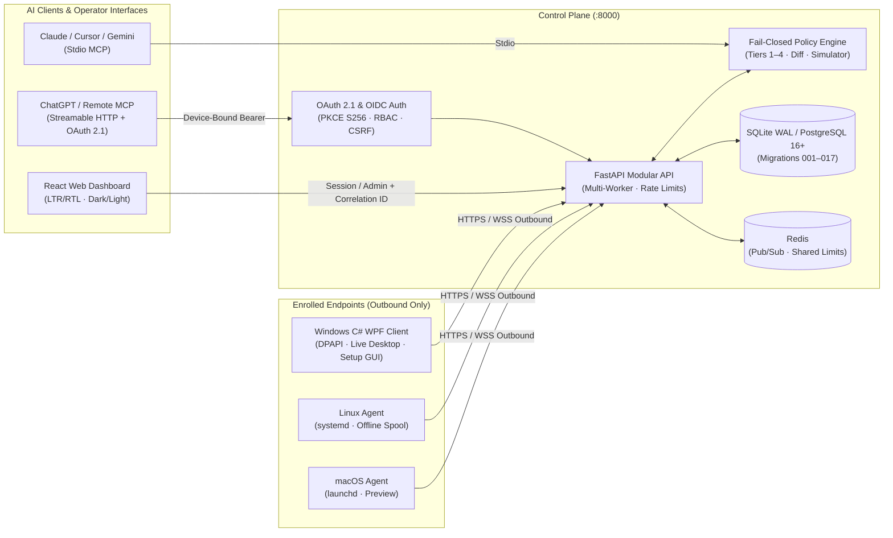

# AI Bridge — Universal AI-to-Computer Control Platform (v0.3.0)

[](https://github.com/jacxishipping/ai-bridge/actions/workflows/ci.yml)
[](https://www.python.org/)
[](apps/windows-client/)
[](LICENSE)

**AI Bridge** connects authorized AI assistants and coding agents (Claude, Codex, Gemini CLI, other Model Context Protocol clients, and ChatGPT via OAuth 2.1 Streamable HTTP) to Linux, Windows, and macOS computers their owners authorize them to control — through a single, policy-enforced, end-to-end audited control plane.

> [!IMPORTANT]
> **This is not a remote root shell.** There is no unrestricted shell endpoint, no arbitrary PowerShell executor, and no tool that can escalate its own permissions. All actions pass through server-side policy enforcement, 4-tier risk gating, path confinement, secret redaction, and hash-chained audit logging (see [docs/security.md](docs/security.md)).

---

## Architecture



---

## Key Capabilities

### Security & Governance
- **Host Tool Protection by Default (`AI_BRIDGE_DISABLE_HOST_TOOLS=1`)**: Host filesystem and shell tools on the MCP server are disabled by default; operations route explicitly to enrolled devices.
- **Four-Tier Fail-Closed Policy Engine**:
  - **Tier 1 (Read-only)**: System telemetry, process/network diagnostics, workspace search.
  - **Tier 2 (Low-risk write)**: Confined workspace file authoring and allowlisted tests.
  - **Tier 3 (Sensitive)**: Service control, package installation, shell execution, interactive desktop actions (requires explicit policy opt-in or human approval).
  - **Tier 4 (High-risk)**: Destructive deletion and administrative actions (requires authorized human approval).
- **Policy-as-Code & Pre-Publish Safety**: Signed policy bundle import/export (`HMAC-SHA256`, `ai-bridge-policy-bundle/v1`), CI simulation fixtures ([scripts/verify_policy_fixtures.py](scripts/verify_policy_fixtures.py)), pre-publish diff, inheriting-device blast radius, and dry-run simulation.
- **Identity, Auth & Isolation**: RBAC (`viewer`, `operator`, `admin`), server-derived tenant isolation, double-submit CSRF on session mutations, device mTLS fingerprint pinning, Win32 DPAPI token sealing (`aib-dpapi-v1:`), and opt-in OIDC group-to-role mapping with deny-by-default and audit logging.
- **Recursive Secret Redaction & Audit Chain**: Credentials, API keys, SSH keys, and bearer tokens are scrubbed before persistence; audit entries are hash-chained and verifiable via `GET /api/audit/verify`.

### Fleet Reliability, Scale & Observability
- **Multi-Worker & PostgreSQL Ready**: Fail-fast Redis enforcement for multi-host or production multi-worker deployments, auto-reconnecting Redis pub/sub for agent/WebRTC fan-out, `psycopg_pool` connection pooling, slow-query logging, and automated schema parity across SQLite and PostgreSQL (`001`–`017`).
- **Task Lifecycle & Dead-Letter Queue (DLQ)**: Per-tool idempotency classification, exponential-backoff retries, progress heartbeats, explicit execution leases, DLQ inspection/replay/purge, and configurable data retention sweeps.
- **End-to-End Traceability**: `X-Correlation-ID` propagation across dashboard, MCP, control plane, offline agent spool, task events, approvals, and audit records (`GET /api/traces/{trace_id}`), plus secured `/metrics` (`AI_BRIDGE_METRICS_TOKEN`).
- **Staged Agent Rollouts**: Progressive update rings (`canary` → `early` → `general`) with verify-only canary mode, approval gates, health-gate auto-pause, pause/resume, and fleet rollback (`rollback_fleet_agent`).
- **Supply-Chain & Release Engineering**: CycloneDX 1.5 SBOM generation ([scripts/generate_sbom.py](scripts/generate_sbom.py)), release evidence bundling ([scripts/assemble_release_evidence.py](scripts/assemble_release_evidence.py)), signed release manifests, and automated vulnerability scanning.

### Web Dashboard & Native Windows Client
- **React/Vite Management Dashboard** ([apps/dashboard/](apps/dashboard/)):
  - Truthful live telemetry (no fabricated placeholder metrics) with explicit `empty`, `offline`, `denied`, and `degraded` banners.
  - Server-side paginated fleet & task tables (`X-Total-Count`), saved filters, device groups, bulk-action blast-radius confirmations, and Global vs. Override vs. Effective policy inheritance tables.
  - Incident Inbox (failed tasks, offline nodes, expired approvals with ack/assign/resolve history) and 14-day fleet trend analytics with formula-safe CSV export.
  - Policy-gated Live Desktop Studio with view-only safety (control UI strictly removed in view-only mode), display resolution clarity, consent banner, Escape-key disarm, and cross-platform capability negotiation.
  - Full LTR (`en`) and RTL (`ar`) localisation, ARIA dialog semantics, keyboard `:focus-visible` outlines, and Dark/Light themes.
- **Native C# WPF Windows Client & GUI Installer** ([apps/windows-client/](apps/windows-client/), [apps/windows-installer/](apps/windows-installer/)):
  - Self-contained `.NET 9` WPF agent with tray controls, Win32 DPAPI credential vault, live desktop streaming, and local fail-closed guardrails.
  - Standalone **WPF GUI Setup & Uninstaller (`AIBridgeSetup.exe`)** featuring a 5-step visual wizard, live Control Plane `/health` test, DPAPI token sealing during setup, Start Menu/Desktop shortcuts, Windows Installed Apps registration (no UAC needed), and silent CLI mode (`/S` / `--silent`, `--uninstall`) for MDM/Intune deployment.

### Release 4 Governed Capabilities (Feature-Flagged)
All Release 4 capabilities are gated via `AI_BRIDGE_FEATURE_<NAME>=1|0` and tracked in `GET /api/features`:
- **Fleet Analytics & Capacity Planning**: Daily health/task-success trends + CSV export (`GET /api/fleet/analytics/trends`).
- **Incident Inbox**: Deduplicated actionable inbox for failed tasks, offline devices, and expired approvals (`GET /api/incidents`, `POST /api/incidents/{id}/ack`).
- **Policy-as-Code**: Signed policy bundle export/import with dry-run diff & simulations (`GET /api/policies/export`, `POST /api/policies/import`).
- **OIDC Group-to-Role Mapping** *(explicit opt-in: `AI_BRIDGE_FEATURE_OIDC_GROUP_MAPPING=1`)*: Deny-by-default group enforcement with audit trail and role sync on login.
- **Managed Update Channels**: Verify-only canary ring with explicit promotion approval gate, pause, and rollback.
- **Curated Workflow Builder**: Strictly Tier-1 read-only diagnostic templates (`GET /api/workflows/curated`) with per-step approval-to-audit timeline (`GET /api/workflows/{id}/timeline`).
- **Governed Agent Memory**: Tenant- & workspace-scoped read-only snippets with provenance, prompt-injection filtering, and opt-in prompt inclusion (`GET/POST/DELETE /api/memory/snippets`).
- **Cross-Platform Desktop Capability Contract**: Honest per-device capability negotiation (`GET /api/devices/{id}/desktop/capabilities`) advertising interactive input only on policy-enabled Windows hosts.

---

## Quick Start

### 1. Local Control Plane & Web Dashboard

Requires **Python 3.11+** and **Node.js 20+**.

```bash
git clone https://github.com/jacxishipping/ai-bridge.git
cd ai-bridge
python -m venv .venv

# Linux / macOS:
source .venv/bin/activate
# Windows PowerShell:
# .\.venv\Scripts\Activate.ps1

pip install -e ".[dev]"

# Generate an admin token and start the control plane (:8000)
export AI_BRIDGE_ADMIN_TOKEN="$(python -c "import secrets; print(secrets.token_urlsafe(32))")"
python -m ai_bridge.control
```

In a second terminal, start the React dashboard (`:5173`):

```bash
npm --prefix apps/dashboard ci
npm --prefix apps/dashboard run dev
```

Open `http://localhost:5173` and sign in with your `AI_BRIDGE_ADMIN_TOKEN` (or local user credentials).

### 2. Local MCP Server (Stdio)

```bash
mkdir -p "$HOME/ai-bridge-workspace"
export AI_BRIDGE_WORKSPACE="$HOME/ai-bridge-workspace"
python -m ai_bridge.server
```

Client setup templates for Claude Desktop, Cursor, Codex, Gemini CLI, and ChatGPT are in [integrations/](integrations/).

### 3. Native Windows C# Client & GUI Installer

Requires **.NET 9 SDK** on Windows:

```powershell
# Build the C# WPF Windows Client
dotnet build apps/windows-client/AIBridgeClient.csproj -c Release

# Build the standalone single-file GUI Installer (dist\windows\AIBridgeSetup.exe + .sha256)
pwsh scripts/build_windows_installer.ps1
```

Unattended / MDM deployment with `AIBridgeSetup.exe`:

```powershell
.\dist\windows\AIBridgeSetup.exe --silent --control-url "https://control.example.com" --token "<DEVICE_TOKEN>"
# Uninstall silently:
.\dist\windows\AIBridgeSetup.exe --uninstall --silent
```

### 4. Platform Polling Agents (Linux, Windows, macOS)

Enroll a node from **Fleet & Device 360** (or `POST /api/devices/enroll`) to mint a one-time device token:

```bash
# Linux (systemd unit in deployment/systemd/ai-bridge-agent.service)
python agents/linux/agent_main.py --control-url http://127.0.0.1:8000 --device-token <TOKEN>

# Windows (Python agent; PowerShell installer in deployment/windows/install-agent.ps1)
python agents\windows\agent_main.py --control-url http://127.0.0.1:8000 --device-token <TOKEN>

# macOS (Preview — launchd E2E verified in CI; see docs/support-matrix.md)
python agents/macos/agent_main.py --control-url http://127.0.0.1:8000 --device-token <TOKEN>
```

**1-Command Bare-Server Linux Install:**

```bash
curl -sSL https://raw.githubusercontent.com/jacxishipping/ai-bridge/main/magic-install.sh | sudo bash
```

**AWS Production Stack (EC2 + RDS + Redis + ALB):** See [deployment/aws/README.md](deployment/aws/README.md).

---

## Documentation

| Document | Purpose |
|---|---|
| [docs/support-matrix.md](docs/support-matrix.md) | Canonical platform, database, agent, and CI support matrix |
| [docs/api-reference.md](docs/api-reference.md) | Auto-generated HTTP/WebSocket API reference (`scripts/generate_api_reference.py`) |
| [docs/environment-reference.md](docs/environment-reference.md) | Auto-generated environment variable reference (`scripts/generate_env_reference.py`) |
| [docs/runbooks.md](docs/runbooks.md) | Operator runbooks for alerts, DLQ replay, rollbacks, and incident recovery |
| [docs/fleet-limits.md](docs/fleet-limits.md) | Multi-worker scaling envelopes, Redis/PostgreSQL requirements, and quotas |
| [docs/production-readiness.md](docs/production-readiness.md) | Production hardening checklist, TLS/mTLS, OIDC, and backup/PITR requirements |
| [analysis/PRODUCTION_READINESS.md](analysis/PRODUCTION_READINESS.md) | Current go / conditional-go / no-go production assessment (supersedes removed FINAL snapshot) |
| [docs/security.md](docs/security.md) | Threat model, 4-tier guardrails, secret redaction, and audit integrity |
| [docs/ROADMAP.md](docs/ROADMAP.md) | Release 1–4 delivery record and governance policy |

---

## Verification & Testing

```bash
# Lint (ruff, 200-char line limit)
ruff check .

# Full Python unit, integration, security & E2E suite (980+ tests)
pytest -q

# Schema parity (SQLite SCHEMA vs migrations 001–017)
python scripts/check_schema_parity.py

# Verify generated API & environment docs and CI policy simulation fixtures
python scripts/generate_api_reference.py --check
python scripts/generate_env_reference.py --check
python scripts/verify_policy_fixtures.py

# Dashboard typecheck and production build
npm --prefix apps/dashboard run typecheck
npm --prefix apps/dashboard run build

# Native C# Windows client, installer & C# unit tests (Windows + .NET 9 SDK)
dotnet build apps/windows-client/AIBridgeClient.csproj -c Release
dotnet build apps/windows-installer/AIBridgeInstaller.csproj -c Release
dotnet run --project apps/windows-client.Tests/AIBridgeClient.Tests.csproj -c Release
```

---

## Repository Layout

```text
ai-bridge/
├── src/ai_bridge/            # Core Python package
│   ├── control/              # FastAPI control plane, routers/, DB, OIDC, rollouts, analytics, incidents, policy bundles
│   ├── tools/                # Policy-gated tool implementations (workspace, diagnostics, desktop, fleet)
│   ├── policy.py             # 4-tier risk policy engine & simulator
│   ├── security.py           # Path confinement, recursive redaction, SSRF & secret guards
│   └── server.py             # MCP stdio & Streamable HTTP server
├── agents/                   # Outbound polling agents (common/, linux/, windows/, macos/)
├── apps/
│   ├── dashboard/            # React 18 + TypeScript + Vite management UI (LTR/RTL)
│   ├── windows-client/       # Native C# .NET 9 WPF Windows Client
│   ├── windows-client.Tests/ # C# unit tests for Windows Client
│   └── windows-installer/    # Native C# .NET 9 WPF GUI Setup & Uninstaller (AIBridgeSetup.exe)
├── windows-agent/            # Native C++ Windows WebRTC dataplane (Preview)
├── migrations/               # Numbered SQLite/PostgreSQL up & down migrations (001–017)
├── deployment/               # AWS CloudFormation, systemd, Docker/nginx, OAuth gateway, monitoring alerts
├── scripts/                  # Doc generators, schema parity, SBOM, release evidence, Windows setup builder
├── integrations/             # MCP client configs (Claude, ChatGPT, Codex, Gemini)
├── docs/                     # Canonical support matrix, API/env references, runbooks, roadmap
└── tests/                    # Unit, integration, security, E2E suites & policy simulation fixtures
```

---

## License

This project is licensed under the MIT License. See [LICENSE](LICENSE) for details.
