# 01 — Master Project Overview (AI Bridge v0.3.0)

> **HISTORICAL.** Current status: [PRODUCTION_READINESS.md](./PRODUCTION_READINESS.md) · [docs/implementation-status.md](../docs/implementation-status.md)

**Scope:** What AI Bridge actually is today, verified against the repository at
`/home/hatch/workspace/ai-bridge-main`. Every capability claim below is labelled
VERIFIED (observed in code/config), INFERRED (reasonable reading, needs deeper verification),
or NOT FOUND.
**Companion reports:** `03_SOURCE_CODE_INVENTORY.md` (file/LOC census),
`15_TESTING_AND_RELIABILITY_REPORT.md` (test evidence),
`16_DOCUMENTATION_CONSISTENCY_REPORT.md` (doc-vs-code discrepancies).
Other tracks (architecture, MCP, security, agents, Windows native, dashboard, DB, WebRTC,
performance, debt, roadmap) are covered by sibling reports in `analysis/` and are only
summarised here.

---

## 1. One-paragraph answer

AI Bridge v0.3.0 is a **policy-enforced remote-computer-control platform**: AI assistants
(Claude, Codex, Gemini, ChatGPT, custom agents) talk MCP to a Python server and/or a FastAPI
control plane; the control plane queues tasks for outbound-polling agents on Linux, Windows,
and macOS endpoints; a React/TypeScript dashboard provides live operations plus a seeded demo;
and a native C++20 Windows agent provides DXGI capture, Media Foundation H.264 encoding, and
WebRTC desktop streaming. The Python core is substantial and real — **109 MCP tools**
(`src/ai_bridge/server.py`), a **5,147-line FastAPI app** (`src/ai_bridge/control/app.py`,
143 routes), 12 SQL migrations, and a 4-tier policy engine. The honest limits, stated in the
repo's own docs, are: macOS agent never run on macOS; Windows full installer/service E2E never
verified on a dedicated host; OIDC, plane-side mTLS, and netns egress are in-tree but env-gated
and not verified end-to-end; emergency-stop and OIDC pending state live in process memory
(single-worker only); and the dashboard's 14 advanced screens are seeded browser-local demo
data, with a separate smaller live workspace for real operations.

---

## 2. Overall architecture (VERIFIED structure)

```mermaid
flowchart LR
    subgraph Clients["AI clients & operators"]
        Claude["Claude / Codex / Gemini CLI\n(stdio MCP)"]
        ChatGPT["ChatGPT / Copilot 365\n(Streamable HTTP + OAuth 2.1)"]
        Custom["Custom agents\n(OpenAI / Anthropic /\nLangChain / Ollama)"]
        Dash["Dashboard (React 18 + TS + Vite)\nLive workspace + seeded demo"]
    end

    subgraph MCP["MCP server — src/ai_bridge/server.py (:8001 HTTP)"]
        Tools["109 @mcp.tool() functions\ntools.py (2,990 lines)"]
        Policy["Policy engine (Tiers 1-4)\npolicy.py — frozen Policy"]
        Routing["Device routing\ndevice_routing.py"]
    end

    subgraph Plane["Control plane — src/ai_bridge/control/app.py (:8000)"]
        API["FastAPI — 143 routes in app.py\n+ 29 in v1_routes.py, 10 in mcp_routes.py"]
        Auth["Auth: admin token, PBKDF2 users,\n8h sessions, roles, OIDC (env-gated)"]
        DB[("SQLite (dev) / PostgreSQL (prod)\n12 migrations, schema_migrations")]
        RL["Rate limit: durable_ratelimit\n(Redis → settings → memory)"]
        Audit["Append-only audit\n(prev_hash / entry_hash chain)"]
    end

    subgraph Fleet["Enrolled endpoints — outbound polling only"]
        Linux["Linux agent\nagent_main.py (1,055 lines)"]
        Win["Windows agent\nPython GUI + native C++20\nservice + desktop agent"]
        Mac["macOS agent\nagent_main.py (94 lines)\nNOT run on macOS"]
    end

    subgraph Native["Native Windows engine — windows-agent/"]
        DXGI["DXGI capture"]
        MF["Media Foundation H.264"]
        RTC["WebRTC (libdatachannel, opt-in)\n+ Python aiortc path"]
        Pipe["Named pipe IPC + DPAPI\n+ HMAC auth"]
    end

    Claude -->|stdio| MCP
    ChatGPT -->|HTTP + bearer| MCP
    Custom -->|MCP / HTTP| MCP
    Dash -->|fetch + SSE + WS| Plane
    MCP -->|device_aware dispatch| Plane
    Plane -->|task queue / long-poll| Fleet
    Fleet -->|heartbeat + results| Plane
    Win --- Native
    Plane -->|sessions / signalling| Native
```



### 2.1 Request lifecycle (as documented and structured in code)

```mermaid
sequenceDiagram
    participant AI as AI client
    participant MCP as MCP server (server.py)
    participant POL as Policy (policy.py)
    participant PL as Control plane (app.py)
    participant AG as Agent (poller.py)
    participant AUD as Audit

    AI->>MCP: tools/call + args
    MCP->>POL: decide(Policy, tool, approval, admin, revoked)
    POL-->>MCP: allowed / needs_approval / denied
    MCP->>PL: run_device_tool → POST /api/tasks (device-bound)
    PL->>AG: task queued; agent long-polls /api/agent/tasks/next
    AG->>AG: allowlisted execution (sandboxed env, rlimits)
    AG->>PL: POST /api/agent/tasks/{id}/result
    PL->>AUD: append-only audit row (hash-chained)
    PL-->>MCP: result (+ queue_ms / exec_ms)
    MCP-->>AI: structured result
```

This flow is VERIFIED as the *designed* flow (route names, function names, and dispatch code
exist: `control/dispatch.py`, `control/app.py`, `agents/common/poller.py`,
`tests/e2e/test_enrollment_flow.py` encodes exactly this sequence). Whether it works end-to-end
in this environment was NOT verified by a live run — pytest is unavailable here (see report 15).

### 2.2 Ports and entry points (VERIFIED)

| Service | Default | Entry point |
|---|---|---|
| Control plane API | `:8000` | `python -m ai_bridge.control` (`control/__main__.py`) / `apps/control-api/main.py` (uvicorn) |
| MCP Streamable HTTP | `:8001` | `python -m ai_bridge.server --http --port 8001` |
| Dashboard dev | `:5173` | `npm run dev` in `apps/dashboard` (Vite); API base `http://127.0.0.1:8000` or `VITE_API_URL` |
| Agents | outbound only | `agents/{linux,windows,macos}/agent_main.py --control-url … --device-token …` |

---

## 3. Verified capabilities vs claimed capabilities

### 3.1 VERIFIED present (code exists and is non-trivial)

| Capability | Evidence |
|---|---|
| MCP stdio + Streamable HTTP server, 109 tools | `src/ai_bridge/server.py` (1,701 lines, 109 `@mcp.tool()`), `tools.py` (92 defs) |
| 4-tier policy engine, frozen `Policy`, deny-by-default unknown tools | `src/ai_bridge/policy.py` (266 lines); 13/13 manual checks passed — see report 15 |
| Workspace confinement (traversal, absolute, symlink, secret-name blocking, backups) | `src/ai_bridge/security.py`, `workspace.py`; manual checks passed (report 15) |
| Control plane: enrollment (hashed token, shown once), revocation, task queue, approvals, audit, emergency stop, tenant filtering | `control/app.py` (143 routes), `control/db.py`, `migrations/001–012` |
| Short-lived device tokens (7-day default) + rotation invalidating old token | `docs/implementation-status.md`, CHANGELOG 0.3.0; code in `control/` (INFERRED location — sibling security track to confirm) |
| Local users (PBKDF2), 8h sessions, viewer/operator/admin roles | CHANGELOG 0.3.0; `control/auth.py`, `role_catalog.py` |
| Versioned policies via `/api/policies`, policy simulation | `docs/implementation-status.md`; `control/app.py` |
| Ed25519 signed-release verification, agent `--check-update`, no silent auto-install by default | `src/ai_bridge/updates.py`; `agents/*/agent_main.py --check-update` |
| Sandboxed task execution (minimal env, workspace cwd, CPU/mem/file-size rlimits) | CHANGELOG 0.3.0; `src/ai_bridge/execution.py` |
| Linux agent (systemd unit, unprivileged) + offline spool + bounded backoff | `agents/linux/agent_main.py`, `agents/common/poller.py` (534 lines), `spool.py` |
| Windows Python agent + GUI + desktop helper + installer scripts | `agents/windows/` (4,731 lines), `deployment/windows/` |
| Native C++20 Windows agent: DXGI capture, MF H.264, SendInput, DPAPI, named-pipe HMAC IPC, system monitor, MCP executor | `windows-agent/src/` (3,433 lines), `CMakeLists.txt` (CTest target `ai_bridge_tests`) |
| Python WebRTC streaming (aiortc), sessions API `POST /api/v1/sessions`, ICE/TURN config, input DataChannel, key-release safety | `src/ai_bridge/webrtc_stream.py` (1,348 lines), `control/v1_routes.py`, `docs/streaming.md` |
| Dashboard live workspace: real auth, health, inventory, tasks, approvals, emergency stop, SSE live activity, WS desktop signalling | `apps/dashboard/src/api.ts`, `src/views/LiveControlView.tsx`, `src/views/live/*`, `apps/dashboard/README.md` |
| Dashboard i18n: 20-locale preview catalogs | `src/i18n/catalogs.ts` (277 lines); 3 `node:test` tests (report 15) |
| OAuth 2.1 gateway (PKCE S256, device binding) + OIDC login (env-gated) | `control/mcp_oauth.py` (370 lines), `control/oidc.py` (155 lines), `deployment/oauth/gateway.py` |
| Rate limiting (durable: Redis → settings → memory) + production readiness fail-closed checks | `control/durable_ratelimit.py`, `control/production_readiness.py`, `GET /health/ready` |
| Migrations 001–012 with `schema_migrations` tracking | `migrations/`, `control/migrations.py` |
| Browser automation (Playwright tools, Browserbase CDP, Firecrawl/You connectors) | `src/ai_bridge/browser_tools.py` (1,075 lines), `connectors/` |
| Custom-AI agents (OpenAI/Anthropic/LangChain/Ollama) | `integrations/custom-ai/*.py` (480 lines) |
| CI: Python tests + ruff, macOS-agent import job, Windows native WebRTC job, dashboard build+test+Playwright | `.github/workflows/ci.yml` (4 jobs) |
| Deployment: Docker/Compose (dev/prod), AWS CloudFormation, Render blueprint, systemd, launchd plist, Windows installer | `deployment/`, `docker-compose*.yml`, `render.yaml` |

### 3.2 Claimed but PARTIAL / NOT VERIFIED end-to-end (repo's own docs say so)

| Claim | Verified status |
|---|---|
| macOS agent works | **NOT verified** — `agents/macos/agent_main.py` docstring: "NOT yet run on macOS"; CHANGELOG 0.3.0 lists macOS agent under "Still not implemented", then `docs/implementation-status.md` says "macOS agent code + launchd unit (import + honesty exercised on `macos-agent` CI)" — i.e. import-tested only |
| Windows full installer / service E2E | **NOT verified** — `docs/implementation-status.md`: "Still NOT verified end-to-end: Windows full installer/service E2E on a dedicated fleet image"; `docs/ROADMAP.md` marks Milestone 4 `[~]` "code written, NOT executed on Windows here" |
| OIDC login | **In-tree, env-gated, not verified end-to-end** — needs a registered provider app (`docs/implementation-status.md`); local password accounts are the default |
| Plane-side device mTLS | **In-tree, env-gated** (`control/device_mtls.py`, `AI_BRIDGE_DEVICE_MTLS`); `docs/remote-access.md` says "The plane itself does not yet verify client certificates" (v0.2-era text, contradicts the v0.3 claim — see report 16) |
| Network-namespace egress control | **Env-gated** (`AI_BRIDGE_TASK_NETNS=1`, fail-closed); not verified here |
| Windows-on-Windows execution (Python agent executing tasks on Windows) | **Listed as not implemented** in CHANGELOG 0.3.0 |
| C++ PeerConnection as the shipping desktop path | **Not the default** — "Fleet Live Desktop still defaults to Python aiortc until devices run `ai_bridge_desktop`" (`docs/implementation-status.md`); libdatachannel path is CI-verified only |
| Desktop audio | **Off by default**; WASAPI loopback "production-ready" status pending; silent PCM fallback (`docs/implementation-status.md`, `docs/streaming.md` §2b) |
| "Fluent 2 Dashboard" (README) | **Stale** — PROJECT.md/TEST_INFRA say Fluent 2 CSS was purged in favour of `@jacxishippingorg/jx-ui-react`; README still advertises "Fluent 2 Web Dashboard" (see report 16) |
| "75 tests" (README Verification section) | **Wrong** — 403 Python `def test_` functions counted; CHANGELOG cites 29 (v0.2) and 33 (v0.3) passed at release time (see reports 15/16) |
| "356 dashboard tests, 100% pass" (TEST_READY.md) | **Count arithmetically correct, evidentiary value weak** — Tier 1/2 (310 of 356) assert on inline literals, not app code; not executed in this environment (no `node_modules`/tsx); see report 15 |
| `apps/dashboard/dist/` in the release ZIP | **NOT FOUND** in this tree (see report 16) |

### 3.3 NOT FOUND / explicitly out of scope

- No generic shell tool (`run_any_command` is denied by policy; `run_shell` is allowlisted argv-only) — VERIFIED by design (`policy.py`, `tasks.py`, manual check: `run_diagnostic("rm -rf /")` raises `ValueError`).
- No down/rollback migrations; no `tests/conftest.py`; no `ORIGINAL_REQUEST.md` (cited as a baseline by TEST_INFRA/TEST_READY).
- No evidence in this tree of a live production deployment (Render/AWS configs exist, but no running service was contacted — out of scope for this read-only investigation).

---

## 4. Component-by-component summary (one line each; detail in sibling reports)

| Component | Size | State |
|---|---|---|
| MCP server (`server.py` + `tools.py`) | 4,691 lines | Real, large; 109 tools; needs per-tool audit (MCP track) |
| Control plane (`control/`) | ~15,000 lines | Real; `app.py` 5,147 lines is the architectural hotspot |
| Linux agent | 1,055 + 665 common | Real; the most complete agent |
| Windows Python agent | 4,731 lines | Real; GUI-heavy; execution on Windows unverified |
| macOS agent | 94 lines | Thin wrapper; unverified on macOS |
| Native Windows C++ agent | 3,433 lines | Real code; Windows-only tests; libdatachannel opt-in |
| Dashboard (live) | `api.ts` + `views/live/*` + `LiveControlView` | Real API-backed operations |
| Dashboard (demo) | `dashboardStore.ts` + 15 views | Seeded local data (40 fake nodes); explicitly a preview |
| WebRTC/desktop | `webrtc_stream.py` 1,348 lines + native | Dual implementations (Python aiortc default; C++ opt-in) |
| Database | 12 migrations, SQLite/Postgres | Real; dual-engine; readiness gates require Postgres + Redis in production |
| Integrations | 773 lines | Thin; vendor configs are README/JSON only except `custom-ai/` |
| Deployment | 5,810 lines | Broad (Docker/AWS/Render/systemd/launchd/Windows); Windows E2E unverified |

---

## 5. Security posture in brief (detail: security track)

VERIFIED design invariants in code/docs: no unrestricted shell; frozen server-side policy;
device tokens SHA-256-hashed at rest, shown once, revocable, checked on every agent call;
Tier-4 requires human approval + admin; screen-view never grants command execution;
human takeover revokes AI input; secrets redacted from logs/audit; append-only hash-chained
audit; DPAPI + HMAC named-pipe IPC on Windows; Ed25519 signed updates. Known residuals
(stated in `docs/threat-model.md` / `docs/production-readiness.md`): plane-side mTLS residual,
redaction is pattern-based, emergency-stop/OIDC state is in-process memory (single worker),
rate limiter is per-process unless Redis is configured, backups are local-only. The security
track must verify these invariants in code rather than taking the docs at their word.

## 6. Production readiness in brief (detail: production-readiness track)

`docs/production-readiness.md` is unusually honest: single-worker requirement (in-memory
emergency stop + OIDC pending state), "not a security certification", "do not claim
million-device scalability", live logs are host service logs (not remote-agent collection),
"connection status is a local TCP check, not proof of a working external gateway", Tier-4/
tenant-isolation/horizontal deployment "need a dedicated security review". Production gates
(`AI_BRIDGE_PROFILE=production` + `/health/ready`) require Postgres, TURN/ICE, admin token,
non-anon MCP, HTTPS public URL, and safe browser sandbox. Render free-tier config
(`render.yaml`) and Docker Compose prod exist.

## 7. Findings

| # | Finding | Evidence |
|---|---|---|
| OV-01 | The product is real and substantial, not a mock: 109 MCP tools, 143 control-plane routes, 12 migrations, 3 agents, native C++ engine | `server.py`, `control/app.py`, `migrations/`, `agents/`, `windows-agent/` |
| OV-02 | Single biggest architectural risk is concentration: `control/app.py` (5,147 lines) + in-process state (emergency stop, OIDC pending) forces single-worker operation | `control/app.py`, `docs/production-readiness.md` ("use one worker") |
| OV-03 | Two desktop-streaming stacks coexist (Python aiortc default + C++ libdatachannel opt-in) with an explicit "not yet default" note | `docs/implementation-status.md` |
| OV-04 | Two dashboards coexist (live workspace vs seeded demo); the demo is the larger, more visible surface | `apps/dashboard/README.md`, `dashboardStore.ts` |
| OV-05 | macOS and Windows execution paths are the least verified; the repo says so itself | CHANGELOG 0.3.0, `docs/implementation-status.md`, `docs/ROADMAP.md` |
| OV-06 | OIDC / mTLS / netns are env-gated code, not verified end-to-end features | `docs/implementation-status.md` |
| OV-07 | Hard-coded production host `jxiptvplayer.app` in install scripts and compose defaults is a supply-chain/ops smell | `README.md`, `magic-install.sh`, `docker-compose.prod.yml:62` |
| OV-08 | Test evidence in this environment is thin (pytest absent, dashboard deps absent) — release-time claims (29/33 passed, 356/356) cannot be re-verified here | Report 15 |
| OV-09 | Documentation is unusually honest in `docs/implementation-status.md` and `docs/production-readiness.md`, but README/TEST_READY overstate (75 tests, Fluent 2, 100% pass) | Report 16 |
| OV-10 | No git history in the delivered tree limits provenance verification (no tags/commits to match CHANGELOG claims against) | Report 03, INV-01 |
