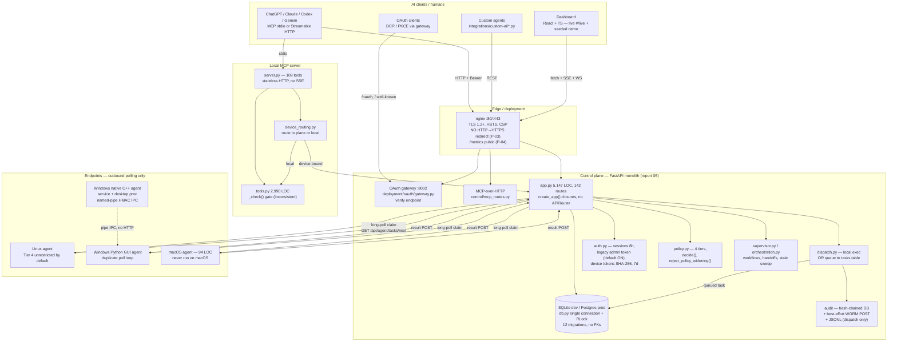

# 02 — Complete Architecture Map

> **Status:** Synthesis report. Built only from the 18 existing audit reports in `analysis/` (01, 03–16, DEPLOYMENT_AUDIT, DISTRIBUTED_RELIABILITY_AUDIT) plus spot-checks by this synthesis against the source tree on 2026-11-17. Every claim cites a real file path or an existing report section. **VERIFIED** = observed in code / counted by grep in a source report or by this synthesis. **INFERRED** = a report's own inference, labelled as such. No measurements were fabricated; no server, agent, or binary was run for this synthesis.
>
> **Reconciliation note (read first).** The tracks disagree on several counts. Figures marked **VERIFIED by this synthesis** were re-checked with `grep`/`wc` on 2026-11-17 and supersede the conflicting track figures:
> - Dashboard tests: **375 `it(` calls on disk** in `apps/dashboard/src/tests/*.test.ts`; **364 in the scope `run-all-tests.ts` imports** (8+8+7+6+155+157+12+11); `npm test` therefore totals **364 + 3 i18n = 367** on current disk. Report 09 (364/375) matches this grep; report 15's "356" breakdown (tier2 155, tier3 10, tier4 10) does **not** match current disk counts (tier2 is 157, tier3 12, tier4 11) and is treated as stale. TEST_READY.md's "356/356 passed, 0.10 s" is stale under either count. The substantive finding is unchanged: 310 of the in-scope tests are self-referential (report 15, TST-04).
> - Python tests: **403 `def test_` in 58 files — VERIFIED**. README's "75 tests" is wrong; CHANGELOG 29 (v0.2.0) / 33 (v0.3.0) are historical subsets with no run logs (reports 15/16, TST-07/08, DOC-01–03).
> - Control-plane routes: **`src/ai_bridge/control/app.py` has 142 `@app.<verb>` decorators — VERIFIED by this synthesis** (report 03 says 143, report 05 says 144 decorators / 146 incl. middleware — off-by-one/definition drift, not material). **212 `@app.` route decorators across all of `control/`** (report 05 §0: app.py + v1_routes 29 + ai_api 12 + custom_agents 10 + mcp_routes 10 + workspace 5 + others) is the control-plane total. Report 12's "~120 routes" for app.py is wrong and is discarded. Report 06's "212 routes" is the control-plane total, not app.py alone.
> - MCP tools: **109 `@mcp.tool()` in `src/ai_bridge/server.py` — consistent across reports 01/03/04/06**. `TOOL_TIERS` = 144 entries (58 READ_ONLY / 9 LOW_RISK / 74 SENSITIVE / 3 HIGH_RISK); 40 tiered names have no MCP tool, 5 MCP tools are untiered (reports 04/06, F-06-04).
> - `control/app.py` is 5,147 lines; `tools.py` 2,990 lines; control plane total 16,666 lines (report 05, VERIFIED by `wc -l`); report 01's "~15,000" is a rounded underestimate and is superseded.

## 1. What AI Bridge is (VERIFIED)

> **HISTORICAL architecture snapshot.** Current production assessment: [PRODUCTION_READINESS.md](./PRODUCTION_READINESS.md).

AI Bridge is a real, substantial codebase — not a mock — that lets MCP-compatible AI clients and a React dashboard submit operations to a control plane, which queues them for outbound-polling agents on Linux/Windows/macOS endpoints, or executes them locally on the control-plane host. At the time of this report it was **not** yet a signed production RC; see the current assessment for lab GO / controlled-fleet CONDITIONAL GO / SaaS NO-GO.

Inventory (report 03, VERIFIED): `src/ai_bridge/` 75 files / ~29,112 lines incl. egg-info; core 11,452 lines + connectors 994; `control/` 38 files / 16,666 lines; `agents/` ~6,546 lines; `windows-agent/` ~3,671 lines C++20 (+147 test lines); dashboard 29,723 TS/TSX lines in 74 files; `integrations/custom-ai/` 480 lines Python — the only integration with code (ChatGPT/Claude/Codex/Gemini are README + JSON config only, INV-07).

## 2. Subsystems

| # | Subsystem | Implementation | Size / entry point | State |
|---|---|---|---|---|
| 1 | MCP server (local) | `src/ai_bridge/server.py`, `tools.py`, `policy.py`, `security.py`, `device_routing.py` | 109 tools; FastMCP `stateless_http=True, json_response=True`; stdio default, Streamable HTTP `:8001` | VERIFIED, works; unaudited, unevenly gated (report 06) |
| 2 | Control plane | `src/ai_bridge/control/` — `app.py` (5,147 LOC, 142 routes), `ai_api.py` (2,284), `custom_agents.py` (1,655), `v1_routes.py` (1,113), `dispatch.py`, `mcp_routes.py`, `supervisor.py`, `orchestration.py`, `db.py`, `oidc.py`, `mcp_oauth.py`, `device_mtls.py`, `plane_state.py`, `combined.py`, `__main__.py` | FastAPI; SQLite dev / Postgres prod; Gunicorn 4 workers in prod compose | VERIFIED; god-module, single-worker-unsafe in 6 places (report 05, DIST) |
| 3 | OAuth gateway | `deployment/oauth/gateway.py` (992 LOC) + `control/mcp_oauth.py` | OAuth 2.1 / PKCE S256 / DCR / refresh rotation; SQLite hash-only store | VERIFIED present; PKCE optional when no challenge, any `https` DCR redirect accepted (F-06-12) |
| 4 | Linux agent | `agents/linux/agent_main.py` (1,055) + `agents/common/poller.py` (534) + `spool.py` (131) | Outbound polling only; systemd unit | VERIFIED; ships unrestricted Tier 4 by default (F07-02, P0) |
| 5 | Windows agent (Python) | `agents/windows/gui_app.py` (2,214) + `gui_ui.py` (1,659) | GUI + duplicate poll loop | VERIFIED; GUI duplicates `Poller` (F07-03) |
| 6 | macOS agent | `agents/macos/agent_main.py` (94 LOC) | Thin wrapper over `common.poller` | VERIFIED; docstring "NOT yet run on macOS" (INV-08, F07-11) |
| 7 | Windows native agent (C++20) | `windows-agent/` — service + interactive desktop agent + DXGI/MF/WebRTC/input | Named-pipe HMAC IPC; DPAPI; libdatachannel opt-in (default OFF) | VERIFIED present; service is not a supervisor (F08-02); libwebrtc backend is a stub (F08-19) |
| 8 | Dashboard | `apps/dashboard/` — React 18 + TS + Vite; live workspace (`#/live`, `views/live/*`) vs seeded demo (`dashboardStore.ts`, 40 fake nodes, 14 screens) | `src/api.ts` (470 LOC, ~57 paths) | VERIFIED; demo is the default landing experience (D-01); live workspace is the best-engineered part (D-14) |
| 9 | WebRTC / desktop streaming | Python aiortc/PyAV `webrtc_stream.py` (1,348) + `screen_capture.py` + `desktop_audio.py`; C++ libdatachannel path opt-in | STUN `stun.l.google.com:19302`; TURN default `jxiptvplayer.app:3478` | VERIFIED; Python path ships, C++ path unwired (report 13) |
| 10 | Database | `control/db.py` + `migrations/001–012` (forward-only, no down migrations) | SQLite dev / Postgres 16 prod; Redis 7 rate-limit only | VERIFIED; no FKs/CHECKs anywhere (DB-02) |
| 11 | AI integrations | `integrations/custom-ai/*.py` (OpenAI, Anthropic, LangChain, Ollama + client); vendor dirs are docs/config | `src/ai_bridge/client.py` SDK | VERIFIED; Ollama single-turn, no approval handling (I-02, I-04) |
| 12 | Deployment | Docker/Compose (dev + prod, 8 services), Render blueprint, AWS CloudFormation, systemd, launchd, Windows installer (GUI wizard + PS1) | Prod compose: control-api (Gunicorn 4) + mcp-http + oauth-gateway + postgres + redis + coturn + nginx + certbot | VERIFIED as files; AWS template never evidenced as applied; Render is test-only (DEPLOYMENT_AUDIT) |

## 3. Overall architecture (Mermaid)



Source: report 01 §2, report 05 §1–§2, report 03 §3, DEPLOYMENT_AUDIT §2. The plane never opens an inbound shell to an agent — agents poll outbound (VERIFIED, report 05 §2.5–2.6, report 07 §2). Media (WebRTC) is peer-to-peer DTLS-SRTP; the plane never sees media, only signalling (report 13 §2).

## 4. Request lifecycle (VERIFIED)

AI CLIENT → AUTH → AUTHZ → POLICY → DISPATCH → ROUTING → AGENT → RESULT → AUDIT. The full trace, with the points where it breaks, is report 05 §2 and report 06 §2–§4:

1. **Connect.** Stdio: no auth at all (local-process trust; all anonymous callers share session key `"default"`, F-06-02). HTTP: `_BearerAuthMiddleware` — admin token (HMAC) or gateway-verified token via `VERIFY_URL` (default `http://127.0.0.1:8002/internal/verify`); bypassed entirely by `AI_BRIDGE_HTTP_ALLOW_ANON=1` (F-04-03 / F-06-01, P0).
2. **Authenticate (plane).** Opaque session tokens (`secrets.token_hex(32)`, 8 h, hash-only storage), legacy admin token (default ON, F-05-05), or device token (SHA-256, 7 d TTL, revoked check). No JWT/JOSE anywhere in `control/`; no cookies; no MFA (report 05 §2.2).
3. **Authorize.** RBAC viewer=1 < operator=2 < admin=3 (`require_role()`). Device tokens are checked per call against `device_row()` with `device_id == row["id"]` (report 12 §4.6 — holds for the task flow).
4. **Policy.** `Policy.decide()` — 4 tiers, deny-by-default for unknown tools. **But:** only 3 `_check(` / 2 `decide(` calls exist in `server.py` for 109 tools; ~40 wrappers have no direct policy call; Tier-1 wrappers bypass `denied/allowed_tools` (F-04-05 / F-06-05). Device-bound sessions skip local policy entirely — the control plane is authoritative for remote execution (report 04 §1.1). `Policy.unrestricted` bypasses all tier/write/approval checks; `max_tier_unattended >= 4` silently authorises Tier 4 without approval (F-04-08, P0).
5. **Dispatch — two paths.** (a) Local/sync: `dispatch.py:277` executes **on the control-plane host itself** for any `operator` when the target is local/host/droplet/no-target (F-05-01, P0). (b) Queued/remote: task row inserted, agent long-polls `GET /api/agent/tasks/next` (atomic claim: `SELECT … WHERE status='queued'` + `UPDATE … WHERE status='queued'`, `rowcount==1` wins; 900 s per-device lease; stale sweep ~30 s — VERIFIED sound for a single DB, report 05 §4, DIST §3). WS push is hint-only; HTTP claim is source of truth.
6. **Agent execution.** Poller claims, dispatches in-process in the poll thread (single-threaded; a hung tool stalls heartbeat/claim/cancel, F07-07), spools the result to local SQLite **before** transmitting, then `POST /api/agent/tasks/{id}/result` (truncated to 512,000 chars; screenshots 16,000,000). Linux agents run with `unrestricted=True, max_tier_unattended=4, allowed_*={"*"}` re-pushed on every start (F07-02, P0); the agent-side `_effective_policy()` merge can only widen, never narrow, server policy (F07-01, P0).
7. **Result & audit.** Result stored in `tasks.result`; hash-chained audit row written by `db.audit()` (insert-then-UPDATE, non-atomic — DB-05 / DIST-11, chain can fork under concurrent writers). **MCP tool calls are never audited** — `audit_event` count is 0 in `server.py` and `tools.py` (F-06-09, P0); the JSONL audit's only caller is `control/dispatch.py:705` (F-04-21). WORM/SIEM export is a best-effort HMAC POST, swallowed on failure unless required (F-05-13). `POST /api/audit/retention` lets an admin delete audit history (SEC-05).

**Alternate entry points that bypass the approval gate (the central architectural fact):** `POST /api/v1/tasks` queues Tier-3/4 tools with no approval check (SEC-01, P0); workflow/scheduler/trigger steps run as admin with `approval_granted=True, is_admin=True` and per-step approval opt-in defaulting off (SEC-02, P0); `term-*` terminal tasks are auto-approved at claim time (F-05-03 / SEC-04, P0). Approval holds on `/api/tasks` only. See report 12 §4 invariants: invariant 2 ("sensitive ops cannot bypass server policy") **FAILS**; invariant 7 (destructive actions need approval) **PARTIAL**; invariant 10 (audit append-only) **FAILS as stated**.

## 5. Task lifecycle (Mermaid) — the diagram missing from the source reports

```mermaid
stateDiagram-v2
    [*] --> queued: submit via /api/tasks (idempotent*)<br/>/api/v1/tasks (NO idempotency)<br/>ai_api.execute / workflow step
    queued --> running: agent claims<br/>atomic UPDATE WHERE status='queued'<br/>rowcount==1, 900 s lease
    queued --> cancelled: POST /api/tasks/{id}/cancel<br/>(WS notify is per-worker only)
    running --> completed: agent POSTs result<br/>UPDATE tasks SET status=? WHERE id=?<br/>(NO status='running' guard — DIST-05)
    running --> failed: agent error / exception text<br/>returned verbatim
    running --> queued: stale sweep requeues<br/>updated_at < now - 900 s<br/>(default ON; non-idempotent tools re-run — F-05-09)
    running --> timed_out: sweep times out<br/>(if requeue disabled)
    running --> cancelled: cancel arrives late<br/>(cooperative only; long loops may finish first)
    completed --> [*]: result stored (512k / 16M cap)<br/>audit row appended<br/>advance_handoff() — NOT transactional<br/>(crash here stalls gated handoffs — DIST-06)
    failed --> queued: supervisor recover_failed_role_tasks<br/>re-queues whole task, no dedup
    cancelled --> [*]
    timed_out --> [*]
    note right of queued: * Idempotency-Key only on POST /api/tasks<br/>(task_submissions PK actor+request_key,<br/>no TTL — DIST-09). v1 has none.
    note right of running: No fencing token / execution epoch.<br/>Original agent can post a late result<br/>after requeue + re-execution —<br/>last-write-wins (DIST-02 / F07-04).
```

Source: report 05 §2.5–2.6/§3.8/§4, DIST §5–§7, report 07 §2.7–2.9. At-least-once execution throughout; no fencing, no progress heartbeat on the task row (agent heartbeat updates the *device* row, not the task row — DIST-08, so long tasks >900 s are re-queued while still running).

## 6. Agent lifecycle (Mermaid)

```mermaid
stateDiagram-v2
    [*] --> enroll: POST /api/devices/enroll (admin token)<br/>token returned ONCE, TTL 7 d<br/>tenant hardcoded "default" (Linux)
    enroll --> save_token: DPAPI seal (Windows GUI/CLI)<br/>or plaintext (Linux agent.json + agent.env<br/>+ device.token — F07-06; native<br/>native-agent.json plaintext — F08-08)
    save_token --> poll: Poller loop — outbound only<br/>spool.flush() → heartbeat() →<br/>GET /api/agent/tasks/next?wait=5/15
    poll --> heartbeat: every run_once() — NO independent<br/>timer; long task delays next heartbeat (F07-10)
    heartbeat --> rotate: if expiry < 48 h, rotate token<br/>failure swallowed (except: pass)
    poll --> claim: atomic claim (server-side)
    claim --> execute: dispatch() IN POLL THREAD<br/>single-threaded; hung tool stalls all (F07-07)
    execute --> spool: result spooled to SQLite<br/>BEFORE transmit (dedup by task_id)
    spool --> report: POST result<br/>lost response → re-send on next flush<br/>(plane overwrites — DIST-05)
    execute --> cancel_check: 0.5 s execution-state poll<br/>+ WS push; cooperative only
    poll --> backoff: error → 2 s doubling to 60 s<br/>401 → retry once with on-disk token<br/>(masks revocation — F07-12)
    poll --> shutdown: sys.exit(0) / GUI Stop<br/>NO drain, NO in-flight flush (F07-09)<br/>recovery only via 900 s lease sweep
    shutdown --> [*]
    note right of poll: macOS: same loop, 94 LOC wrapper,<br/>never run on macOS. Windows GUI:<br/>duplicate _poll_loop() (F07-03).
```

Source: report 07 §2, DIST §7. Presence: heartbeat updates `devices.status='online'`, `last_seen`, inserts telemetry (pruned to 500/device); `STALE_HEARTBEAT_SEC=90`; **no automatic flip to `offline` found** — staleness is computed at read time (DIST §7, INFERRED).

## 7. Data flows

| Flow | Path | Notes |
|---|---|---|
| MCP tool call (local) | Client → `server.py` wrapper → `tools.*` / `browser_tools.*` → local OS | Policy inconsistent (F-04-05); no audit (F-06-09); browser tools local-only, no `@device_aware` (F-06-08) |
| MCP tool call (remote) | Client → `server.py` → `run_device_tool()` → `POST /api/tasks` → agent poll → result | Local policy never runs for bound devices (report 04 §1.1) |
| Dashboard | Browser → `api.ts` → REST + SSE `/api/events/stream` + WS desktop signalling → plane `:8000` | 15 s polling + full re-sync per SSE event (D-09); tokens in stream URLs (D-08) |
| WebRTC signalling | Dashboard → `POST /api/v1/sessions` → DB `webrtc_sessions` → agent `GET/POST /api/agent/webrtc/{id}/offer\|candidates\|error` | Windows-only gate for live-desktop targets (report 13 §2, INFERRED); legacy route 410-gated |
| WebRTC media | Agent ⇄ viewer, DTLS-SRTP peer-to-peer | Plane never sees media; STUN default Google; TURN ephemeral HMAC-SHA1, 24 h TTL (report 13) |
| WebRTC input | Viewer → DataChannel `"input"` → Python streamer or C++ peer connection → SendInput / DLL | View-only unenforced for remote agents (F13-03, P0); takeover unchecked (F13-04, P1); Python fallback has no mouse-held-state release (F13-08) |
| Audit | `db.audit()` → hash chain → optional WORM POST | Non-atomic insert-then-UPDATE (DB-05); MCP calls absent (F-06-09) |
| Secrets | Env / Vault / AWS → `secrets_backend.py` (fails open to env unless `AI_BRIDGE_SECRETS_REQUIRED=1`, F-05-10) | MCP OAuth tokens plaintext in DB (SEC-06 / DB-06); `run_shell` children inherit `DATABASE_URL` etc. (SEC-07) |
| Updates | Signed Ed25519 library `updates.py` exists | **Unused** by fleet/installer/container paths, which do unsigned `git checkout -f` / `git pull --ff-only` (P-13, P0) |

## 8. Trust boundaries

| Boundary | Mechanism (VERIFIED) | Weakness |
|---|---|---|
| Stdio MCP ↔ local OS | Local-process trust only | No auth; shared `"default"` session; unlocked TTL-less approval dicts (F-06-02) |
| HTTP MCP ↔ plane | Bearer admin token or gateway verify; DNS-rebinding protection | Both disabled by single env vars (F-04-03, P0) |
| Dashboard ↔ plane | Session token (8 h) / admin token; OIDC RS256/JWKS | CSRF opt-in, per-process secret (SEC-10); CORS wildcard methods/headers + credentials (F-05-04); tokens in stream URLs (D-08) |
| Agent ↔ plane | Device token SHA-256, 7 d, revoked check, per-call `device_id` check | mTLS is proxy-header trust on `tasks/next` only (F-05-06 / SEC-09); no client certs from Python agent; token plaintext on Linux/native (F07-06, F08-08) |
| Windows service ↔ desktop agent | Named pipe + HMAC-SHA256, constant-time compare, SDDL, `PIPE_REJECT_REMOTE_CLIENTS` | No nonce/timestamp → replayable; any authenticated local user can connect (F08-03); desktop agent never reads the reply (F08-04) |
| Python ↔ native DLL | `ctypes.CDLL` from fixed build paths | No signature/hash/version check; DLL input surface always-on, unauthenticated (F08-07, F13-15) |
| Tenant boundary | **None enforced** | Tenant is a caller-supplied query param defaulting `"default"`; `users` has no tenant column; `v1_list_tasks` has no tenant filter (SEC-03, P0) |
| Human takeover | DB-backed flag in `plane_state` | Checked only in desktop-input paths; queued/shell/workflow tasks and WebRTC input ignore it (SEC-08, F13-04) |
| Emergency stop | DB-backed flag; MCP local mirror in `plane_control_flags.py` | Local mirror read only by `webrtc_stream.py:681`; MCP shell/desktop tools ignore it (F-04-22) |

## 9. Duplicated responsibilities (VERIFIED — the system's defining defect)

The inventory-level pattern (INV-12) confirmed by the module and control-plane tracks:

| Duplication | Instances | Consequence |
|---|---|---|
| Workspace | `workspace.py` (file ops) vs `control/workspace.py` (FastAPI routes) | Name collision only, not functional duplication (report 04 §1.7) — but confuses every import |
| Rate limiting | `control/ratelimit.py` (async Redis-or-memory) vs `control/durable_ratelimit.py` (Redis → DB → memory) | Divergent enforcement; sync wrapper falls back to per-worker memory in async contexts (DIST-07, PERF-02) |
| MCP surface ×3 | `server.py` (109 tools) vs `control/mcp_routes.py` (CRUD/OAuth/execute) vs `control/mcp_client.py` (outbound urllib JSON-RPC, skips `initialize`, F-06-15) | Three policy/enforcement behaviours; `enforce_mcp_tool_policy()` not called on the `mcp_routes` execute path (F-06-14) |
| Audit ×3 | JSONL `audit.py` (only caller `dispatch.py:705`) vs `dispatch_audit.py` callback vs DB hash-chain `db.audit()` + WORM POST | MCP calls logged nowhere (F-06-09); chain non-atomic (DB-05) |
| Screen capture ×3 | `webrtc_stream.grab_screen` vs `screen_capture.capture_desktop` vs `tools.py` fallbacks | Divergent scaling/Pillow-fallback behaviour; Pillow-missing fallback fabricates images (F-04-15) |
| Desktop automation ×2 | Legacy `mouse_click/keyboard_type/...` vs canonical `desktop_*` in `tools.py` | Same Win32 backends, different names/tiers/`_check` sites (F-04-06) |
| Shell execution ×4 | `execution.RUNNER` (allowlisted) vs `tools.run_shell` vs `tools.terminal_exec` vs `terminal_manager.TerminalSession` | Different timeout/kill/env policies; `_run_argv` leaks env (SEC-07) |
| WebRTC ×2 | Python aiortc (default) vs C++ libdatachannel (opt-in, default OFF) | Two input paths with different monitor geometry (F08-10), different ABR behaviour (F13-07) |
| Dashboard ×2 | Live workspace vs seeded demo (14 screens, 40 fake nodes, larger surface) | Demo is default; fake Merkle verification, fake provider cards (D-01–D-03) |
| Task creation ×3 | `app.py:submit_task` vs `ai_api.execute` vs `v1_routes.v1_create_task` | Idempotency only on one path (F-05-14); approval only on one path (SEC-01) |
| Emergency stop ×2 | `plane_control_flags.py` (in-memory mirror) vs `control/plane_state.py` (durable DB flag) | MCP tools read neither (F-04-22) |
| Human takeover ×2 | `v1_routes._HUMAN_TAKEOVER_BY_DEVICE` in-memory cache vs `plane_state` DB settings | Can diverge across workers until DB fallback (report 05 §3.4) |
| Poll loop ×2 | `agents/common/poller.py` vs `agents/windows/gui_app.py:_poll_loop()` | Fixes to one never reach the other (F07-03) |
| Update ×2 | Signed `updates.py` library vs unsigned `git` fleet/installer paths | Signed path unused (P-13) |
| Scheduler | `_scheduler_loop` runs in **every** Gunicorn worker with no leader election | Duplicate scheduled workflows (DIST-01, P1) |

## 10. Deployment topologies (VERIFIED, DEPLOYMENT_AUDIT)

Four shapes that are not the same system: **dev** (SQLite, single uvicorn, loopback :8000, coherent); **Docker Compose prod** (most complete — 8 services; control-api Gunicorn 4 workers, mcp-http :8001, oauth-gateway :8002, postgres:16-alpine, redis:7-alpine AOF, coturn 3478, nginx, certbot; dashboard is built into the control-api image, static-mount route NOT FOUND in `app.py`); **Render** (single free instance, sleeps, no Redis/TURN/gateway, embedded MCP — test only); **AWS CloudFormation** (515 lines, ALB+EC2 ASG+RDS+ElastiCache+EFS; no evidence ever applied; each ASG host runs the whole Compose stack, so per-host state diverges). The central contradiction: docs say **single worker only** (e-stop/OIDC in-process), prod compose runs **4 Gunicorn workers** (DIST §8; TST-15).

## 11. What is genuinely sound (VERIFIED — do not redesign these)

- Outbound-only agent polling; plane never opens an inbound shell (report 05 §2.5).
- Atomic task claim (`rowcount==1`, 900 s lease, ~30 s stale sweep) and `POST /api/tasks` idempotency (PK `(actor, request_key)`, ON CONFLICT DO NOTHING, 409 on hash mismatch) — the only verified multi-worker-safe mechanisms (DIST §3).
- Deny-by-default 4-tier policy; no `shell=True`/`os.system`/`eval`/`exec`/`pickle`/`verify=False` anywhere in `src/ agents/ integrations/` (report 12 §3).
- PBKDF2-HMAC-SHA256 200k passwords; SHA-256 token hashes; 7-day device tokens; 8 h sessions; approval TTL/tool-match in the DB path.
- Outbound OAuth 2.1 / PKCE S256 / DCR / refresh rotation (report 06 §5.1) — the strongest auth component.
- Hash-chained audit (design sound; implementation non-atomic — DB-05).
- Live dashboard workspace (`#/live`): 401-aware, never falls back to demo, role/stale/stopped gating (D-14).
- C++ RAII/`ComPtr`, correct HMAC construction + constant-time compare, correct DPAPI use (report 08 §15).

## 12. Cross-references

- Request lifecycle detail: report 05 §2–§4; MCP detail: report 06; agents: report 07; native Windows: report 08; dashboard live/demo split: report 09 §3; DB: report 11; security invariants: report 12 §4; WebRTC: report 13; distributed: DISTRIBUTED_RELIABILITY_AUDIT; deployment: DEPLOYMENT_AUDIT.
- Consolidated defect list: report 17. Debt list: report 18. Roadmap: report 20. Verdict: report 21. Scorecard: report 22.
