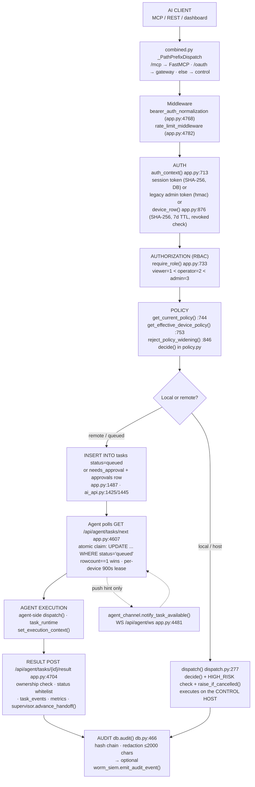

> **HISTORICAL analysis.** Current production assessment: [PRODUCTION_READINESS.md](./PRODUCTION_READINESS.md).

# 05 — Control Plane Analysis (`src/ai_bridge/control/`)

**Scope:** `src/ai_bridge/control/*.py` — 38 files, **16,666 LOC total** (VERIFIED `wc -l`, 2026-11-17).
**Method:** READ-ONLY. LOC from `wc -l`; symbols from `grep -n "^class |^def |^async def "` and reads.
No tests executed; no server run. **VERIFIED** = read in the cited file. **INFERRED** = reasonable
reading. **NOT FOUND** = searched, absent.

## 0. Inventory at a glance

| File | LOC | Role in one line |
|---|---|---|
| `app.py` | 5,147 | Monolithic FastAPI control plane; `create_app()`; 144 route decorators |
| `ai_api.py` | 2,284 | AI-client API: tool catalog, sync execution, ReAct agent, OpenAI-compatible proxy |
| `custom_agents.py` | 1,655 | Persistent 24/7 LLM agents (BYOK) + `AgentRunner` |
| `v1_routes.py` | 1,113 | v1 modular backend: devices/sessions/signalling/tasks/audit |
| `dispatch.py` | 716 | In-process tool dispatch — the server-side enforcement point |
| `mcp_routes.py` | 654 | MCP server CRUD + OAuth flow + outbound tool execution routes |
| `supervisor.py` | 582 | Multi-agent supervisor handoffs |
| `db.py` | 525 | SQLite/Postgres abstraction + schema + hash-chained audit |
| `mcp_oauth.py` | 370 | MCP-server OAuth2 (PKCE, client-credentials, refresh) + per-tool guardrails |
| `role_catalog.py` | 284 | Named multi-agent role presets (catalog only, not enforcement) |
| `mcp_client.py` | 271 | Outbound MCP client (raw `urllib` JSON-RPC) |
| `production_readiness.py` | 250 | Production checklist / deploy gate |
| `metrics.py` | 229 | Prometheus metrics |
| `agent_memory.py` | 196 | Persistent per-agent memory chunks in DB |
| `alerts.py` | 174 | Outbound alerts (Slack/Discord/Telegram/generic webhook) |
| `combined.py` | 171 | Combined ASGI app (`python -m ai_bridge.control`): control + MCP + OAuth gateway |
| `live_activity.py` | 161 | Operator live-activity snapshot |
| `desktop_capabilities.py` | 159 | Static OS capability matrix |
| `oidc.py` | 155 | Generic OIDC login (dormant unless configured) |
| `workspace.py` | 142 | Workspace/dashboard helper routes (roles/metadata/fleet) |
| `migrations.py` | 139 | Versioned SQL migrations (SQLite + Postgres) |
| `device_mtls.py` | 130 | Optional plane-side device mTLS fingerprint gate |
| `agent_channel.py` | 127 | WebSocket push *hint* channel only |
| `durable_ratelimit.py` | 125 | Cross-worker rate limiting (Redis → DB → memory) |
| `plane_state.py` | 110 | Durable plane flags (emergency stop, human takeover) in DB `settings` |
| `ratelimit.py` | 107 | Async Redis-or-memory rate limiter (older path) |
| `secrets_backend.py` | 94 | Secret resolution (env \| Vault \| AWS Secrets Manager) |
| `fleet_health.py` | 81 | Fleet health summary (`STALE_HEARTBEAT_SEC=90`) |
| `csrf.py` | 79 | CSRF for session auth (opt-in only) |
| `orchestration.py` | 71 | Task lifecycle / lease + stale recovery |
| `task_runtime.py` | 67 | Cooperative cancellation for in-flight execution |
| `task_events.py` | 66 | Per-task event trail |
| `worm_siem.py` | 65 | External WORM/SIEM audit sink (best-effort POST) |
| `dispatch_audit.py` | 61 | Selective dispatch audit callback |
| `backup.py` | 48 | Offline SQLite backup CLI only |
| `auth.py` | 39 | Local passwords/sessions/roles only |
| `__main__.py` | 18 | Entrypoint; binds `0.0.0.0` when `PORT` is set |
| `__init__.py` | 1 | Package marker only |

**Route counts VERIFIED:** `app.py` 144 `@app.` decorators (146 by the broader task grep, which also
matches `@app.middleware`); `v1_routes.py` 29; `ai_api.py` 12; `custom_agents.py` 10;
`mcp_routes.py` 10; `workspace.py` 5 — **212 `@app.` route decorators across `control/`**.
No `APIRouter`/`include_router`/`add_api_route` in `app.py`/`v1_routes.py` (NOT FOUND): all routes are
closures defined inside `create_app()` (`app.py:642`), `attach_v1_routes()` (`v1_routes.py:256`),
`attach_ai_routes()` (`ai_api.py:1253`), `install_custom_agent_routes()` (`custom_agents.py:1221`),
`install_mcp_routes()` (`mcp_routes.py:183`), `install_workspace_routes()` (`workspace.py:23`).
`app.py` also has 2 `@app.middleware("http")` (`bearer_auth_normalization:4768`,
`rate_limit_middleware:4782`) and 1 SPA catch-all `GET /{full_path:path}` (`app.py:5139`).

## 1. Architecture: one monolith, three embedded apps

`combined.py` (`create_combined_app()`, L132) composes a single Starlette app via `_PathPrefixDispatch`
(L96): `/mcp*` → the FastMCP Streamable-HTTP app (`server.create_http_app()`), `/oauth`,
`/.well-known/oauth-*`, `/.well-known/openid-configuration`, `/internal/verify` → the OAuth gateway
(`deployment/oauth/gateway.py`, 992 LOC), everything else → the control plane. `_should_embed()` (L21)
defaults to embedding on PaaS (Render sets `PORT`) so `/mcp` is publicly reachable. `_install_inprocess_verify()`
(L69) installs an in-process token-verify hook (`inprocess:` URL) to avoid single-worker HTTP
self-deadlock — **INFERRED** risk: embedded verification bypasses the network OAuth check; correctness
depends entirely on the gateway implementation.

`__main__.py:9` — `main()` runs `configure_logging()`, then `uvicorn.run(create_combined_app(), host, port)`;
port from `PORT` or `AI_BRIDGE_CONTROL_PORT` (default 8000); host `0.0.0.0` if `PORT` is set, else
`127.0.0.1`. Binding `0.0.0.0` on Render/PaaS is by design (VERIFIED).

`app.py:1-18` docstring states the core network invariant: **devices connect OUTBOUND; the plane never
opens an inbound shell** (VERIFIED as a design claim; agent polling is the only execution path — §4).

## 2. Request lifecycle (VERIFIED hops)

### 2.1 Entry points (VERIFIED)
- `POST /api/ai/execute` (`ai_api.py:1307`) or `POST /v1/chat/completions` (`ai_api.py:1883`) or
  `POST /api/tasks` (`app.py:1487`) or `POST /api/v1/tasks` (`v1_routes.py:1034`).
- MCP entry via `combined.py:create_combined_app:132` (`_PathPrefixDispatch:96` → `/mcp`).

### 2.2 Auth (VERIFIED)
`app.py:4768` `bearer_auth_normalization` middleware copies `Authorization: Bearer X` into both
`X-Admin-Token` and `X-Session-Token` headers → `app.py:4782` `rate_limit_middleware` → handler calls
`auth_context():713` (session token: `SELECT * FROM sessions WHERE token_hash=SHA256(?)` +
`expires_at>=now`, then user lookup `disabled=0`; else legacy admin token via `hmac.compare_digest`
if `auth.legacy_admin_enabled():38`) or `device_row():876` for agent routes (SHA-256 device token,
`revoked=0`, `token_expires_at` check, TTL 7 d via `AI_BRIDGE_DEVICE_TOKEN_TTL_DAYS`).
Session tokens are created in `login` (`app.py:4016`, `secrets.token_hex(32)`, 8 h expiry, hash-only
storage) and the OIDC callback (`app.py:4065`, `oidc.verify_id_token():94`). **No JWT/JOSE/PyJWT
anywhere in `control/` (grep NOT FOUND)** — sessions are opaque random tokens, not JWTs.
`auth.py` (39 LOC): `ROLES={"viewer":1,"operator":2,"admin":3}`; `hash_password()` PBKDF2-HMAC-SHA256,
200,000 iterations; `verify_password()` (`hmac.compare_digest`); `new_salt()` (`secrets.token_hex(16)`);
`legacy_admin_enabled()` — **legacy shared admin token is enabled by default**; disabling requires
explicitly setting `AI_BRIDGE_DISABLE_LEGACY_ADMIN_TOKEN=1`.

### 2.3 Authorization / RBAC (VERIFIED)
`require_role(min_role):733` compares `auth.ROLES[role]` vs `ROLES[min_role]`; 401 if unauthenticated,
403 if insufficient. Per-route levels verified in bulk (submit/cancel = `operator`, enroll/revoke/delete
= `admin`, reads = `viewer`). MCP tools are additionally gated by
`mcp_oauth.enforce_mcp_tool_policy():328`. The role *catalog* (`role_catalog.py`: supervisor, planner,
researcher, developer, computer_operator, browser_operator, tester, security_auditor, recovery) is a
separate agent-role preset system — its `allowed_tools` are prompt/catalog level, **not** a second
enforcement layer (INFERRED from the absence of enforcement there); enforcement is `dispatch()` +
policy. **NOT FOUND:** TOTP/MFA, cookies (no `Set-Cookie` in greps), API-key scopes beyond roles.

### 2.4 Policy (VERIFIED)
`app.py:get_current_policy():744` (latest `policies` row) + `get_effective_device_policy():753`
(device `policy_json` merged; `unrestricted` shortcut → all allows, `max_tier_unattended=4`) →
`submit_task:1487` checks `denied_tools`/`allowed_tools`, computes the tier via `..policy.TOOL_TIERS` +
`max_tier_unattended`/`allow_tier3`/`allow_file_deletion` → `needs_approval` → creates an `approvals`
row (TTL `AI_BRIDGE_APPROVAL_TTL_SECONDS`, default 3600) + task `status='needs_approval'`, else `queued`.
Device-side policy narrowing is enforced by `reject_policy_widening():846` (a device token cannot
widen policy). Human takeover (`v1_routes.is_device_human_takeover_active():100`) blocks AI input in
v1 task creation (`:1058`). Emergency stop (`plane_state.is_emergency_stop():56`, DB-backed) blocks new
tasks (`app.py:1494`, `ai_api:execute`).

### 2.5 Tool dispatch — two paths (VERIFIED)
**(a) Local/sync:** `ai_api.execute_ai_tool:1307` → `dispatch():dispatch.py:277` → `decide(policy, tool,
approval_granted, is_admin or approval_granted)` → `PermissionError` if denied; `raise_if_cancelled()`;
HIGH_RISK tier without approval + `max_tier_unattended<4` → `PermissionError`; large `handlers` dict
(~70 local tools + 21 `browser_*` via `_dispatch_browser` + `microsoft365`/`browserbase`/`you_search`/
`firecrawl.TOOLS` merged at `:690-697`); unknown tool → `ValueError`; after execution
`dispatch_audit.record_dispatch_tool()` + optional file audit (`AI_BRIDGE_AUDIT_LOG`).
**`dispatch()` executes on the calling host (control plane or agent process importing it); it is not
itself a remote-execution transport.** `approval_granted=True` is passed through for
`desktop_anticipate_action` unconditionally (`dispatch.py:640-650`, INFERRED intentional
pre-authorization).
**(b) Queued/remote:** `INSERT INTO tasks` in `submit_task` / `ai_api:1425,1445` /
`supervisor.enqueue_role_task():201`.

### 2.6 Device routing / agent polling (VERIFIED)
Agent polls `GET /api/agent/tasks/next` (`app.py:4607`): `device_row()` + `device_mtls.require_device_mtls()`
(`:4617`) + emergency-stop check + `orchestration.device_has_active_lease():16` (skip if a `running`
task < 900 s old) + atomic claim + approval resolution (only `status='approved'` + unexpired +
tool-match → `approval_granted=True`; **`term-*`/`terminal_exec` forced `True` — see Finding F-05-03**)
+ `policy=get_effective_device_policy(row)` returned with the task. Push hint only:
`app.py:notify_tasks():681` → `agent_channel.notify_task_available():103` → WS `/api/agent/ws`
(`app.py:4481`, auth via `X-Device-Token` header or `?token=` query, then `agent_channel.register()`).
**No server-initiated execution connection** — the docstring invariant holds for this path.

### 2.7 Result + audit (VERIFIED)
Agent `POST /api/agent/tasks/{id}/result` (`app.py:4704`): `device_row()` + task ownership check
(`device_id` match) + status whitelist `{completed, failed, cancelled, timed_out}` +
`UPDATE tasks SET status=?, result=?, updated_at=?` (result truncated, `MAX_RESULT_CHARS`-class cap,
`app.py:54` `MAX_RESULT_CHARS=512_000`) + `task_events.append_task_event()` +
`metrics.record_task_execution()` + `supervisor.advance_handoff()` on completion/failure +
`audit("device", ...)`. Audit: `db.audit():466` (redacted args/result ≤ 2000 chars; hash chain
`entry_hash=SHA256(prev_hash|id|ts|actor|device_id|tool|args_json|decision)`, `prev_hash` from the
latest row) → optional `worm_siem.emit_audit_event():41` (HMAC-signed POST). Dispatch-time selective
audit via `dispatch_audit.record_dispatch_tool():55` → `app.py:_record_dispatch_audit():892`. Readable
via `GET /api/audit:1971`, `GET /api/audit/export:2004`.

## 3. Per-file analysis (control plane)

### 3.1 `app.py` — 5,147 LOC — the monolith
`create_app(admin_token, db_path, database_url):642`. Imports include `..tools`, `..terminal_manager`,
`..policy`, `..security.redact*`, `.agent_channel`, `.alerts`, `.auth`, `.metrics`, `.db`,
`.dispatch.dispatch`, `.ratelimit`, `.csrf`, `.secrets_backend.get_secret`.
Key routes: `GET /install.sh:913`, `/install.ps1:919`, `/health:933`, `/health/live:937`,
`/health/ready:942`, `/health/production-checklist:973`, `/metrics:985`,
`POST /api/devices/enroll:1008`, `POST /api/tasks:1487`, `GET /api/tasks/{id}:1587`,
`POST /api/tasks/{id}/cancel:1618`, approvals `1711-1956` incl. unauthenticated-by-token
`GET /api/approvals/quick/{id}:1789` (HMAC sig — the one unauthenticated-but-signed endpoint,
rate-limited 10/min per approval + 30/min per IP at `app.py:1791-1793`),
`GET /api/audit:1971`, `POST /api/emergency-stop:2026`, workflows `2048-2552`
(`_execute_workflow_step_sync:2238`, `_run_workflow_worker:2329`, `submit_workflow:2516`),
triggers/schedules `3076-3276`, desktop/WebRTC `3308-3745`, terminal `3785-3887`, auth `4006-4176`
(`login:4016`, `logout:4037`, OIDC `4048-4065`), policies `4203-4255`, agent polling `4419-4877`
(`heartbeat:4419`, `ws:4481`, `tasks/next:4607`, `tasks/{id}/result:4704`), SSE
`GET /api/events/stream:4877`, alerts/backups/tenants `4929-5139`.
Composition at `4818-4873`: `attach_ai_routes()`, `attach_v1_routes()`, `install_mcp_routes()`,
`AgentRunner(...).start()`. Background: `_scheduler_loop():2660` (daemon thread, 10 s tick,
`sweep_stale_running_tasks` every ~30 s, `app.state.last_stale_sweep`); workflow workers via
`threading.Thread(target=_run_workflow_worker)` (`:2222,2538,2702,3293`).
In-memory `app.state`: `conn:668`, `admin_token:669`, `emergency_stop:670` (bool, mirrored from DB),
`task_cond:679` (`threading.Condition`), `device_live_meta={}:1051`, `latest_frames={}:3305`,
`webrtc_sessions={}:3306` — **the last three are lost on restart, per-process only**.
**Risks VERIFIED:** (1) CORS `allow_origins` hardcodes `http://201.79.36.129`,
`https://jxiptvplayer.app`, `https://ai-bridge-dashboard.onrender.com` + `env_public_base_url()`
default `https://jxiptvplayer.app` (`:657-666,697-711`); `allow_credentials=True`,
`allow_methods=["*"]`, `allow_headers=["*"]`. (2) Docstring `app.py:1-18` states rate limit
"120/min/token/IP in-memory, per process" — stale vs. the actual middleware (1200/300, see §6).
(3) `term-*` + `terminal_exec` tasks get `approval_granted=True` unconditionally in `next_task`
(`:4678-4680`).

### 3.2 `db.py` — 525 LOC — persistence + hash-chained audit
SQLite/Postgres abstraction + schema + hash-chained audit. Imports `contextlib, hashlib, json, os, re,
sqlite3, threading, time, ..security.redact*`. `SCHEMA` (~L25-202): tables `devices, tasks, approvals,
audit, settings, users, sessions, policies, workflows, telemetry, triggers, schedules,
task_submissions` (UNIQUE actor+request_key implied by ON CONFLICT use), `custom_agents, mcp_servers,
mcp_oauth_states, agent_runs, workflow_templates, alert_deliveries, device_metadata, task_events,
agent_memory_chunks` + indexes (`idx_tasks_device_status`, `idx_audit_tenant_ts`, etc.).
`to_pg_sql():206`, `RowDict:255`, `_LockedResult:268`, `LockedConnection:286` (thread lock around
SQLite), `PostgresConnection:330`, `connect():402` (auto-detect `DATABASE_URL` postgres vs SQLite
`~/.ai-bridge/control.db`, `WAL, busy_timeout=5000`, runs `migrations.run_migrations()`),
`hash_token():434` (SHA-256 hex), `now():438`, `_ensure_audit_hash_columns():442`, `audit():466`
(redacts args/result, hash chain — §2.7).
**Risks:** SQLite `LockedConnection` serializes via one lock — **INFERRED** throughput bottleneck
under concurrency; Postgres path exists but `to_pg_sql` translation is regex-based (**INFERRED**
fragility). Audit is hash-chained but stored in a mutable DB — tamper-*evident*, not tamper-*proof*.

### 3.3 `ai_api.py` — 2,284 LOC — AI-client API
Tool catalog, sync execution, ReAct agent, OpenAI-compatible proxy. `build_tool_specs():909`,
`resolve_device_record():969`, `find_default_windows_device():1000`, models `AIExecuteIn:1024,
AIAgentIn:1032, ChatCompletionIn:1050, AISettingsIn:1060, AIChatIn:1076`, `mask_key():1086`,
`validate_llm_key():1102`, `extract_bearer_token():1244`, `attach_ai_routes():1253`.
Routes (12): `GET /api/ai/tools:1285`, `POST /api/ai/execute:1307`, `POST /api/ai/agent:1508`,
`POST /v1/chat/completions` + `/api/v1/chat/completions:1883-1884`, `GET /v1/models` +
`/api/v1/models:1940-1941`, `GET /api/ai/devices:1955`, `GET/POST /api/settings/ai:1992/2046`,
`POST /api/ai/chat:2121`, `POST /api/ai/chat/stream:2197`.
Execution split **VERIFIED** (`execute_ai_tool:1307-1450`): `is_local` (`local/host/droplet` or no
target) → in-process `dispatch(tool, args, is_admin=(role=="admin")):1370` **on the control host**;
else `resolve_device_record()` → policy check → `INSERT INTO tasks ... status='needs_approval'/
'queued':1425/1445` + `notify_tasks()`. LLM keys sent as `Bearer` to OpenAI/Anthropic
(`:1122,1178-1194`).
**Risk HIGH (VERIFIED):** the local branch executes tools on the control-plane host itself with only
`operator` role + `dispatch()` policy gate; no device isolation for `local`. No `Idempotency-Key`
handling in this file (**NOT FOUND** — unlike `app.py:submit_task`).

### 3.4 `v1_routes.py` — 1,113 LOC — v1 backend
Devices/sessions/signalling/tasks/audit. `_HUMAN_TAKEOVER_BY_DEVICE: dict:46` (**in-memory, but
hydrated from DB on startup** via `hydrate_human_takeover_from_db():92` + `bind_control_connection():50`
/`_BOUND_CONN:47`), `set_device_human_takeover():56`, `is_device_human_takeover_active():100`
(memory first, then DB fallback), `derive_session_permissions():117` (server-side from mode+policy),
`save/load_webrtc_session_db():160/181`, `format_session_v1():197`, models `CreateSessionV1In:239,
UpdateSessionModeV1In:251`, `attach_v1_routes():256`.
Routes (29): devices `GET /api/v1/devices:285, /{id}:304, /{id}/status:335, /{id}/monitors:386,
/{id}/ui-elements:415, /{id}/files:429, POST .../files/upload:442, GET .../files/download:479`;
`POST /api/v1/agents/{device_id}/heartbeat:507`; sessions `GET /api/v1/sessions:558, POST:573,
GET /{id}:701, POST+PATCH /{id}/mode:714-715, PATCH /{id}/quality:761, POST /{id}/clipboard:787,
POST /{id}/terminate:817, POST /{id}/offer:840, /answer:862, /ice:880, GET /sessions/ice-servers:907,
GET /{id}/recording:916, POST /{id}/recording/seal:927, WS /api/v1/ws/sessions/{id}:951`; tasks
`GET /api/v1/tasks:1017, POST:1034, GET /{id}:1075`; `GET /api/v1/policies:1091,
GET /api/v1/audit:1103`.
Auth **VERIFIED:** all v1 handlers call `require_role("viewer"|"operator"|"admin", ...)` or
`auth_context()`/`device_row()` (e.g. heartbeat `:514` uses `device_row`).
`_sessions_store():279` — **INFERRED** to be `app.state.webrtc_sessions`; v1 sessions are persisted
to DB via `save_webrtc_session_db()` on create/mode change.
**Risk:** human-takeover in-memory cache can diverge across workers until the DB fallback;
`v1_create_task:1035` re-implements task creation and does **NOT** use `Idempotency-Key` per grep
(**NOT FOUND** there).

### 3.5 `dispatch.py` — 716 LOC — enforcement point
See §2.5. Also `_start_webrtc_from_task():21`, `_supervisor_enqueue_handoff():52`,
`_supervisor_recover_role_tasks():56`, `_agent_run_role():60`, `_dispatch_list_devices():68`,
`_dispatch_device_status():78`, `_dispatch_browser_snapshot():92`, `_dispatch_agent_notify():99`,
`_dispatch_agent_remember():110`, `_dispatch_agent_delegate():132`, `_dispatch_agent_run_workflow():152`,
`_dispatch_browser():157`, **`dispatch(...):277`**.

### 3.6 `mcp_routes.py` — 654 LOC — outbound MCP servers
MCP server CRUD + OAuth flow + tool execution routes. Models `MCPServerIn:31, MCPServerPatch:47,
MCPDiscoverIn:63, MCPExecuteIn:67`, `_mask():72`, `_serialize_mcp_server():79`, `_callback_url():106`,
`install_mcp_routes():183`. Routes (10): `GET /api/mcp/templates:186`, `GET /api/mcp/servers:194`,
`POST /api/mcp/oauth/discover:206`, `POST /api/mcp/servers:215`, `POST .../oauth/start:345`,
`GET /api/mcp/oauth/callback:426`, `POST .../sync:525`, `PATCH .../{id}:566`, `DELETE .../{id}:610`,
`POST .../execute:627`. **Risk:** OAuth `state` handling and callback are in this file — INFERRED
need for targeted review (not fully read in this pass). See report 06 for the OAuth/PKCE detail.

### 3.7 `supervisor.py` — 582 LOC — multi-agent handoffs
`_PLANE_CONN: ContextVar:14` (per-context DB handle; `set/reset/get_plane_conn():17/22/26`),
`HANDOFF_PROFILES:30` (`code: [planner→dev_workspace_plan, developer→git_status,
tester→run_project_tests_structured]`, `research: [...]`), `RECOVERY_STEP:151` (single recovery step),
`role_agent_id():159`, `tag_task_args():166` (embeds `_handoff_id/_parent_task_id/_step_index/_role/
_profile/_mode/_goal` into `args_json`), `enqueue_role_task():201` (`INSERT INTO tasks`),
`supervisor_handoff_plan():252` (raises on unknown profile), `run_supervisor_handoff_enqueue():273`
(**gated mode default: enqueues only step 0**), `_parse_args():318`, `advance_handoff():327` (on
`completed` → enqueue next step; on `failed/timed_out/cancelled` → enqueue `RECOVERY_STEP`; terminal
→ `handoff_complete|recovery_failed`), `handoff_status():406`, `recover_failed_role_tasks():475`
(failed → `queued`, `result=NULL`), `delegate_role_target():499`, `enqueue_agent_run_role():511`,
`dispatch_supervisor_enqueue_handoff():545`, `dispatch_supervisor_recover():570`.
Wiring **VERIFIED:** `advance_handoff()` called from `app.py:task_result` (`:4704` handler, ~line 4760)
after the result update; routes `POST /api/supervisor/handoff:2828`, `GET .../handoffs/{id}:2869`,
`POST /api/supervisor/recover:2881`.
**Risk:** handoff state lives only in `tasks.args_json` + `tasks.status` (durable, good); no separate
handoff table — status is derived by scanning tasks (**INFERRED**).

### 3.8 `orchestration.py` — 71 LOC — leases + stale recovery
`DEFAULT_RUNNING_LEASE_SEC=900` (`AI_BRIDGE_TASK_RUNNING_LEASE_SEC`), `DEFAULT_SWEEP_INTERVAL_SEC=30`.
`device_has_active_lease():16` (`SELECT id FROM tasks WHERE device_id=? AND status='running' AND
updated_at>=now-lease LIMIT 1`), `sweep_stale_running_tasks():27` (stale `running` → `queued` if
`AI_BRIDGE_STALE_TASK_REQUEUE=1` (default) and no emergency stop, else `timed_out`; guarded
`UPDATE ... WHERE status='running'`).
**Risk:** lease is per-device (1 running task/device enforced in `next_task`); requeue can re-run a
non-idempotent tool after an agent crash (**INFERRED** risk).

### 3.9 `task_runtime.py` — 67 LOC — cancellation
**Single global execution context**: `_cancel_check:None`, `_lock:8`,
`_current_task_id/_current_device_id:None` — **one task per process**; concurrent local executions
would overwrite each other (**VERIFIED** design, **INFERRED** risk). `TaskCancelled(RuntimeError):13`,
`set_execution_context():17`, `clear_execution_context():31`, `current_device_id():35`,
`current_task_id():40`, `is_cancelled():45`, `raise_if_cancelled():56`,
`cooperative_sleep():61` (0.25 s slices). Called by `dispatch():277` (`raise_if_cancelled()` before
dispatch).

### 3.10 `plane_state.py` — 110 LOC — durable flags
Durable plane flags (emergency stop, human takeover) in DB `settings`. Only in-memory state:
`_EMERGENCY_REFRESH_AT=0.0:9` + `_EMERGENCY_REFRESH_LOCK:10` (1 s/0.75 s TTL cache for DB re-read —
**lost on restart is harmless, it is just a timestamp**). `_get_setting():13`, `_set_setting():21`
(upsert), `load_emergency_stop():30` (`settings plane.emergency_stop`), `set_emergency_stop():35`,
`sync_emergency_stop_to_app():39`, `refresh_emergency_stop():45`, `is_emergency_stop():56`,
`is_human_takeover_active():65`, `save/load/load_all/clear_human_takeover():74/79/89/105`
(`settings plane.human_takeover.{device_id}`), `now_payload():110`. This is the *durable* counterpart
to `app.state.emergency_stop` — multi-worker convergence via 0.75–1 s TTL re-read. Risk: low.

### 3.11 `agent_channel.py` — 127 LOC — WS push hints
WebSocket push *hint* channel only; docstring states HTTP claim remains the source of truth.
`bind_event_loop():24`, `register():30`, `unregister():35`, `connected_device_ids():45`,
`subscriber_count():50`, `_send_json():57`, `push_to_device():65`, `_schedule():83`,
`notify_task_available():103`, `notify_cancel():110`, `notify_emergency_stop():117`,
`reset_for_tests():125`. State: `_lock:18`, `_subscribers: dict[str,set[WebSocket]]:20`, `_loop:21` —
**in-memory, lost on restart; per-process only**. Push is best-effort/dropped if no loop
(`_schedule:83-101`); no auth here — auth is in `app.py:4481` WS handler before `register()`.

### 3.12 `mcp_client.py` — 271 LOC — outbound MCP client
MCP HTTP client (JSON-RPC over `urllib`). `_build_headers():21`, `_parse_mcp_response():46`,
`fetch_mcp_tools():70`, `execute_mcp_tool():152`, `format_mcp_tool_for_llm():229`. Uses stdlib `urllib`
(no `httpx` timeout pooling here). See report 06, §7 for protocol conformance gaps.

### 3.13 `mcp_oauth.py` — 370 LOC — outbound OAuth2
PKCE, client-credentials, refresh + per-tool guardrails. `_http_json():27`, `_post_form():51`,
`generate_pkce_pair():62`, `discover_oauth_metadata():70`, `register_oauth_client():120`,
`_parse_token_response():148`, `fetch_client_credentials_token():166`,
`exchange_authorization_code():184`, `refresh_oauth_token():207`, `ensure_valid_mcp_token():226`
(refresh-if-expired, persists to DB), `get_mcp_tool_policies():295`, `save_mcp_tool_policies():312`,
`enforce_mcp_tool_policy():328` (`allow|deny|require_approval`; deny → error; require_approval →
inserts an `approvals` row `status='pending'`, 3600 s expiry). OAuth tokens stored in DB
(`mcp_servers`/`mcp_oauth_states` tables); `VALID_MCP_TOOL_POLICIES` allowlist enforced on save.
See report 06, §5 for the PKCE detail.

### 3.14 `device_mtls.py` — 130 LOC — mTLS fingerprint gate
Optional plane-side device mTLS fingerprint gate. `device_mtls_enabled():22`
(`AI_BRIDGE_DEVICE_MTLS ∈ {1,true,yes}`), `normalize_fingerprint():26`,
`fingerprint_from_pem():32` (SHA-256 of DER), `extract_request_fingerprint():43` (headers
`X-Client-Cert-Fingerprint`, `X-SSL-Client-Fingerprint`, `X-Client-Cert`,
`X-Forwarded-Tls-Client-Cert-Info`), `ensure_mtls_column():64` (lazy `ALTER TABLE devices ADD
mtls_fingerprint`), `set_device_fingerprint():88`, `require_device_mtls():95` (403 if not enrolled or
mismatch; no-op if disabled), `describe_device_mtls():120`.
**Risk VERIFIED:** trust is placed in *proxy-forwarded headers*, not a TLS handshake in this process;
spoofable if the edge proxy does not strip/validate them (**INFERRED** risk, depends on deployment).
Only enforced where called — **VERIFIED** call site is `app.py:next_task` (`:4617-4625`); **NOT FOUND**
on heartbeat/ws/policy/rotate in the greps done.

### 3.15 `secrets_backend.py` — 94 LOC — secrets
Secret resolution (env | Vault | AWS Secrets Manager). `secrets_backend_name():18`
(`AI_BRIDGE_SECRETS_BACKEND`, default `env`), `get_secret():22`, `describe_secrets_backend():35`,
`_vault_get():45` (`AI_BRIDGE_VAULT_ADDR/TOKEN`, path `secret/data/ai-bridge`, `httpx GET`, also tries
the key without the `AI_BRIDGE_` prefix), `_aws_sm_get():73` (`boto3 secretsmanager GetSecretValue`,
`AI_BRIDGE_AWS_SECRET_ID`, JSON or raw).
**Risk VERIFIED:** if `AI_BRIDGE_SECRETS_REQUIRED≠1`, a missing/unreachable Vault/AWS backend
**silently falls back to env** (`or default`); fail-closed only when required=1. Unknown backend raises
`RuntimeError`.

### 3.16 `csrf.py` — 79 LOC — CSRF (opt-in)
`_CSRF_SECRET:18` (server secret, rotated on restart per docstring), `_csrf_key():22`,
`generate_csrf_token():26` (`{expiry}:{HMAC-SHA256[:16]}`, TTL 86400 s), `validate_csrf_token():34`,
`csrf_middleware():54` (skips GET/HEAD/OPTIONS/TRACE, skips if `X-Admin-Token`/`X-Device-Token`
present, skips `/api/auth/login|logout`).
**Risk VERIFIED:** middleware is **opt-in only** — installed in `app.py:648-649` only if
`AI_BRIDGE_CSRF_ENABLED ∈ {1,true,yes}`. Default = no CSRF enforcement.

### 3.17 `oidc.py` — 155 LOC — OIDC login (dormant unless configured)
`_DISCOVERY_CACHE:{"at":0,"doc":None}`, `_PENDING: dict[state, {nonce,at}]` — **in-memory, lost on
restart; 600 s expiry, pruned in `new_login()`**. `oidc_config():34` (requires all of
`AI_BRIDGE_OIDC_ISSUER/CLIENT_ID/CLIENT_SECRET/REDIRECT_URI`, else `None`), `discovery():50` (1 h
cache, `/.well-known/openid-configuration`), `new_login():66` (state+nonce `token_urlsafe(24)`,
`response_type=code, scope=openid email profile`), `_b64url():90`, `verify_id_token():94` (RS256 only,
JWKS by `kid`, `cryptography` PKCS1v15/SHA256, checks `iss, aud, exp, nonce`), `pop_pending():151`.
Callback wiring **VERIFIED** `app.py:4065-4131`: exchanges the code at `token_endpoint`, verifies the
ID token, matches/creates a local user by email/sub (auto-created as `viewer`, password
`oidc-only-<random>`), issues an 8 h session token, redirects to the dashboard with
`#session_token=...` in the URL fragment.
**Risk:** session token in the URL fragment (not logged by the server, but visible in browser history
— **INFERRED**).

### 3.18 `custom_agents.py` — 1,655 LOC — persistent LLM agents
Persistent 24/7 LLM agents (BYOK). `resolve_llm():71`, `_bound_devices():98`, `_resolve_device():131`,
`_system_prompt():333`, `execute_agent():424` (one ReAct cycle, `max_steps`, depth cap `_depth<2` for
peer context, MCP tools merged), `AgentRunner:854` (daemon thread `_loop`, tick `RUNNER_TICK_S`,
claims due agents `enabled=1 AND next_run_at<=? LIMIT 10`, `MAX_CONCURRENT_RUNS`, `_running:set`),
`install_custom_agent_routes():1221`. Routes (10): `GET/POST /api/agents:1226/1238`,
`PATCH/DELETE /api/agents/{id}:1280/1350`, `POST /api/agents/{id}/run:1372`, `GET .../runs:1391`,
memory chunks `GET/POST/DELETE .../memory/chunks:1414/1434/1478`, `POST .../ask:1510`.
**Risk:** agents hold provider API keys (resolved from DB settings via `provider_key():61`);
`AgentRunner._running` is in-memory — a restart loses run-state but DB `next_run_at` re-drives
scheduling (**INFERRED**).

### 3.19 `agent_memory.py` — 196 LOC — agent memory
Persistent per-agent memory chunks in DB. `ensure_memory_table():25`, `append_memory_chunk():67`,
`query_agent_memory():110`, `load_agent_memory():137`, `clear_agent_memory():147`,
`format_chunks_for_prompt():169` (max 4000 chars), `export_agent_memory():195`.
**Risk:** low; chunk content is LLM prompt context — **INFERRED** injection surface if untrusted memory
is fed to prompts (not verified in this file).

### 3.20 `live_activity.py` — 161 LOC — live activity
Operator live-activity snapshot (Phase 7). `_parse_task_args():11`, `_enrich_task_row():21` (extracts
`_role/_project/_task/_role_agent/_handoff_id/_parent_task_id/_step_index/_profile/_mode/_goal` from
`args_json`), `_group_handoffs():38` (buckets by `_handoff_id`, status `in_progress|blocked`),
`build_live_activity():82` (running/queued + failed/timed_out tasks + running/failing custom agents,
limit ≤ 200). Read-only, DB-backed. No in-memory state in this file (**VERIFIED** — only a local
`buckets` dict).

### 3.21 `desktop_capabilities.py` — 159 LOC — capability matrix
Static OS capability matrix. `normalize_platform_family():38` (win32→Windows, darwin→Darwin,
linux→Linux), `platform_supports_webrtc_desktop_stream():77` (Windows only), `stream_gate_for_os():82`,
`build_capability_matrix():112` (Windows: all True except `verified_on_target_ci=False`; macOS/Linux:
stream/automation/OCR/native all False). Hardcoded matrix, no live probing except an optional host
probe (`:126`).

### 3.22 `dispatch_audit.py` — 61 LOC — selective audit
Selective dispatch audit callback. `_CALLBACK:None` (module global), `set_dispatch_audit_callback():31`,
`should_audit_tool():36` (names `run_shell, terminal_exec, perform_approved_ui_action,
launch_approved_application, capture_desktop_screenshot/frame, ...` + prefixes `firecrawl_,
browserbase_, you_, supervisor_, desktop_, mouse_, keyboard_` + any tool `tier >= SENSITIVE` via
`..policy`), `record_dispatch_tool():55` (no-op if no callback or not auditable; exceptions swallowed).
Wiring **VERIFIED:** `app.py:892-895` sets the callback to `_record_dispatch_audit()` →
`audit("dispatch", device_id, tool, args, "executed")`.
**Risk:** audit is *sampling by tool list*, not all dispatches; the callback is a process-global
singleton.

### 3.23 `worm_siem.py` — 65 LOC — external audit sink
External WORM/SIEM audit sink (POST JSON). `worm_siem_url():18` (`AI_BRIDGE_WORM_SIEM_URL`),
`worm_siem_required():22` (`AI_BRIDGE_WORM_SIEM_REQUIRED`), `describe_worm_siem():26`, `_sign():34`
(HMAC-SHA256 with `AI_BRIDGE_WORM_SIEM_HMAC_SECRET`, header `X-AI-Bridge-Signature`),
`emit_audit_event():41` (`{"schema":"ai-bridge.audit.v1","ts","event"}`, `httpx.post`, timeout 5 s;
returns `{ok,skipped}`; raises only if required, else returns an error dict).
Wiring **VERIFIED:** called from `db.audit():466` (after hash-chain insert) only if a URL is set;
exceptions swallowed (`try/except: pass`).
**Risk VERIFIED:** this is *not* WORM storage itself, only a best-effort POST to an external collector;
the local audit table is a mutable SQLite/Postgres table (hash chain detects tampering after the fact,
does not prevent it). `POST /api/audit/retention` (`app.py:2016`) can prune audit rows (**INFERRED** —
retention handler not fully read).

### 3.24 `task_events.py` — 66 LOC — task event trail
`EVENTS_TABLE_SQL` (`task_events(id,task_id,event,detail_json,created_at)` + index),
`ensure_events_table():22`, `append_task_event():30` (id 12-hex, detail truncated 4000 chars),
`list_task_events():50` (limit 1–200). Risk: none material.

### 3.25 `fleet_health.py` — 81 LOC — fleet health
`STALE_HEARTBEAT_SEC=90`. `_device_online():13` (`status==online` and age < 90 s),
`summarize_fleet_health():19` (per-device latest telemetry, stale list,
`webrtc_stream.list_active_stream_health()`). **Risk:** N+1 query per device (telemetry lookup in a
loop) — **INFERRED** perf note.

### 3.26 `metrics.py` — 229 LOC — Prometheus metrics
Gauges/counters: `aibridge_active_devices, aibridge_tasks_total, aibridge_task_duration_seconds
(buckets 0.1–120 s), aibridge_queue_depth, aibridge_stale_running_tasks, aibridge_stale_heartbeat_devices,
aibridge_http_requests_total, aibridge_uptime_seconds`; `_START_TIME=time.time():25` (in-memory uptime),
`_PHASE_DEPTH:92`. `record_task_execution():104`, `record_http_request():113`,
`update_fleet_gauges():124`, `get_metrics_payload():177` (fallback plaintext if the lib is missing),
`build_metrics_summary():191` (queue/running/completed-1h/failed-1h/avg-duration).
`/metrics` requires `operator` (`app.py:986-994`); low-cardinality endpoint collapsing done in
middleware (`app.py:4804-4810`).

### 3.27 `alerts.py` — 174 LOC — outbound alerts
Outbound alerts (Slack/Discord/Telegram/generic webhook). `get_alert_config():23` (env),
`_send_http_json():34`, `_send_slack_alert():49`, `_send_discord_alert():83`,
`_send_telegram_alert():106`, `_send_generic_alert():125`, `dispatch_alert():139` (async via daemon
`Thread`, returns `{"queued":True}`).
**Risk:** webhook URLs/tokens from env/DB settings; SSRF validation is in `app.py:_validate_webhook_url:59`,
not here — **INFERRED** direct callers bypass that check.

### 3.28 `migrations.py` — 139 LOC — migrations
Versioned SQL migrations (SQLite + Postgres). `MIGRATIONS_DIR:18` = repo-root `/migrations`,
`ensure_migrations_table():21`, `get_applied_versions():42`, `_sqlite_has_column():48`,
`_adapt_and_execute_statement():58` (dialect adaptation), `run_migrations():87` (filename stem prefix =
version, skips applied, records in `schema_migrations`, logs failure per-file).
**Risk:** migration failure is logged, not fatal — **VERIFIED** `run_migrations:131` logs the error;
**INFERRED** partial-apply risk if a file has multiple statements.

### 3.29 `production_readiness.py` — 250 LOC — deploy gate
`is_production_profile():9` (`AI_BRIDGE_PROFILE=production|prod|1|true|yes` or `RENDER` set),
`turn_credentials_configured():14`, `_truthy_env():29`, `env_public_base_url():33`,
`legacy_webrtc_routes_allowed():46` (disabled in prod unless `AI_BRIDGE_ALLOW_LEGACY_WEBRTC=1`),
`require_redis_for_multi_host():57` (`AI_BRIDGE_REQUIRE_REDIS|AI_BRIDGE_MULTI_HOST`),
`assess_production_readiness():61` (issues list; `critical` incl. missing TURN, missing admin token,
Redis-required-for-multi-host (`:180-187`), WORM-required-but-unconfigured (`:148-152`);
`ok = no critical`).
**Risk:** the checklist is advisory except where callers enforce (e.g. `make_quick_sig` raises in prod
without an admin token, `app.py:100-113`).

### 3.30 `backup.py` — 48 LOC — SQLite backup CLI
Offline SQLite backup CLI only. `verified_backup(source,destination):16` (`O_CREAT|O_EXCL, 0o600`,
`sqlite3 backup()`, `PRAGMA integrity_check`, `COUNT users/devices`, deletes dest on failure),
`main():38` (`python -m ai_bridge.control.backup SRC DST`). Docstring warns backups contain
password/session/device-token hashes — must be treated as credentials; no encryption in this file
(**VERIFIED**).

### 3.31 `workspace.py` (control) — 142 LOC — helper routes
Models `UserUpdate:13, DeviceMetadata:18`, `install_workspace_routes():23`, `device_summary():138`.
Routes (5): `PATCH /api/auth/users/{username}:24` (admin), `PUT /api/devices/{id}/metadata:46` (admin),
`GET /api/fleet/inventory:66` (viewer), `GET /api/tasks/history:101` (viewer),
`GET /api/fleet/notifications:123` (viewer). Risk: low. (Name collision with core `workspace.py` —
see report 04, §2.)

### 3.32 `combined.py` — 171 LOC — ASGI composition
See §1. `_should_embed():21` (`AI_BRIDGE_EMBED_MCP`, default embed on Render/`PORT`);
`_prepare_embed_env():31`; `_load_oauth_gateway():59`; `_install_inprocess_verify():69`;
`_PathPrefixDispatch:96`; `_lifespan_context():124`; `create_combined_app():132`.

### 3.33 `__main__.py` / `__init__.py`
See §0/§1. `__init__.py` is a 1-line package marker.

## 4. Task claiming & idempotency (VERIFIED)

**Claim:** `app.py:next_task` — `SELECT ... WHERE device_id=? AND status='queued' ORDER BY created_at
ASC LIMIT 1` then `UPDATE tasks SET status='running' WHERE id=? AND status='queued'` inside
`conn.transaction()`, `rowcount==1` required to win; plus the per-device lease
`device_has_active_lease()` (900 s) prevents a second claim while one is `running`; stale `running`
tasks are reclaimed by `_scheduler_loop` → `orchestration.sweep_stale_running_tasks()` (~every 30 s,
requeue default on). This is a sound claim design for a single DB, provided all workers share the
same database (SQLite file or Postgres).
**Idempotency:** `POST /api/tasks` only — `Idempotency-Key` header (1–128 ASCII, 422 otherwise),
`task_submissions` table, `INSERT ... ON CONFLICT (actor,request_key) DO NOTHING`, hash-mismatch →
409, same-hash replay → returns the original task. **NOT FOUND** in `ai_api.execute` or
`v1_create_task`.

## 5. In-memory vs durable state

| State | Location | Lost on restart? | Consequence |
|---|---|---|---|
| tasks / approvals / audit / sessions / users / devices / policies / settings incl. `plane.emergency_stop` + `plane.human_takeover.*` | DB (`db.py`) | No | Durable core |
| WebRTC sessions (v1) | DB via `save_webrtc_session_db()` | No | Durable |
| `task_submissions` (idempotency) | DB | No | Durable |
| `agent_channel._subscribers` + `_loop` | `agent_channel.py:18-21` | Yes | WS push hints only; agents reconnect — harmless |
| `oidc._PENDING` (≤600 s) + `_DISCOVERY_CACHE` (1 h) | `oidc.py` | Yes | Login states lost; discovery re-fetched — harmless |
| `ratelimit._RATE`, `durable_ratelimit._MEMORY`, Redis client handles | `ratelimit.py`, `durable_ratelimit.py` | Yes | Rate-limit windows reset — fail-open briefly |
| `app.state.device_live_meta`, `latest_frames`, `webrtc_sessions` | `app.py:1051,3305-3306` | Yes | Desktop frames/sessions lost; v1 sessions also in DB |
| `v1_routes._HUMAN_TAKEOVER_BY_DEVICE` | `v1_routes.py:46` | No (rehydrated) | Rehydrated from DB on startup (`app.py:674-676`); can diverge across workers until the DB fallback |
| `task_runtime` single global current-task/cancel context | `task_runtime.py` | Yes | Per-process; unsafe under concurrent local dispatch |
| `csrf._CSRF_SECRET` | `csrf.py:18` | Yes | Restart invalidates all CSRF tokens |
| `dispatch_audit._CALLBACK`, `supervisor._PLANE_CONN` (ContextVar), `metrics._START_TIME` | various | Yes | Callback/ContextVar re-set per process; uptime resets |
| `plane_state` TTL timestamp only | `plane_state.py:9-10` | Harmless | Just a cache timestamp |
| `custom_agents.AgentRunner._running` | `custom_agents.py:854` | Yes | Run-state lost; DB `next_run_at` re-drives scheduling (INFERRED) |

**Multi-worker verdict (VERIFIED structure, INFERRED consequence):** durable state is DB-backed, so
multi-worker operation is *possible* when a shared database (Postgres) and Redis are configured. But
several per-process structures break cross-worker consistency: `app.state.webrtc_sessions`,
`device_live_meta`, `latest_frames`; the WS push channel (`agent_channel`); the in-memory rate-limit
fallbacks; and the single-global `task_runtime` context. `production_readiness.require_redis_for_multi_host()`
makes Redis a *critical* checklist item only when `AI_BRIDGE_REQUIRE_REDIS`/`AI_BRIDGE_MULTI_HOST` is
set — it is not enforced by default.

## 6. Rate limiting (VERIFIED — three layers)

1. **Global middleware** `app.py:4782-4799`: auth paths 30/min/IP, otherwise per-token-hash 1200/min or
   per-IP 300/min, via `app.py:_rate_limit():90` → if `REDIS_URL`/`AI_BRIDGE_REDIS_URL` is set →
   `ratelimit.rate_limit()` (async Redis sorted-set, `ratelimit.py:41`), else
   `durable_ratelimit.allow()` (Redis → DB `settings` → memory).
2. **`ratelimit.py`** (107 LOC): in-memory `_RATE: dict[str,list[float]]:16` + `_RATE_LOCK:17`
   (sliding window), async Redis client (lazy `redis.asyncio`, **never pings** — sets
   `_redis_available=True` on construction only, VERIFIED). `_redis_rate_limit():41` (sorted-set, key
   `ratelimit:{key}`, falls back to memory on any error), `_memory_rate_limit():65`,
   `rate_limit():76` (sync wrapper; if inside a running loop → memory fallback), `make_rate_limiter():103`.
   Defaults `limit=120, window=60`.
3. **`durable_ratelimit.py`** (125 LOC): `_redis_url():16` (`REDIS_URL`/`AI_BRIDGE_REDIS_URL`),
   `_get_sync_redis():20` (sync client, `ping()`, cached `_SYNC_REDIS/_SYNC_REDIS_OK:12-13`),
   `backend_name():41` (`redis|database|memory`), `_memory_allow():49`, `_redis_allow():61` (sorted-set
   sliding window, key `aibridge:ratelimit:{key}`, `ZREMRANGEBYSCORE/ZADD/ZCARD/EXPIRE`),
   `_db_allow():80` (read-modify-write on `settings` key `ratelimit.{key}`, fixed-window `{t0,count}`),
   `allow():116` (Redis → DB → memory).
**Risks:** `_db_allow` is **not atomic** (race under concurrent workers, INFERRED); `_get_redis` in
`ratelimit.py` caches `_redis_available=True` forever and never re-checks — a dead client falls back
per-call via exception → memory (INFERRED inconsistent multi-worker enforcement); `redis` imports are
**lazy/optional** in both files (no top-level `import redis`).

## 7. Findings

| ID | Severity | File | Evidence |
|---|---|---|---|
| F-05-01 | P0 | `src/ai_bridge/control/ai_api.py:1307-1370` | Local branch executes `dispatch()` **on the control-plane host itself** for any `operator` (`is_local` path). No device isolation for `local`. |
| F-05-02 | P1 | `src/ai_bridge/control/app.py:648-649`, `src/ai_bridge/control/csrf.py:54` | CSRF middleware is opt-in only (`AI_BRIDGE_CSRF_ENABLED`); default = no CSRF enforcement. |
| F-05-03 | P0 | `src/ai_bridge/control/app.py:4678-4680` | `term-*`/`terminal_exec` tasks get `approval_granted=True` unconditionally in `next_task` — terminal (real-shell) execution is auto-approved at claim time. |
| F-05-04 | P1 | `src/ai_bridge/control/app.py:657-666,697-711` | Hardcoded CORS origins (`http://201.79.36.129`, `https://jxiptvplayer.app`, `https://ai-bridge-dashboard.onrender.com`) with `allow_credentials=True`, `allow_methods=["*"]`, `allow_headers=["*"]`. |
| F-05-05 | P1 | `src/ai_bridge/control/auth.py:38` | Legacy shared admin token enabled by default; disabling requires explicit env. |
| F-05-06 | P1 | `src/ai_bridge/control/device_mtls.py:43-95`, `src/ai_bridge/control/app.py:4617-4625` | mTLS is proxy-header trust, not a TLS handshake; enforced only on `tasks/next` in the greps done (NOT FOUND on heartbeat/ws/policy/rotate). |
| F-05-07 | P1 | `src/ai_bridge/control/task_runtime.py:8-17` | Single global execution context — one task per process; concurrent local executions overwrite each other. |
| F-05-08 | P2 | `src/ai_bridge/control/durable_ratelimit.py:80-115` | DB rate-limit fallback is a non-atomic read-modify-write; memory fallback is per-process. Multi-worker enforcement is inconsistent. |
| F-05-09 | P2 | `src/ai_bridge/control/orchestration.py:27` | Stale-task requeue (default on) can re-run a non-idempotent tool after an agent crash (INFERRED). |
| F-05-10 | P1 | `src/ai_bridge/control/secrets_backend.py:22-45` | Silent env fallback when Vault/AWS is missing/unreachable unless `AI_BRIDGE_SECRETS_REQUIRED=1`. |
| F-05-11 | P2 | `src/ai_bridge/control/app.py:1-18,4782` | Rate-limit docstring (120/min) is stale vs actual middleware (1200/300); `app.py` is a 5,147-LOC monolith with all routes as closures inside `create_app()` — no `APIRouter` decomposition. |
| F-05-12 | P2 | `src/ai_bridge/control/dispatch.py:640-650` | `approval_granted=True` passed unconditionally for `desktop_anticipate_action`. |
| F-05-13 | P2 | `src/ai_bridge/control/worm_siem.py:41`, `src/ai_bridge/control/db.py:466` | "WORM" is a best-effort HMAC POST, swallowed on failure unless required; local audit is hash-chained but mutable — tamper-evident, not tamper-proof. `POST /api/audit/retention` can prune audit rows (INFERRED). |
| F-05-14 | P2 | `src/ai_bridge/control/app.py:1487`, `src/ai_bridge/control/ai_api.py:1307`, `src/ai_bridge/control/v1_routes.py:1035` | `Idempotency-Key` exists only on `POST /api/tasks`; NOT FOUND in `ai_api.execute` or `v1_create_task` — duplicate submissions can double-execute. |
| F-05-15 | P2 | `src/ai_bridge/control/oidc.py:66-151`, `src/ai_bridge/control/app.py:4065-4131` | OIDC session token delivered in the URL fragment (`#session_token=...`); OIDC login states are in-memory (`_PENDING`, 600 s). |
| F-05-16 | P2 | `src/ai_bridge/control/migrations.py:87-131` | Migration failure is logged, not fatal; partial-apply risk if a file has multiple statements (INFERRED). |
| F-05-17 | P2 | `src/ai_bridge/control/alerts.py:34-139` | SSRF validation lives in `app.py:_validate_webhook_url:59`, not in `alerts.py` — direct callers bypass it (INFERRED). |
| F-05-18 | P2 | `src/ai_bridge/control/db.py:286-330` | SQLite serialised through a single lock (INFERRED throughput bottleneck); Postgres translation is regex-based (`to_pg_sql`) — INFERRED fragility. |
| F-05-19 | P3 | `src/ai_bridge/control/fleet_health.py:19` | N+1 telemetry query per device in `summarize_fleet_health` (INFERRED perf note). |
| F-05-20 | P3 | `src/ai_bridge/control/agent_memory.py:169` | Memory chunks are fed into LLM prompts (max 4000 chars) — untrusted-memory prompt-injection surface (INFERRED, not verified in this file). |

**NOT FOUND in this pass:** JWT/JOSE/PyJWT anywhere in `control/`; `Set-Cookie` usage; TOTP/MFA;
mTLS enforcement on heartbeat/ws/policy/rotate; `Idempotency-Key` in `ai_api`/`v1_routes`;
full read of the OAuth `state`/callback handling in `mcp_routes.py:345-520` (targeted review still
needed — see report 06, §5).
