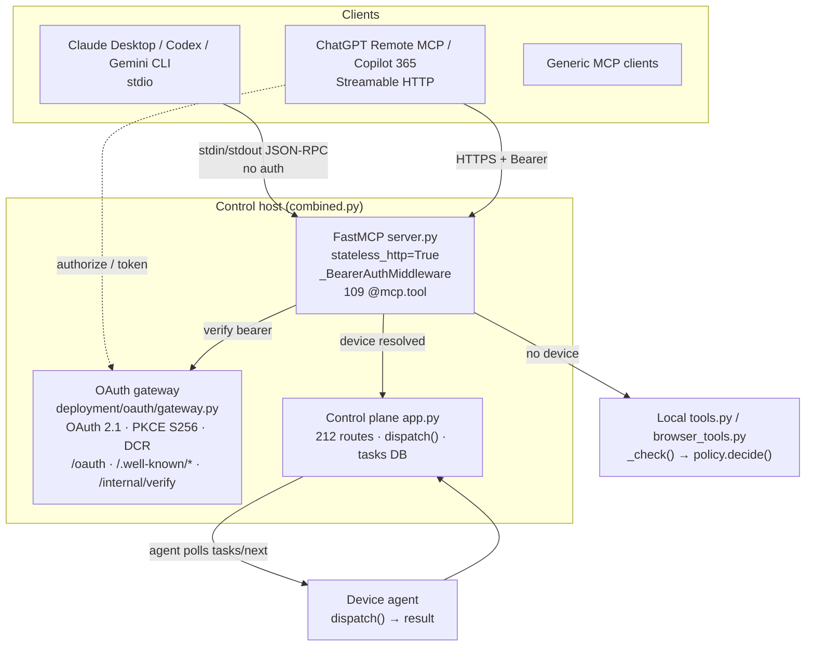

> **HISTORICAL analysis.** Current production assessment: [PRODUCTION_READINESS.md](./PRODUCTION_READINESS.md).

# 06 — MCP Protocol Audit

**Scope:** `src/ai_bridge/server.py` (1,701 LOC), `src/ai_bridge/tools.py` (2,990 LOC),
`src/ai_bridge/policy.py` (~266 LOC), `src/ai_bridge/control/mcp_routes.py` (654 LOC),
`src/ai_bridge/control/mcp_oauth.py` (370 LOC), `src/ai_bridge/control/mcp_client.py` (271 LOC),
`src/ai_bridge/client.py` (335 LOC), `src/ai_bridge/device_routing.py` (279 LOC),
`deployment/oauth/gateway.py` (992 LOC), `pyproject.toml`, `requirements.txt`,
`mcp-chatbot-clients.json`, `integrations/`, and MCP tests under `tests/`.
**Method:** READ-ONLY. Counts from `grep -c` / `wc -l` (2026-11-17); behaviour from reading the files.
No server was run; no live client handshake was performed. **VERIFIED** = read in the cited file.
**INFERRED** = reasonable reading, SDK behaviour not inspected. **NOT FOUND** = searched, absent.

## 0. Verdict in one paragraph

AI Bridge exposes **109 MCP tools** over **stdio + Streamable HTTP only** (no SSE server transport),
using the `mcp` Python SDK (`mcp>=1.6.0,<2.0.0`) via FastMCP with `stateless_http=True`. Tool schemas are
derived from Python type hints + docstrings — there is **no pydantic validation layer** in the MCP
path. Authentication exists only at the HTTP transport (bearer middleware); **stdio has no auth**.
Policy enforcement is real but split across two layers (`server.py` wrappers vs `tools.py`
implementations) and is inconsistent: 5 exposed tools are not in the policy table at all, 40 tiered
tools are not exposed, and ~40 wrappers contain no direct policy call. **No MCP tool invocation is
audit-logged.** The outbound OAuth 2.1/PKCE implementation (S256, DCR, refresh rotation) is the
strongest part of the protocol surface; the inbound gateway makes PKCE optional when no challenge is
sent. Protocol version is pinned by tests to `2024-11-05`; no 2025-* version, resources, prompts,
sampling, roots, elicitation, progress, or cancellation exists in own code.

## 1. Transports + SDK

**Transports that exist: stdio + Streamable HTTP only. SSE server transport: NOT FOUND.** VERIFIED.

- `server.py:1` docstring: "MCP server: stdio (local clients) and Streamable HTTP (remote clients)."
- `server.py:29-31` — the only MCP imports in the whole server:
  `from mcp.server.fastmcp import FastMCP`, `from mcp.server.transport_security import
  TransportSecuritySettings`, `from mcp.types import ImageContent, TextContent`.
  `grep -rn "from mcp|import mcp|FastMCP" src/` returns only these plus comments in
  `control/combined.py:32,151` and `control/mcp_client.py:4`. No `SseServerTransport`, `sse_app`,
  `StreamableHTTPServerTransport`, or low-level `mcp.server.Server` anywhere.
- `server.py:84-89`: `mcp = FastMCP("ai-bridge", stateless_http=True, json_response=True,
  transport_security=_mcp_transport_security)`.
- `server.py:75-82`: `TransportSecuritySettings(enable_dns_rebinding_protection=True,
  allowed_hosts=AI_BRIDGE_MCP_ALLOWED_HOSTS, allowed_origins=AI_BRIDGE_MCP_ALLOWED_ORIGINS)`; if
  `AI_BRIDGE_MCP_DISABLE_DNS_PROTECTION=1`, protection is off.
- `server.py:1683-1684`: `create_http_app() -> _BearerAuthMiddleware(mcp.streamable_http_app())`.
- `server.py:1687-1700` `main()`: `--http` / `AI_BRIDGE_HTTP=1` → `uvicorn.run(app,
  host=AI_BRIDGE_MCP_HOST` (default `127.0.0.1`), `port=AI_BRIDGE_MCP_PORT` (default 8001)); else
  `mcp.run(transport="stdio")`.
- `server.py:1615-1682` `_BearerAuthMiddleware`: rewrites `/`, ``, `/mcp/` → `/mcp`; appends
  `application/json, text/event-stream` to `Accept` (comment: FastMCP strictly requires
  `application/json`; ChatGPT/curl send `*/*`); if `AI_BRIDGE_HTTP_ALLOW_ANON != 1`, requires Bearer =
  `AI_BRIDGE_ADMIN_TOKEN` (hmac) or a gateway-verified token via `resolve_binding(VERIFY_URL, tok)`
  (`VERIFY_URL` default `http://127.0.0.1:8002/internal/verify`, `server.py:92`), else HTTP 401
  `{"detail":"Missing or invalid bearer token"}` + `WWW-Authenticate: Bearer`.
- Mounting: `control/combined.py:109-110` routes `/mcp` and `/mcp/*` to `create_http_app()`; `:114-118`
  routes `/oauth`, `/.well-known/oauth-*`, `/.well-known/openid-configuration`, `/internal/verify` to
  the OAuth gateway; `:144-165` embeds all three in one Starlette app with a combined lifespan
  (comment: "FastMCP Streamable HTTP requires its lifespan (task group) to run").

**Version pins VERIFIED:** `pyproject.toml:12` and `requirements.txt:8`: `mcp>=1.6.0,<2.0.0`;
`fastapi>=0.110`, `uvicorn>=0.29`, `pydantic>=2.6`, `httpx>=0.27`. No lockfile pinning an exact `mcp`
version; the installed version was **NOT** verified (no pip/import run per task constraints).
`pyproject.toml:39-40`: entry points `ai-bridge = ai_bridge.server:main`,
`ai-bridge-control = ai_bridge.control.__main__:main`.

## 2. Initialization / handshake / session

- **No `initialize` handling in own code — NOT FOUND in `server.py`:** `grep -rn
  "initialize|protocolVersion|protocol_version" server.py mcp_client.py mcp_routes.py client.py`
  returns zero hits in `server.py`/`mcp_client.py` (only `browser_session_info` / device-session
  comments). Handshake, `protocolVersion` negotiation, `capabilities`, `notifications/initialized` are
  entirely inside the `mcp` SDK's `FastMCP`/`streamable_http_app()`.
- Tests pin the old version: `tests/integration/test_mcp_stdio.py:29-33` sends `initialize` with
  `"protocolVersion": "2024-11-05"`, then `notifications/initialized`, asserts
  `result.serverInfo.name == "ai-bridge"`; `tests/integration/test_mcp_http_roundtrip.py:41-43` same
  version over HTTP, and accepts 200/202/406/401/403/405 as "route exists" (weak assertion — 406 counts
  as pass).
- **No `2025-*` protocol version anywhere — NOT FOUND:** `grep -rn "2025-03-26|2025-06-18|2025-11-25"
  docs/ src/ tests/` = 0 hits.
- **Session management is home-grown, token-keyed, stateless — VERIFIED:**
  - `server.py:84-89`: `stateless_http=True` — the SDK keeps no `Mcp-Session-Id`; own code never
    reads/writes `Mcp-Session-Id` (0 hits across `src/`).
  - `server.py:95-114`: `_bearer_token()` extracts Bearer from
    `mcp.get_context().request_context.request.headers`; `_session_key()` = `sha256(token)[:16]`, or
    `"default"` when no token (i.e. **all anonymous stdio callers share one session key**).
  - `server.py:49-53`: `_SELECTED_DEVICE: dict[str, str|None]` and `_APPROVALS: dict[str, dict]` —
    plain dicts, **no lock, no TTL/expiry**; `select_device()` (`:924-959`) caps at 1024 entries with
    FIFO eviction (`pop(next(iter(...)))`). `device_routing.py:30,36` does have `_CLIENT_LOCK` /
    `_VERIFY_CACHE_LOCK` for the verify cache only.
  - `server.py:116-143`: `_oauth_bound_device()` validates the bearer on **every call** via
    `resolve_binding(VERIFY_URL, tok)` (`device_routing.py:92`, raises `BindingError`, cached 15 s);
    admin token → unbound. `_session_device()` prefers the OAuth binding, else `_SELECTED_DEVICE`.
  - `device_routing.py:92`: docstring says callers must fail closed on binding failure — but
    `server.py:_oauth_bound_device()` swallows all exceptions → `None` → unbound/local (see report 04,
    F-04-02).

## 3. Tool registration — all 109 tools (VERIFIED)

`grep -c "@mcp.tool"`: `server.py` = **109**, `tools.py` = **0**. `grep -rn "@mcp\." src/` confirms no
`@mcp.resource` / `@mcp.prompt` anywhere. All 109 are sync `def`s (`@mcp.tool()` + docstring →
FastMCP derives the JSON Schema from type hints + docstring). `tools.py` is the implementation library
only; `server.py` wraps it. `TOOL_TIERS` in `policy.py` has **144** entries; **40 tiered names have no
MCP tool** (VERIFIED by script — see §3.3); **5 MCP tools are NOT in `TOOL_TIERS`** (deny-by-default
gap in `policy.decide()`): `system_info` (canonical name is `get_system_info`; wrapper renamed),
`view_live_screen`, `interact_and_view_screen`, `select_device`, `browser_navigate_with_shot`
(consumes approval for `browser_navigate`).

### 3.1 System / workspace / git / tasks (`server.py:347-587`)
| # | Tool | Signature (key params) | Tier* |
|---|---|---|---|
| 1 | `system_info` | `device=None` | — NOT TIERED |
| 2 | `get_resource_usage` | `device=None` | 1 |
| 3 | `get_disk_usage` | `device=None` | 1 |
| 4 | `get_memory_usage` | `device=None` | 1 |
| 5 | `list_workspace` | `relative_directory=".", device=None` | 1 |
| 6 | `read_workspace_file` | `relative_path, device=None` | 1 |
| 7 | `search_workspace` | `query, relative_directory=".", device=None` | 1 |
| 8 | `create_workspace_file` | `relative_path, content, overwrite=False, device=None` | 2 |
| 9 | `edit_workspace_file` | `relative_path, old_text, new_text, device=None` | 3 |
| 10 | `move_workspace_file` | `source, destination, device=None` | 3 |
| 11 | `delete_workspace_file` | `relative_path, device=None` | 4 |
| 12 | `get_service_status` | `service, device=None` | 1 |
| 13 | `get_recent_logs` | `source="system", lines=50, device=None` | 1 |
| 14 | `list_processes` | `limit=50, device=None` | 1 |
| 15 | `list_docker_containers` | `device=None` | 1 |
| 16 | `git_status` | `relative_directory=".", device=None` | 1 |
| 17 | `git_diff` | `relative_directory=".", device=None` | 1 |
| 18 | `dev_workspace_plan` | `relative_directory=".", max_depth=3, device=None` | 1 |
| 19 | `browser_session_info` | `device=None` | 1 |
| 20 | `run_project_tests` | `test_command="pytest", timeout=120, device=None` | 2 |
| 21 | `run_linter` | `timeout=60, device=None` | 2 |
| 22 | `create_backup` | `relative_directory=".", device=None` | 3 |
| 23 | `deploy_application` | `project_directory=".", target_directory="deploy-staging", device=None` | 3 |
| 24 | `submit_task` | `task_name, timeout=30` (no `device` param) | 3 |
| 25 | `get_task_status` | `task_id, device=None` | 1 |
| 26 | `get_task_result` | `task_id, device=None` | 1 |
| 27 | `cancel_task` | `task_id, device=None` | 2 |
| 28 | `request_approval` | `tool_name, reason` | 2 |
| 29 | `approve_task` | `approval_id, admin_token` | 4 |

### 3.2 Desktop, legacy set (`server.py:588-879`)
| # | Tool | Notes | Tier* |
|---|---|---|---|
| 30 | `get_desktop_status` | | 3 |
| 31 | `capture_desktop_screenshot` | | 3 |
| 32 | `capture_desktop_frame` | `scale=0.75, quality=70` | 3 |
| 33 | `view_live_screen` | `scale=0.75, quality=75, annotate=False, max_marks=40`; returns native MCP `ImageContent`; **no `@device_aware`** | — NOT TIERED |
| 34 | `interact_and_view_screen` | action ∈ click/double_click/right_click/move/scroll/type/press/hotkey/click_text/click_element/focus_window/launch_app/none; **no `@device_aware`** | — NOT TIERED |
| 35 | `take_screenshot` | | 3 |
| 36 | `mouse_click` | `x, y, button="left", clicks=1` | 3 |
| 37 | `mouse_move` | `x, y` | 3 |
| 38 | `mouse_scroll` | `delta=-120, x=None, y=None` | 3 |
| 39 | `mouse_drag` | `start_x, start_y, end_x, end_y` | 3 |
| 40 | `keyboard_type` | `text` | 3 |
| 41 | `keyboard_press` | `key` | 3 |
| 42 | `list_desktop_windows` | | 1 |
| 43 | `focus_window` | `title` | 3 |
| 44 | `get_screen_size` | | 1 |
| 45 | `launch_approved_application` | `app_name, url=None`; admin-approved list only | 3 |
| 46 | `perform_approved_ui_action` | `action, x, y, text, key, title, delta` | 3 |

### 3.3 Fleet / host (`server.py:879-1033`)
| # | Tool | Notes | Tier* |
|---|---|---|---|
| 47 | `list_devices` | all enrolled devices + local host | 1 |
| 48 | `select_device` | switch default target device for this session; **no `@device_aware`**, no policy check | — NOT TIERED |
| 49 | `get_device_status` | `device_id="local"` | 1 |
| 50 | `run_diagnostic_task` | `task_name`; predefined read-only diagnostic | 1 |
| 51 | `run_shell` | `command, working_directory="", timeout=0`; argv list, no shell interpretation; host-tools gate | 3 |
| 52 | `read_file` | `path, max_chars=100000`; any UTF-8 file (host-tools opt-in) | 3 |
| 53 | `write_file` | `path, content, overwrite=False`; any absolute path (host-tools opt-in) | 3 |
| 54 | `install_package` | `package_id, version=None`; apt/dnf/pacman/apk/winget | 3 |

### 3.4 Desktop vision / OCR (`server.py:1034-1136`)
| # | Tool | Tier* |
|---|---|---|
| 55 | `ocr_screen` | 3 |
| 56 | `click_text` (`text, occurrence=1, button, clicks=1`) | 3 |
| 57 | `click_element` (`mark_id=None, name=None, button, clicks=1`) | 3 |
| 58 | `list_ui_elements` | 1 |
| 59 | `set_of_marks_screenshot` (`max_marks=40`) | 3 |
| 60 | `wait_for_text` (`text, timeout_seconds=15.0, poll_interval=1.0, occurrence=1`) | 3 |
| 61 | `verify_screen_contains` (`text, occurrence=1`) | 3 |
| 62 | `press_hotkey` (`combo`) | 3 |
| 63 | `get_clipboard` | 3 |
| 64 | `set_clipboard` (`text, paste=False`) | 3 |
| 65 | `execute_workflow` (`steps: list[dict], stop_on_failure=True, max_retries=1`) | 3 |
| 66 | `broadcast_fleet_command` (`tool, args={}, target_os=None, target_device_ids=None`); **no `@device_aware`, no `device` param** | 3 |

### 3.5 Canonical v1.0 computer-use set (`server.py:1177-1346`)
| # | Tool | Tier* |
|---|---|---|
| 67 | `desktop_get_screenshot` | 3 |
| 68 | `desktop_get_window_screenshot` (`hwnd=None, title="", scale=1.0`) | 3 |
| 69 | `desktop_get_monitors` | 1 |
| 70 | `desktop_clipboard_get` | 3 |
| 71 | `desktop_clipboard_set` (`text, paste=False`) | 3 |
| 72 | `desktop_get_status` | 3 |
| 73 | `desktop_mouse_move` (`x, y`) | 3 |
| 74 | `desktop_click` (`x, y, button="left", clicks=1`) | 3 |
| 75 | `desktop_keyboard` (`text="", key="", action="type"`) | 3 |
| 76 | `desktop_scroll` (`delta=-120, x=None, y=None`) | 3 |
| 77 | `desktop_execute_command` (`command, working_directory="", timeout=60`); host-tools gate | 3 |
| 78 | `desktop_open_application` (`app_name, url=None`) | 3 |
| 79 | `desktop_get_windows` | 1 |
| 80 | `desktop_wait` (`condition="sleep", text="", window_title="", seconds=1.0, timeout_seconds=10.0`) | 3 |
| 81 | `desktop_verify_action` (`expected_text="", expected_window=""`) | 3 |

### 3.6 Browser / Playwright (`server.py:1346-1560`) — none has `@device_aware` or a `device` param; all local-only
| # | Tool | Tier* |
|---|---|---|
| 82 | `browser_navigate` (`url, wait_until="networkidle", timeout=30`) | 3 |
| 83 | `browser_screenshot` (`full_page=False`) | 3 |
| 84 | `browser_click` (`selector, button="left", clicks=1`) | 3 |
| 85 | `browser_type` (`selector, text, clear_first=True, submit=False`) | 3 |
| 86 | `browser_get_text` (`selector="body"`) | 1 |
| 87 | `browser_evaluate` (`script`) — executes JS in the page | 3 |
| 88 | `browser_get_url` | 1 |
| 89 | `browser_go_back` | 3 |
| 90 | `browser_go_forward` | 3 |
| 91 | `browser_scroll` (`delta_y=0, delta_x=0`) | 3 |
| 92 | `browser_close` | 2 |
| 93 | `browser_new_page` (`url=None`) | 3 |
| 94 | `browser_get_elements` (`selector, include_text=True`) | 1 |
| 95 | `browser_wait_for_selector` (`selector, timeout=10, state="visible"`) | 3 |
| 96 | `browser_select_option` (`selector, value=None, label=None`) | 3 |
| 97 | `browser_download_file` (`url, filename=None`) | 3 |
| 98 | `browser_set_viewport` (`device="desktop", width=None, height=None, is_mobile=None`) — note `device` here is a viewport preset, not a fleet device | 3 |
| 99 | `browser_expect` (`text, url_contains, title_contains, selector, screenshot_on_fail=False`) | 3 |
| 100 | `browser_wait_for_url` (`url_contains, timeout=15`) | 3 |
| 101 | `browser_diagnostics` | 1 |
| 102 | `browser_compare_screenshot` (`baseline, threshold=0.08, full_page=False, update_baseline=False`) | 3 |
| 103 | `browser_navigate_with_shot` (`url, wait_until="networkidle", timeout=30`) — consumes approval for `browser_navigate`, not its own name | — NOT TIERED |

### 3.7 External search (`server.py:1563-1614`) — no `@device_aware`, no approval, no policy check in the wrapper
| # | Tool | Tier* |
|---|---|---|
| 104 | `firecrawl_scrape` (`url`) | 1 |
| 105 | `firecrawl_search` (`query, limit=5`) | 1 |
| 106 | `firecrawl_map_site` (`url, search=None`) | 1 |
| 107 | `firecrawl_crawl` (`url, limit=10`) | 1 |
| 108 | `you_web_search` (`query, count=5`) | 1 |
| 109 | `you_fetch_contents` (`urls: list[str] \| str`) | 1 |

\* Tier = `policy.TOOL_TIERS` entry for the canonical tool name (VERIFIED by script: 58 READ_ONLY,
9 LOW_RISK, 74 SENSITIVE, 3 HIGH_RISK across 144 entries). Tier 1 = READ_ONLY, 2 = LOW_RISK,
3 = SENSITIVE, 4 = HIGH_RISK.

### 3.8 Tiered but NOT exposed (40 names, VERIFIED by script)
`agent_delegate, agent_notify, agent_remember, agent_run_role, agent_run_workflow, browser_snapshot,
browserbase_connect, browserbase_create_session, browserbase_end_session, browserbase_navigate,
browserbase_screenshot, desktop_anticipate_action, desktop_get_ui_elements, desktop_veto_action,
get_native_encode_status, get_network_info, get_system_info, git_apply_patch, git_checkpoint,
git_commit, git_create_branch, git_log, m365_create_event, m365_get_mail, m365_get_profile,
m365_list_events, m365_list_files, m365_list_mail, m365_search_files, m365_search_mail,
m365_send_mail, run_project_tests_structured, start_webrtc_stream, stop_webrtc_stream,
supervisor_delegate_role, supervisor_enqueue_handoff, supervisor_recover_role_tasks, terminal_exec,
update_fleet_agent, workspace_project_structure`.
These are reachable only via control-plane dispatch (INFERRED: `control/dispatch.py` / agent paths),
not directly via this MCP server — a real surface asymmetry: the policy table promises tools the MCP
server does not offer, and the MCP server offers 5 tools the policy table does not know.

## 4. Per-tool checks — VERIFIED by grep + code read

**Schema validation:** No `pydantic`/`BaseModel` in `server.py` or `tools.py` (`grep` = 0 hits). The input
schema is FastMCP-generated from Python annotations + docstrings; runtime coercion is the SDK's
(**INFERRED** — SDK not inspected). Manual validation lives in callees only:
`workspace.confined_path()` / `security.confined_path()` (path confinement),
`diagnostics.service_status(allowed_services=…)` allowlist, `tools._split_argv()` (argv, no shell),
`tools.run_project_tests` allowlisted commands (`policy.Policy.allowed_test_commands` default
`{"pytest","pytest -q","npm test","go test"}`), `browser_tools` URL/selector checks.
`mcp_routes.py` *does* use `BaseModel` (`MCPServerIn`, `MCPServerPatch`, `MCPDiscoverIn`,
`MCPExecuteIn`, `:31-67`) — but only for the control-plane REST API managing *outbound* MCP servers,
not for inbound MCP tool calls.

**Auth:** HTTP transport gate only (`_BearerAuthMiddleware`, §1); **stdio has no authentication**
(local-process trust — **INFERRED** design). Per-tool bearer/admin checks exist in only 4 wrappers:
`run_shell` (`:991`), `read_file` (`:1004`), `write_file` (`:1017`), `desktop_execute_command`
(`:1272`) — each computes `is_admin = hmac.compare_digest(bearer, AI_BRIDGE_ADMIN_TOKEN)` and calls
`_require_host_tools_enabled(is_admin)` (`:65-70`: raises unless admin or
`AI_BRIDGE_DISABLE_HOST_TOOLS != 1`, default `1` = disabled). `approve_task` (`:575-586`) takes
`admin_token` as a *tool argument* and hmac-compares it. No per-tool RBAC/roles in `server.py` (roles
exist only in the control plane `require_role`).

**Policy / risk-tier:** `policy.py` `TOOL_TIERS` (Tiers 1–4) + `decide()` (`:221-266`): Tier 4 needs
`approval_granted and is_admin`; Tier 3 needs `allow_tier3` (`AI_BRIDGE_ALLOW_TIER3`, default False,
`config.py:54`) or `max_tier_unattended>=3` or admin or approval; desktop Tier-3 tools also need
`desktop_enabled` (`AI_BRIDGE_DESKTOP_ENABLED`, default False); `Policy.unrestricted=True` bypasses
all guards. Enforcement point is `tools._check()` (`tools.py:84-89` → `decide()` → raises
`PermissionError`).
Server-layer explicit enforcement is sparse (VERIFIED counts: **3 `_check(` occurrences, 2 `decide(`
occurrences in `server.py`**; 63 `_consume_local_approval` occurrences): only `edit/move_workspace_file`
call `decide()` directly (`server.py:411,424`); `create_workspace_file`/`submit_task` call
`tools._check()` (`:≈400,533`); `delete_workspace_file` (`:435`) only checks `_consume_local_approval`.
**Most enforcement is downstream** in `tools.*` / `browser_tools.*`, each calling
`_check("<name>", approval_granted=…)` — verified for all desktop/mouse/keyboard/clipboard/OCR/
workflow/browser functions (`browser_tools.py` — every `browser_*` impl calls `_check`).
**Gaps / missing (VERIFIED):**
- No `_check` in *either* layer for: `list_workspace`, `read_workspace_file`, `search_workspace`
  (`workspace.py:20,39,129` — confinement only), `get_disk_usage`, `get_memory_usage`,
  `get_recent_logs`, `list_processes`, `list_docker_containers`, `git_status`, `git_diff`,
  `dev_workspace_plan`, `browser_session_info`, `get_desktop_status` (`tools.py:255-261`, no `_check`),
  `list_devices`, `select_device`, `get_device_status`, `get_task_status/result/cancel` (only
  `RUNNER.get/cancel`, `execution.py:55,207,220`), `request_approval`, `run_diagnostic_task`
  (delegates to `tasks.run_diagnostic`), `firecrawl_*` / `you_*` (no policy call in the wrapper;
  connector internals not fully audited — treat as **NOT VERIFIED downstream**).
- `write_file` (`server.py:1019`) never passes `approval_granted` — it calls
  `tools.write_file(path, content, overwrite, is_admin=is_admin)` with the default
  `approval_granted=False`, so an approval obtained via `request_approval`/`approve_task` can never
  unlock it (Tier-3 gate then depends only on `allow_tier3`/admin). Same pattern:
  `capture_desktop_screenshot` (`:595`) and `take_screenshot` (`:746`) pass no approval, while
  `capture_desktop_frame` (`:629`) consumes approval for `capture_desktop_screenshot`.
- `view_live_screen` / `interact_and_view_screen` / `broadcast_fleet_command` / all 22 `browser_*` /
  all 6 search tools have **no `@device_aware`** (see §3); browser/search tools also have no `device`
  param at all — they always run locally.
- `device_aware` (`server.py:267-345`): `bound="route"` (default) → `run_device_tool(CONTROL_URL, admin,
  device, dispatch_name, call_args)`; `bound="control"` → special-cases task/device lookups;
  `bound="unavailable"` (`submit_task`, `request_approval`, `approve_task`, `run_diagnostic_task`) →
  raises `ValueError` if a remote device is active. Auto-routing: desktop tools in
  `DESKTOP_ROUTING_TOOLS` (`:≈190-230`, 41 names) auto-route to the first online Windows device when
  on a non-Windows host with no device selected.

**Error handling:** `server.py` has only 11 `try:` / 11 `except` total. Most wrappers have **zero**
try/except — exceptions propagate to FastMCP. Notable: `interact_and_view_screen` (`:≈695-730`)
catches action errors into `{ok:False, action, error}`; `list_devices` (`:≈905`) swallows fleet errors
(`except Exception: pass`). `tools.py` returns `{ok:False, error:…}` dicts in many impls (26 `ok.*False`
matches) and raises `PermissionError`/`ValueError` from `_check`/validation. No structured per-tool
error taxonomy in own code.

**Audit logging: NONE for MCP tool calls — VERIFIED.** `grep -rn "audit(" server.py tools.py
browser_tools.py` = 0 (only a docstring mention at `tools.py:2940` about session-recording Merkle
audit); `audit_event` count in `server.py` and `tools.py` = 0 (VERIFIED by script). Audit exists only
in the control plane: `mcp_routes.py:335,423,517,556,605,624,653` (`create_mcp_server`,
`start_mcp_oauth`, `mcp_oauth_authorized`, `sync/update/delete_mcp_server`, `execute_mcp_<tool>`) and
`app.py:5100-5111` (tool-policy updates). MCP tool invocations themselves are not audit-logged.

### Per-family check matrix

| Family (tools) | Schema | Validation | Auth | Policy | Device ctx | Errors | Audit |
|---|---|---|---|---|---|---|---|
| Workspace read (5–7, 16–17) | SDK-derived | confinement only | transport only | **none** | `@device_aware` | propagate | **none** |
| Workspace write (8–11) | SDK-derived | confinement + backup | transport only | partial: `create` `_check`; `edit/move` `decide()`; `delete` approval-only | `@device_aware` | propagate | **none** |
| System/diagnostics (2–4, 12–15, 50) | SDK-derived | allowlist (services) / clamps | transport only | **none** in either layer | `@device_aware` | propagate / `"unavailable"` strings | **none** |
| Tasks/approvals (24–29) | SDK-derived | id/name only | transport only; `approve_task` takes admin token as arg | `submit_task` `_check`; `delete` approval-only; `approve_task` hmac | `bound="unavailable"` / `"control"` | propagate | **none** |
| Desktop legacy (30–46) | SDK-derived | Win32/UIA in impl | transport only | downstream `_check` in `tools.*` | `@device_aware` except 33–34 | mixed dict/propagate | **none** |
| Fleet/host (47–54) | SDK-derived | host-tools gate on 51–54 | transport + admin check on 51–54 | downstream / host gate | `@device_aware` except 48 | propagate | **none** |
| Vision/OCR (55–66) | SDK-derived | OCR/UIA in impl | transport only | downstream `_check` in `tools.*` | `@device_aware` except 66 | mixed | **none** |
| Desktop v1 (67–81) | SDK-derived | impl-level | transport + admin check on 77 | downstream `_check` | `@device_aware` | mixed | **none** |
| Browser (82–103) | SDK-derived | impl-level (`browser_tools`) | transport only | downstream `_check` in `browser_tools.*` | **none — always local** | mixed | **none** |
| Search (104–109) | SDK-derived | connector-level (NOT VERIFIED) | transport only | **none** in wrapper | **none — always local** | propagate | **none** |

## 5. OAuth 2.1 / PKCE — two sides, VERIFIED

### 5.1 Outbound client: `control/mcp_oauth.py` (370 LOC)
- `generate_pkce_pair()` (`:62-68`): verifier `secrets.token_urlsafe(48)`; challenge
  `base64url(SHA256(verifier))` stripped of `=`; **S256 only** (no `plain`).
- `discover_oauth_metadata()` (`:71-…`): RFC 9728 protected-resource metadata
  (`/.well-known/oauth-protected-resource[/path]`) → `authorization_servers[0]`, then RFC 8414 / OIDC
  (`/.well-known/oauth-authorization-server`, `/.well-known/openid-configuration`); returns
  `authorization_endpoint`, `token_endpoint`, `registration_endpoint`, `scopes_supported`.
- `register_oauth_client()` (`:≈120-145`): RFC 7591 DCR, `grant_types=[authorization_code,
  refresh_token]`, `response_types=[code]`, `token_endpoint_auth_method=none` (public client).
- Flows (`:≈150-230`): `fetch_client_credentials_token()` (client_credentials, Basic auth if a secret
  is present, else form body); `exchange_authorization_code()` (code + `redirect_uri` +
  `code_verifier`); `refresh_oauth_token()` (refresh_token grant). `_parse_token_response()` (`:148-161`):
  `expires_at = now + max(60, expires_in)`, default 3600 s if absent.
- `ensure_valid_mcp_token()` (`:235-290`): refreshes when missing or `now >= expires_at - 60`; persists
  `auth_token`/`oauth_refresh_token`/`oauth_token_expires_at` to the `mcp_servers` table.
  Refresh-token rotation is server-driven (a new refresh token is stored if returned).
- `mcp_routes.py:350-430` `start_mcp_oauth`: DCR if no `client_id`; `state = secrets.token_urlsafe(24)`;
  verifier/challenge stored in `mcp_oauth_states` (pruned `>900s` = 15 min); authorize URL carries
  `response_type=code&code_challenge_method=S256`. Callback (`:431-520`): single-use state (deleted on
  read), exchanges the code, stores tokens, re-discovers tools.
- `enforce_mcp_tool_policy()` (`mcp_oauth.py:328-370`): per-tool guardrail `allow | require_approval |
  deny` from `settings.mcp_tool_policies`; `require_approval` creates an `approvals` row expiring in
  3600 s. **NOT called by `mcp_routes.py`'s own execute endpoint** (`:638-653` — no policy check
  there); it *is* called by `control/ai_api.py:1779` and `control/custom_agents.py:770` for LLM-driven
  outbound calls.
- **Device binding in `mcp_oauth.py`: NOT FOUND** — no `device_id` field/logic in this file. Binding
  lives in the gateway (below).

### 5.2 Inbound provider: `deployment/oauth/gateway.py` (992 LOC)
- Docstring: "Minimal OAuth 2.1 authorization server… PKCE (S256), refresh-token rotation, revocation,
  internal verification". `CODE_TTL=600`, `ACCESS_TTL=3600`, `REFRESH_TTL=30*24*3600` (`:30-32`).
  Only SHA-256 hashes of codes/tokens are stored.
- Discovery (`:125-153`): `/.well-known/oauth-protected-resource[/mcp]`,
  `/.well-known/oauth-authorization-server`, `/.well-known/openid-configuration`;
  `registration_endpoint=/oauth/register`, `grant_types_supported=[authorization_code, refresh_token]`,
  `code_challenge_methods_supported=[S256]`, `scopes_supported=[openid, offline_access, mcp]`.
- `POST /oauth/register` (`:160-191`): DCR, `client_id=secrets.token_hex(16)`, any `https` redirect URI
  accepted (per `copilot365/README.md:50`).
- `authorize` GET/POST (`:746-858`): validates `client_id` + registered redirect URI; **rejects
  `code_challenge_method` not in `("S256",)`** (`:769`); the approval page requires an admin token +
  optional device binding, stored via `UPDATE clients SET device_id=?` and into `codes.device_id`.
- `pkce_ok()` (`:886-895`): if no challenge → `True` (**PKCE optional when no challenge was sent —
  gap vs strict OAuth 2.1**); else S256 recompute + `hmac.compare_digest`.
- `POST /oauth/token` (`:897-954`): `authorization_code` (single-use code, 600 s TTL, client+redirect
  match, PKCE check) and `refresh_token` (old refresh token **revoked** before issuing a new pair —
  rotation, `issue_pair()` `:860-884`); `unsupported_grant_type` otherwise. No `client_credentials`
  grant on this provider.
- `POST /oauth/revoke` (`:956`), `GET /internal/verify` (`:969-990`): admin token → `{ok, device_id:
  None}`; access token → `{ok, device_id, client_id}` (token's `device_id` else client's). This is what
  `server.py:_oauth_bound_device()` calls.
- No DPoP, mTLS, PAR, or sender-constraining beyond the device binding — **NOT FOUND**.

## 6. Error responses

- **No JSON-RPC error codes in own code — NOT FOUND:** `grep -rn "3260|-326|-327" src/ai_bridge/` = 0
  hits. Codes (`-32600` etc.) and `isError` framing are the SDK's (**INFERRED**).
- Own code raises plain exceptions: 17 `raise PermissionError|ValueError|RuntimeError` sites in
  `server.py` (`:69,148,164,181,308,337,414,427,436,545,555,581,584,701,707,728,972`); `tools.py`/
  `browser_tools.py` return `{ok: False, error: …}` dicts.
- `isError`: **never set** in `server.py` (0 hits); only *read* in `control/mcp_client.py:211`
  (`is_err = bool(result.get("isError", False))` → `{ok: not is_err, …}`).
- Only native MCP content types used: `view_live_screen` / `interact_and_view_screen` return
  `list[ImageContent, TextContent]` via `_to_vision_content()` (`server.py:603-620`); every other tool
  returns `dict`/`str`/`list[dict]`, which FastMCP serialises as text.

## 7. Outbound MCP client (`control/mcp_client.py`, 271 LOC) — VERIFIED gaps

Docstring claims "HTTP JSON-RPC 2.0 and Streamable HTTP (FastMCP / MCP Spec 2024-11-05+)". The
implementation is raw `urllib` POST, not the MCP SDK: `fetch_mcp_tools()` (`:67`) and
`execute_mcp_tool()` (`:158`) POST `{"jsonrpc":"2.0","method":"tools/list"|"tools/call"}` with
`Accept: application/json, text/event-stream, */*`, trying the URL as given then `<url>/mcp` on
non-`/mcp` URLs. `_parse_mcp_response()` (`:44-60`) parses SSE `data:` lines as a fallback.
`MCPServerIn.transport` (`mcp_routes.py:34`, default `"http"`) is stored in the DB but **never branched
on** — no stdio/SSE execution path for outbound servers. The outbound client **skips `initialize`
entirely** (sends `tools/list` first) — non-conformant clients may be rejected by strict servers; no
`Mcp-Session-Id` handling, no pagination (no cursor on `tools/list`, `"params": {}`).

## 8. Concurrency / notifications / sampling / roots / prompts / resources

- **Concurrency:** all 109 tool `def`s are synchronous; FastMCP runs them off the event loop
  (**INFERRED** standard FastMCP behaviour). HTTP mode is `uvicorn` + `stateless_http=True` (no
  per-connection session state, no resumability). Shared mutable state without locks: `_APPROVALS`,
  `_SELECTED_DEVICE` (`server.py:49-53`); with locks: verify cache (`device_routing.py:30,36`), SoM
  marks (`tools.py:63`), transfers/recordings (`tools.py:2558,2887`). `LAST_FRAME_SCALE`
  (`tools.py:60`) is a bare global read by `interact_and_view_screen` for coordinate rescaling.
- **Resources / prompts / sampling / roots / elicitation / progress / cancellation: NOT FOUND.**
  `grep -rn "mcp.resource|mcp.prompt|sampling|list_roots|elicit|create_message" src/` returns only
  false positives (`Image.Resampling` in `screen_capture.py`/`tools.py`/`webrtc_stream.py`). No
  `notifications/*` handlers in own code; the outbound client never sends `notifications/initialized`
  or `notifications/cancelled`. Task cancellation exists only at the app layer (`RUNNER.cancel`,
  `cancel_task`, `execution.py:207`) and fleet dispatch, not as MCP protocol cancellation. No
  pagination/cursor handling in `mcp_client.py`.

## 9. Client compatibility

**`mcp-chatbot-clients.json`** (base `https://jxiptvplayer.app`, all `status: registered`, all
`scope=offline_access mcp`, `code_challenge_method=S256`): Claude Desktop (`client_id 709562cb…`,
`redirect_uri http://localhost:0/callback`), ChatGPT Remote MCP (`efb29e2e…`,
`https://chatgpt.com/mcp/callback`), Gemini CLI (`6bcab879…`, `localhost:0`), Codex CLI (`4b850501…`,
`localhost:0`), Grok Custom Integration (`6734662d…`, `localhost:8000/callback`), Cursor IDE
(`84373eac…`, `localhost:0`), Windsurf IDE (`a93df9dc…`, `localhost:0`). Note: `localhost:0` redirect
URIs are placeholders, not runnable ports (**INFERRED**); PKCE challenge/state values are present in
the file and are not reproduced here.

**`integrations/` (7 dirs):** `chatgpt/` (remote Streamable HTTP only; README: web ChatGPT cannot run
local stdio), `claude/` (`claude-config.json`: stdio `python -m ai_bridge.server`), `codex/` (stdio via
`~/.codex/config.toml`), `copilot365/` (remote Streamable HTTP via Copilot Studio, Dynamic discovery;
README states **not yet tested against a live Copilot Studio tenant**), `custom-ai/` (5 Python agents —
OpenAI/Anthropic/Ollama/LangChain — using the REST `AIBridgeClient`, **not MCP**), `gemini/` (stdio via
`~/.gemini/settings.json`), `generic-mcp/` (`mcp-config.json`: stdio `ai-bridge-local` + remote
`ai-bridge-remote` at `https://jxiptvplayer.app/mcp`). `.mcp.json` at the repo root is an **empty**
`{"mcpServers": {}}`. `docs/mcp-clients.md` confirms the same split; `client.py` (`AIBridgeClient`,
335 LOC) is a REST SDK to `/api/ai/*` and `/v1/chat/completions` — **no MCP protocol in it**.

**MCP tests found** (`find tests -iname "*mcp*"`): `tests/integration/test_mcp_http_roundtrip.py`
(70 LOC), `tests/integration/test_mcp_stdio.py` (45 LOC), `tests/unit/test_mcp_oauth2.py` (175 LOC),
`tests/unit/test_mcp_admin_fleet.py` (84 LOC), `tests/unit/test_serverai_mcp_orchestration.py`
(175 LOC), `tests/unit/test_chatgpt_mcp_discovery.py` (78 LOC). Test *results* were not run in this
audit and are **not claimed** here.

**Known gaps vs the current MCP spec (2025–2026) — INFERRED from the absences above:**
1. Protocol version frozen at `2024-11-05` in tests; no 2025-03-26 / 2025-06-18 / 2025-11-25
   negotiation in own code (SDK-dependent).
2. No resources, prompts, sampling, roots, elicitation, progress, or `list_changed` notifications.
3. Outbound `mcp_client.py` skips `initialize` entirely — non-conformant clients may be rejected by
   strict servers; no `Mcp-Session-Id` handling, no pagination.
4. `stateless_http=True` + `json_response=True`: no SSE streaming of results, no resumable sessions.
5. SSE server transport absent (aligned with its deprecation, but older SSE-only clients have no path;
   the "Custom HTTP / SSE MCP Server" template label in `mcp_routes.py:168` is misleading since the
   transport is never branched).
6. Gateway PKCE is optional when no challenge is supplied (`gateway.py:887-889`); DCR accepts any
   `https` redirect URI.
7. `mcp-chatbot-clients.json` covers 7 clients but `integrations/` has no Grok/Cursor/Windsurf guides,
   and Copilot 365 has a guide but no JSON entry; `.mcp.json` is empty.

## 10. Findings

| ID | Severity | File | Evidence |
|---|---|---|---|
| F-06-01 | P0 | `src/ai_bridge/server.py:1615-1682,79-82` | `AI_BRIDGE_HTTP_ALLOW_ANON=1` disables HTTP bearer auth; `AI_BRIDGE_MCP_DISABLE_DNS_PROTECTION=1` disables DNS-rebinding protection. Single-env-var off-switches on the MCP transport. |
| F-06-02 | P1 | `src/ai_bridge/server.py:95-114,49-53` | Stdio has no authentication (local-process trust); all anonymous stdio callers share session key `"default"`; `_APPROVALS`/`_SELECTED_DEVICE` are unlocked, TTL-less dicts. |
| F-06-03 | P1 | `src/ai_bridge/server.py:116-143` | `_oauth_bound_device()` swallows all verify exceptions → unbound/local execution (fail-open conversion of fail-closed `resolve_binding`). |
| F-06-04 | P0 | `src/ai_bridge/server.py` + `src/ai_bridge/policy.py` | 5 MCP tools not in `TOOL_TIERS` (`system_info`, `view_live_screen`, `interact_and_view_screen`, `select_device`, `browser_navigate_with_shot`) — deny-by-default gap; `decide()` would deny them if called, but they are never `_check`ed. 40 tiered tools not exposed. |
| F-06-05 | P1 | `src/ai_bridge/server.py` (109 wrappers) | Only 3 `_check(` / 2 `decide(` in the file; ~40 wrappers have no direct policy call; Tier-1 wrappers bypass `denied/allowed_tools` lists (see §4 matrix). |
| F-06-06 | P1 | `src/ai_bridge/server.py:1019,595,746` | `write_file`, `capture_desktop_screenshot`, `take_screenshot` never pass `approval_granted` — an approval obtained via `request_approval`/`approve_task` can never unlock them. |
| F-06-07 | P1 | `src/ai_bridge/server.py:924-959,1150-1176` | `select_device` (no auth/policy check) can re-target the session; `broadcast_fleet_command` has no `@device_aware` and no `device` param — fleet-wide fan-out from a single tool call. |
| F-06-08 | P1 | `src/ai_bridge/server.py:1346-1614` | All 22 `browser_*` + 6 search tools are local-only (no `@device_aware`, no `device` param); `browser_evaluate` runs arbitrary JS; search tools have no policy check in the wrapper. |
| F-06-09 | P0 | `src/ai_bridge/server.py`, `src/ai_bridge/tools.py` | **No audit logging for any MCP tool call** — `audit_event` count = 0 in both files; `grep -rn "audit("` = 0. Audit exists only in the control plane. |
| F-06-10 | P1 | `src/ai_bridge/server.py`, `src/ai_bridge/tools.py` | No pydantic/`BaseModel` validation in the MCP path; schemas are SDK-derived from type hints + docstrings; runtime coercion is SDK-dependent (INFERRED). |
| F-06-11 | P2 | `src/ai_bridge/server.py` | Only 11 `try:`/`except` in 1,701 lines; most wrappers propagate raw exceptions to FastMCP; no structured per-tool error taxonomy; `isError` never set (0 hits). |
| F-06-12 | P1 | `deployment/oauth/gateway.py:886-895,160-191` | PKCE optional when no challenge is supplied (`pkce_ok()` returns `True`); DCR accepts any `https` redirect URI. Gap vs strict OAuth 2.1. |
| F-06-13 | P2 | `deployment/oauth/gateway.py:969-990` | No DPoP, mTLS, PAR, or sender-constraining beyond device binding (NOT FOUND). |
| F-06-14 | P2 | `src/ai_bridge/control/mcp_oauth.py:328-370`, `src/ai_bridge/control/mcp_routes.py:627-653` | `enforce_mcp_tool_policy()` is NOT called by `mcp_routes.py`'s own execute endpoint — the outbound per-tool guardrail is bypassed on the control plane's own execution path. |
| F-06-15 | P2 | `src/ai_bridge/control/mcp_client.py:44-158` | Outbound client skips `initialize`, sends `tools/list` first; no `Mcp-Session-Id`, no pagination; `transport` field stored but never branched (no stdio/SSE execution path). |
| F-06-16 | P2 | `src/ai_bridge/server.py:84-89` | `stateless_http=True` + `json_response=True`: no SSE streaming of results, no resumable sessions. |
| F-06-17 | P3 | `tests/integration/test_mcp_stdio.py`, `test_mcp_http_roundtrip.py` | Protocol version frozen at `2024-11-05` in tests; no 2025-* negotiation; HTTP roundtrip test accepts 406 as "route exists" (weak assertion). |
| F-06-18 | P3 | `src/ai_bridge/server.py`, `src/ai_bridge/control/mcp_routes.py:168` | No resources, prompts, sampling, roots, elicitation, progress, or cancellation in own code (NOT FOUND); "Custom HTTP / SSE MCP Server" template label is misleading. |
| F-06-19 | P3 | `mcp-chatbot-clients.json`, `integrations/`, `.mcp.json` | 7 clients registered but no Grok/Cursor/Windsurf integration guides; Copilot 365 has a guide but no JSON entry and is untested against a live tenant (per its README); root `.mcp.json` is empty. |
| F-06-20 | P2 | `src/ai_bridge/server.py:575-586` | `approve_task` takes `admin_token` as a *tool argument* (the admin credential transits the MCP tool-call channel) instead of transport-level auth. |

**NOT FOUND / not verified in this audit:** the installed `mcp` SDK version (no pip/import run);
whether the SDK's default DNS-rebinding protection is on when `AI_BRIDGE_MCP_ALLOWED_HOSTS` is unset;
downstream policy enforcement inside `connectors/firecrawl.py` and `connectors/you_search.py`;
full read of the OAuth `state`/callback handling in `mcp_routes.py:345-520`; live handshake behaviour
against any real client (no server was run, no client connected).
