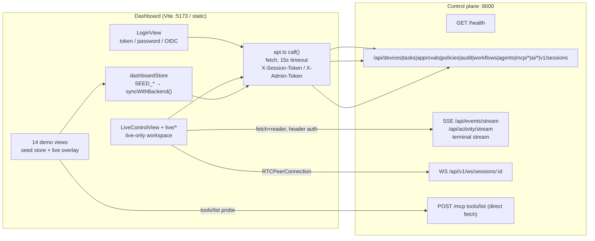

> **HISTORICAL analysis.** Current production assessment: [PRODUCTION_READINESS.md](./PRODUCTION_READINESS.md).

# 09 — Dashboard Architecture Audit

**Scope:** `apps/dashboard/` (React 18 + TypeScript + Vite + Tailwind v4), plus the
contract it consumes (`src/ai_bridge/control/app.py`, `src/ai_bridge/control/ai_api.py`).
**Method:** read-only source inspection. Every file path below was read or grepped.
No `npm install`, no build, no test run was performed in this track (see §8):
all test-count claims are therefore **counts of test definitions in source**, not
execution results. Status labels used throughout: **VERIFIED** (seen in a file
cited), **INFERRED** (reasonable reading of code, labelled as such), **NOT FOUND**
(looked for, absent).

## 1. Executive summary

The dashboard is a **dual-mode application**: one codebase renders (a) a **live
control-plane workspace** (`#/live`, `apps/dashboard/src/views/LiveControlView.tsx`
+ `views/live/*`) that talks only to real backend endpoints, and (b) a **demo
preview** (the other 14 routes) that renders seeded, browser-local data from
`apps/dashboard/src/state/dashboardStore.ts` and, when signed in, progressively
replaces that seed with live data via `syncWithBackend()`. The demo/live split
is explicit, labelled in the UI, and generally honest — but the demo is the
**default landing experience** (the login screen offers "Explore demo workspace",
and Playwright asserts a "Demo workspace" note on every non-login view), so any
reader who skips the banner will mistake seed data for a fleet.

Key verified facts:

- `apps/dashboard/src/api.ts` (470 lines) is the **only** HTTP layer: ~57 distinct
  paths, one `call()` wrapper, 15 s timeout, `X-Session-Token` preferred over
  `X-Admin-Token`, tokens in `sessionStorage` (admin token also read from
  `localStorage` as a legacy fallback).
- The store seeds **40 fake devices, fake approvals/tasks/workflows/audit/MCP/
  OAuth/log records** (`dashboardStore.ts:69–646`) and replaces them wholesale
  only after authentication; several live-mapped fields are honestly zeroed
  ("not reported") because the backend does not report them.
- Live mode is real for the core loop (devices, tasks, approvals, policies,
  audit export, terminal PTY, workflows, WebRTC desktop), but **four things are
  demo-only even in spirit**: the provider cards in `AiApiHubView` (hardcoded
  fake API keys and latencies), the Merkle "verification" in `AuditTrailView`
  (hardcoded root, tautological check), the vision canvas in
  `TaskQueueVisionView` (hardcoded fake Ubuntu desktop when no live frame
  exists), and desktop audio (mute toggle only, explicitly "not shipped").
- The "356 tests, 100% pass" claim in `TEST_READY.md` does **not** match the
  current test files: `run-all-tests.ts` imports only 8 of 14 unit-test files
  (omits `tier5-adversarial` and all 3 `challenger-*` suites), and raw
  `it(`-call counts differ from the claimed per-tier totals (see §8).
- No `node_modules/` or `dist/` exists in the checkout (`ls` → "No such file or
  directory"), so **no build or test was runnable here without installing** —
  the CI workflow (`.github/workflows/ci.yml`, `dashboard` job) is the only
  evidence the suite runs anywhere.

## 2. Architecture

### 2.1 Stack and entry point

| Item | Evidence |
|---|---|
| React 18.3.1, Vite 5, Tailwind v4, TypeScript 5.5 | `apps/dashboard/package.json` |
| Design system `@jacxishippingorg/jx-ui-react` ^3.0.0, `motion` ^14.9.0, `lucide-react` ^0.469.0 | `apps/dashboard/package.json` (only 3 runtime deps besides React) |
| No router library, no state library | hash routing in `src/state/navigation.ts` (`readRoute`/`writeRoute`, `#/view?device=…`); custom `useSyncExternalStore` store in `src/state/dashboardStore.ts` |
| Entry | `src/main.tsx`: `consumeIdentityRedirect()` → `applySavedDensity()` → `initializeLanguage()` → `initializeTheme()` → `JXThemeProvider defaultMode="dark"` |
| Build chunking | `vite.config.ts`: `vendor-react`, `vendor-jxui`, `vendor-motion` manual chunks; `chunkSizeWarningLimit: 800` |
| Dev server | `vite.config.ts`: port 5173; `VITE_API_URL` baked in via `define` (empty default) |

**VERIFIED:** the JXUI package is a **private scoped package**
(`@jacxishippingorg/jx-ui-react`). Whether it resolves from a registry was
**NOT VERIFIED** — `node_modules/` is absent and no registry config
(`.npmrc`) was found in the repo. If that package is unavailable, `npm ci`
fails and nothing builds. `src/ui.tsx` (391 lines) is a local adapter layer
over JXUI (`JXButton`, `JXCard`, `HoldToConfirmButton`, `ProductModePill`,
etc.) — i.e. the "zero custom UI" claim in `TEST_READY.md` §5.1 is about
using JXUI primitives, but a 391-line local adapter plus `Brand.tsx`,
`DensityControl.tsx`, `ThemeControl.tsx`, `LanguageControl.tsx` do exist.

### 2.2 Routing — 16 views, two worlds

`src/types/dashboard.ts` defines 16 `ViewId`s; `src/App.tsx` (202 lines)
switches on them. `src/shell/navigation.ts` groups them into Overview / Fleet /
Execute / Govern / Integrate. `App.tsx:80` appends `" · Demo"` to
`document.title` for every view except `live` and `login` — a small but real
honesty mechanism.

| Route | Component | World |
|---|---|---|
| `#/login` | `views/LoginView.tsx` (153 lines) | Live auth entry + demo escape hatch |
| `#/live` | `views/LiveControlView.tsx` (621 lines) + `views/live/*` (9 panels) | **Live only** |
| `#/overview`, `#/devices`, `#/device-360-system`, `#/task-queue-and-vision`, `#/live-desktop-studio`, `#/interactive-terminal`, `#/autonomous-workflows`, `#/fleet-operations`, `#/ai-api-and-agents`, `#/human-approvals`, `#/security-policies`, `#/audit-trail`, `#/mcp-and-oauth`, `#/diagnostics-and-logs` | `views/*.tsx` | **Demo seed by default; live overlay when signed in** |

`App.tsx:52` falls back to hostname `"srv-us-east-412"` (the seed primary
node) when no device is selected — another seed leak into the shell.

### 2.3 The API layer (`src/api.ts`, 470 lines) — VERIFIED

- **Base URL resolution** (`api.ts:1–8`): `VITE_API_URL`, else same-origin when
  not on `localhost:5173`, else `http://127.0.0.1:8000`. So a Render static
  dashboard must set `VITE_API_URL` (render.yaml does:
  `https://ai-bridge-control.onrender.com`); a same-origin prod build needs
  none. Dev default is loopback :8000.
- **Cold-start handling** (`api.ts:20–57`): `probeControlHealth()` waits up to
  60 s, with a 12 s "wake-kick" probe first for cross-origin deploys — an
  explicit free-tier Render workaround, with user-facing hints telling the
  operator to set `AI_BRIDGE_CORS_ORIGINS`.
- **Auth** (`api.ts:83–166`): `token()` reads `ai_bridge_admin_token` from
  `sessionStorage` **or `localStorage`**; `sessionToken()` reads
  `ai_bridge_session_token` from both. `authenticate()` stores the admin token
  in `sessionStorage` only, and the OIDC session token in `sessionStorage`
  only (`consumeIdentityRedirect()`, with a comment that a persisted token
  would outlive the session). **Inconsistency (finding D-07):** the
  `localStorage` read path means a token once persisted by an older build is
  still honoured, undermining the session-only promise.
- **Transport** (`call()`, `api.ts:169–198`): single `fetch` wrapper, JSON,
  15 s `AbortSignal.timeout`, `X-Session-Token` preferred, else
  `X-Admin-Token`. 401 clears credentials. Non-GET 5xx errors are flagged
  `uncertain=true` ("Outcome unknown… Refresh before submitting again") —
  good idempotency hygiene, paired with `Idempotency-Key: crypto.randomUUID()`
  on `submitTask()`.
- **Token-in-URL** (finding D-08): SSE/WebSocket URLs carry the credential as
  a query parameter via `authQuerySuffix()` (`api.ts:83`):
  `liveActivityStreamUrl`, `eventsStreamUrl`, `streamWorkflowUrl`,
  `terminalStreamUrl`, `sessionWebSocketUrl` all append
  `?session_token=…` / `?token=…`. This is forced by `EventSource`/WS not
  accepting headers (the code comments say so, and the live views instead use
  `fetch` + reader for SSE precisely to send headers — e.g.
  `LiveControlView.tsx:159–171`). Query-string tokens land in server access
  logs, proxy logs and browser history; the risk is bounded but real.
- **Endpoint inventory:** 57 distinct literal paths were extracted from
  `api.ts` by regex (see §2.5). Every one has a matching route prefix in
  `src/ai_bridge/control/*.py` (180 route literals found there) — **no orphan
  dashboard endpoint was found** by that crude prefix check. Notable: the
  dashboard calls newer endpoints (`/api/v1/sessions/*`, `/api/fleet/*`,
  `/api/supervisor/*`, `/api/triggers`, `/api/schedules`) that the demo store
  never touches.

### 2.4 The store (`src/state/dashboardStore.ts`, 1,285 lines) — VERIFIED

- **Seed first, live second.** Constructor initialises state from
  `SEED_DEVICES` (40 nodes generated by `Array.from({length: 40})`,
  `dashboardStore.ts:69`), `SEED_APPROVALS`, `SEED_TASKS`,
  `SEED_WORKFLOWS`, `SEED_AUDIT_EVENTS`, `SEED_MCP_CONNECTIONS`,
  `SEED_OAUTH_CLIENTS`, `SEED_LOGS` (lines 69–646). Operator profile is the
  fictional "Sarah Jenkins, Lead SecOps Engineer, sarah.j@security.internal".
  Telemetry is deterministic arithmetic (`createTelemetry`, lines 30–67),
  e.g. `cpuPercent = 18 + (index*7)%55`, fake SHA-256 fingerprints built from
  `index*9876543210` hex-padded.
- **Live sync** (`syncWithBackend`, lines ~755–1040): gated by
  `isLiveAuthenticated()` (token **or** session token present). One
  `Promise.all` of 9 calls — `me`, `health`, `devices`, `fleetTelemetry`,
  `tasks`, `approvals`, `audit`, `connections`, `workflows` — then wholesale
  replacement of the corresponding slices. Runs once 50 ms after mount and
  every 15 s (`setInterval`) when `autoPollEnabled`, plus an SSE event stream
  (`startEventStream`, `/api/events/stream`) whose every `data:` line triggers
  a **full re-sync** (not an incremental patch). Failure of any single call is
  swallowed (`.catch(() => null)`); a throw sets `gatewayStatus: "degraded"`.
- **Honest gaps in the live mapping** (lines ~830–880): fields the control
  plane does not report are zeroed with a code comment ("Only values the
  control plane actually reports are used; anything else stays 0 / 'not
  reported'"): `cpuClockGhz: 0`, `networkRxMbps/TxMbps: 0`, `swap*: 0`,
  `tpmStatus: "inactive"`, `certExpiryDays: 0`, `fingerprintSha256: "unknown"`.
  Consequence: in live mode the Device 360 gauges show 0 for clock/network/
  swap — accurate but degraded versus the demo's rich fake gauges.
- **Demo mutations fabricate audit history.** `dispatchTask`,
  `resolveApproval`, `triggerEmergencyStop`, `resumeFleet` (lines ~1082–1285)
  each have a live branch (`api.*` + re-sync, throwing on failure) and a
  demo branch that mutates local state **and prepends a fake audit event**
  whose "SHA-256" is `sha256:${Date.now().toString(16).padStart(64,"0")}` —
  a timestamp, not a hash. In demo mode the audit ledger is therefore
  self-authored fiction, which is fine only because the banner says so.
- **No persistence of demo state:** refreshing resets demo state
  (`apps/dashboard/README.md`, "Refreshing resets demo state") — VERIFIED by
  construction (seed is module-level, no localStorage of fleet data).
  Only *preferences* persist (see §5).

### 2.5 Dashboard → backend communication

Transports actually used (grep-verified): `fetch` everywhere in `api.ts`;
`fetch` + `ReadableStream` reader for SSE in `LiveControlView.tsx:159`,
`dashboardStore.ts:734`, `TerminalView.tsx:227`, `WorkflowsView.tsx:125`
(the comments note `EventSource` cannot send auth headers); `WebSocket`
only in `LiveDesktopView.tsx:1344` (signalling fallback) and
`RTCPeerConnection` only in `LiveDesktopView.tsx:1188` (Windows-only WebRTC);
no `EventSource` constructor anywhere in `src/`.

## 3. Per-view live-vs-mock verdicts

Method: for each view, grepped `useDashboardStore` (seed source), `api.*`
calls, and `isLive`/`token()` guards, and read the demo-fallback branches.
"Live" below means *the view calls a real backend endpoint and honours its
response when signed in*; "Demo" means *seed/local data with no backend
effect*. Every view is hybrid unless marked otherwise — the live/demo line is
the presence of a credential, not the route.

| # | View (file) | Verdict when signed in | Verdict when signed out | Live endpoints used (api.ts) | Demo-only evidence |
|---|---|---|---|---|---|
| 1 | Login (`views/LoginView.tsx`) | **Live** — real auth | N/A (entry point) | `probeControlHealth` (`/health`), `authenticate` (`/api/auth/me` or `/api/auth/login`), `oidcConfigured` (`/api/auth/oidc/configured`), `oidcLogin` (redirect) | "Explore demo workspace" button navigates to `#/overview` with no credential; password-strength meter is local UI only |
| 2 | Control plane / Live (`views/LiveControlView.tsx` + `views/live/*`) | **Live only** — separate from the seed store by design ("Live data is deliberately separate from the local demonstration store", `LiveControlView.tsx:53`) | Renders an error/empty state; a 401 sets `expired` so it never silently shows sample data (`LiveControlView.tsx:69–70`) | `me`, `health`, `devices`, `fleetHealth`, `liveActivity`, `desktopCapabilities`, `roles`, `liveActivityStreamUrl` (SSE), `emergencyStop/Clear`, `supervisorHandoff/Status/Recover`, `enableRole`, `logout`; panels: `devices`/`enroll`, `tasks`/`taskHistory`/`taskEvents`/`submitTask`, `approvals`/`decide`, `audit`, `connections`, `logs`, `policies`/`createPolicy`, `users`/`createUser`/`updateUser`, `notifications`, `deviceOverview`/`deviceMetadata` | None in live path. Preferences (filters, sort, ≤10 named views) are localStorage, scoped per account+API (`views/live/preferences.ts`) |
| 3 | Fleet overview (`views/OverviewView.tsx`, 246 lines) | **Mostly demo** — counts/cards come from the store (seed until `syncWithBackend` replaces them); only two live overlays | **Demo**, labelled: "Numbers and devices on this page are simulated. Connect a control plane to see your real fleet." (`OverviewView.tsx:82`); `ProductModePill` "Sample fleet" | `metricsSummary`, `liveActivity(20)`, `supervisorRecover` (recovery button, live-only, `OverviewView.tsx:156`) | Store-derived counts + 5 most recent tasks; `isLive` only gates the extra panels |
| 4 | Devices (`views/DevicesView.tsx`, 909 lines) | **Hybrid, live for mutations** | **Demo** — "Preview device enrollment", "Demo preview only — no real device token is issued" (`DevicesView.tsx:643–653`); "Simulate key generation" button (`:842`) | `enroll`, `revoke`, `deleteDevice` (live branches, `:202/:225/:244`); list itself is store-driven | Demo branches set notices "Simulated revocation/deletion for …" (`:234/:253`); enrollment command preview is generated locally |
| 5 | Device details / 360 (`views/Device360View.tsx`, 1,423 lines) | **Hybrid** | **Demo** — "Demo agent upgrade simulated", "Telemetry refreshed … (demo snapshot)" (`:371/:387`) | `deviceOverview`, `deviceTelemetry`, `refreshDeviceTelemetry`, `updateDevice`, `updateDeviceAgent`; process kill & daemon actions go through `dispatchTask` → `submitTask` (`run_shell`: `kill -15 <pid>` / `taskkill /PID <pid> /F`, `:452–456`; `systemctl <action> <daemon>`, `:483`) | Daemon start/stop/restart in demo: "simulated in demo mode" with a **deterministic fake PID** `1000 + ((len*137 + …) % 8000)` (`:499–517`); live telemetry fields missing from backend render as 0 (see §2.4) |
| 6 | Tasks & vision (`views/TaskQueueVisionView.tsx`, 1,440 lines) | **Hybrid** | **Demo** — "Simulated cancellation/deletion/clearing" (`:301/:321/:339`) | `taskHistory` (server history when live), `taskEvents`, `cancelTask`, `deleteTask`, `clearTasks`, `updateTask`, `desktopFrame` (live screenshot when available, `:564`) | **Vision canvas is a hardcoded fake desktop** when no live frame: "Top Simulated OS Bar" (`:1231`), fake terminal (`systemctl status ai-bridge-agent`, "WebSocket channel: verified (TLS 1.3)"), fake "Packets/Sec" chart, "IPC Channel: OK • 14ms" (`:1221–1300`); SoM overlay uses `DEFAULT_SOM_MARKS` static boxes |
| 7 | Live desktop studio (`views/LiveDesktopView.tsx`, 2,496 lines — largest view) | **Live for WebRTC + frames; Windows-only** | **Demo** — `INITIAL_WINDOWS` fake window list (`:80/:164`); "Demo mode: simulated recording seal (0x7fa281b94d)" (`:686`); non-live start shows "WebRTC signaling active in live control plane mode" notice and returns (`:1129–1136`) | `createSessionV1`, `getSessionV1` (polls up to 30×500 ms for the SDP offer), `getIceServersV1` (fallback STUN `stun.l.google.com:19302`), `postAnswerV1`, `postIceV1`, `setSessionModeV1`, `updateSessionQualityV1`, `terminateSessionV1`, `getSessionRecordingV1`, `sealSessionRecordingV1`, `desktopFrame`, `deviceMonitors`, `listDeviceFilesV1`, `uploadDeviceFileV1`, `syncSessionClipboardV1`, `sendDesktopInput`; WS signalling fallback (`:1344`); RTCDataChannel `"input"` carries mouse/keyboard, clipboard, SoM, file-transfer messages | **Audio is a placeholder:** "mute toggle only; live WASAPI Opus capture is not shipped" (`:203–205`); "Test simulation of agent action anticipation" (`handleSimulateIntent`, `:421`) fabricates an agent intent; ABR ladder is client-side bitrate state (`BITRATE_LADDER_KBPS`) |
| 8 | Terminal (`views/TerminalView.tsx`, 803 lines) | **Live PTY** — real session via control plane | **Demo, labelled:** "Demo mode: this terminal is a local simulation. Sign in to open a real session." (`:533`); input echoes "[demo] Simulated output only — … was not run anywhere." (`:408`) | `createTerminalSession`, `listTerminalSessions`, `writeTerminalInput`, `closeTerminalSession`, `resizeTerminal`, `terminalStreamUrl` (SSE, ≤3 reconnect retries then error, `:227–300`); live output capped at `MAX_LIVE_CHARS` | `DEMO_TERMINAL_LINES` fixtures (`:34–36`, "never used when signed in"); demo "reconnect simulated" (`:473`); README clarifies the terminal submits command tasks and "does not expose the backend's control-plane-host shell as if it were a remote device terminal" |
| 9 | Workflows (`views/WorkflowsView.tsx`, 681 lines + `views/WorkflowsDemoView.tsx`, 899 lines) | **Live** (`WorkflowsLive`) | **Demo only** — `WorkflowsDemoView` is "the only place fixtures live" (`WorkflowsView.tsx:4`); includes a "Simulated Canvas Graphic & Reticle" (`WorkflowsDemoView.tsx:663`) | `workflows`, `workflowDetail`, `submitWorkflow`, `cancelWorkflow`, `retryWorkflow`, `deleteWorkflow`, `scheduleWorkflow`, `workflowTemplates`, `createWorkflowTemplate`, `deleteWorkflowTemplate`, `schedules`, `streamWorkflowUrl` (SSE progress + polling fallback, `:125`) | Demo view renders seeded preview when signed out; live view is a separate component, not a store overlay |
| 10 | Fleet operations (`views/FleetOperationsView.tsx`, 1,253 lines) | **Hybrid** | **Demo** — "Simulated fleet agent rolling update across N nodes" (`:468`) | `triggers`, `schedules`, `fleetVersion`, `fleetDesktopFrames`, `fleetBroadcast` + `broadcastStatus` (poll), `updateFleet`, `create/delete/toggle/testTrigger`, `create/delete/toggle/runScheduleNow` | Local rule cards; `handleSimulateRuleTrigger` (`:540`) creates a throwaway trigger to test it live, else local; trigger/schedule lists fall back to store-derived data when not live |
| 11 | AI providers & agents (`views/AiApiHubView.tsx`, 2,773 lines — largest file in the dashboard) | **Hybrid, but provider cards are fake even when live** | **Demo** — execution returns a fabricated result (see below) | `getAiSettings`/`saveAiSettings`, `aiTools`, `aiFleet`, `aiExecute`, `aiAgent`, `aiChat` + `aiChatStreamUrl` (SSE), `agents`/`createAgent`/`updateAgent`/`deleteAgent`/`runAgentNow`/`askAgent`/`agentRuns`/`agentMemoryChunks`, `mcpServers`/`mcpTemplates`/`createMcpServer`/`updateMcpServer`/`deleteMcpServer`/`syncMcpServer`/`startMcpOAuth`/`discoverMcpOAuth`/`executeMcpTool`, `mcpToolPolicies`, `createWorkflowTemplate` | **Provider cards are static demo data by the file's own admission:** "the provider cards above are demo data" (`:346–348`) — hardcoded `sk-ant-api03-***9a4`, `sk-proj-***410f`, `AIzaSy***71b9`, fixed latencies 18/24/22/6 ms, `gemini-ultra`/`o1-preview` model lists; demo "ping" latency is a formula `12 + ((charCode*7) % 18)` (`:1139`); demo execution is fabricated: `status: "fulfilled"`, `durationMs: 128`, `tokens: {412, 84, cost: "demo"}`, `verified_by: "Demo Mode Sandbox"` (`:1217–1224`); SDK snippets reference `https://bridge.internal` and device `srv-us-east-412` |
| 12 | Human approvals (`views/HumanApprovalsView.tsx`, 792 lines) | **Hybrid** — list from store (live-synced), decisions live | **Demo** — "Deny sample request", hold-to-confirm 600 ms vs 900 ms live (`:725/:774`) | `replanApproval`, `deleteApproval` (live); decision itself via store `resolveApproval` → `api.decide` when live | Decision history in demo is locally fabricated (`effectiveHistoryRecords`, `:156`); README notes "the current API does not record requester identity; the UI says so rather than guessing" |
| 13 | Security policies (`views/SecurityPoliciesView.tsx`, 736 lines + `views/SecurityPoliciesDemo.tsx`, 843 lines) | **Live** (`LiveSecurityPolicies`) | **Demo only** — `SecurityPoliciesDemo.tsx:1`: "DEMO-ONLY: seeded fixtures (fake hashes, webhooks). Rendered only when no credentials are present. Never mount in live mode." | `policies`, `policyHistory`, `createPolicy`, `updatePolicyVersion`, `deletePolicyVersion`, `simulatePolicy`, `devicePolicy`/`setDevicePolicy`/`resetDevicePolicy`, `devices`, `me`, `getWebhook`/`setWebhook`/`testWebhook`, `alertsConfig`/`updateAlertsConfig`/`testAlerts`/`alertDeliveries`, `backups`/`createBackup`/`restoreBackup`/`downloadBackupBlob`, `tenants` | Demo component is a separate tree, not a store overlay — the cleanest split in the app |
| 14 | Audit trail (`views/AuditTrailView.tsx`, 525 lines) | **Hybrid** — rows from store (live-synced from `/api/audit`); **export is live** | **Demo** — fabricated ledger + fabricated verification (see below) | `exportAudit` only (live branch, `:136`); rows arrive via `dashboardStore.syncWithBackend()` | **Merkle verification is not a verification:** root is the hardcoded constant `0x7fa281b94d27e8a10459c03bfe82910fa321` (`:53`); `chainValid` is initialised `true` (`events.length === 0 ? true : true`, `:105`) and the loop only checks local `prevHash` linkage, never recomputes a hash; demo reports `blocksChecked: 14920` hardcoded (`:124`); the "RECORDING_SEALED (Merkle Root 0x7fa281b94d)" banner (`:494/:502`) is static text |
| 15 | MCP & OAuth (`views/ConnectionsView.tsx`, 1,213 lines) | **Hybrid** | **Demo** — "Demo cards below are sample sessions. Connect to probe /mcp and manage real OAuth clients." (`:642–646`); probe buttons disabled when not live (`:588/:597`) | `connections`, `updateOAuthClient`, `deleteOAuthClient`; **plus two direct `fetch` probes that bypass `api.ts`:** `tools/list` JSON-RPC POST to `/mcp` with `Authorization: Bearer <token>` (`:146–177`) and OAuth discovery GET (`:177–200`) | Seed connections/clients are filtered out in live mode by hard ID sets `SEED_MCP_IDS` (`mcp-stream-01…04`) and `SEED_CLIENT_IDS` (`client-cur-891`, `client-cld-104`, `client-py-092`) (`:97–98/:294/:348`); demo sessions are a hardcoded `useState` list (`:240`); "gateway secret rotation" state exists but no rotation endpoint is called (rotation UI only sets a notice — **INFERRED** from the absence of any `api.*` rotation call; verify before relying on it) |
| 16 | Diagnostics & logs (`views/DiagnosticsLogsView.tsx`, 718 lines) | **Hybrid** | **Demo** — structured `defaultLogs` + a hardcoded `30.72` metric (`:346`) | `logs(service, lines)` (live service logs, `:161`), via store `refreshLive` for the audit-derived stream | Seed store logs `log-1…log-4` filtered out in live mode via `SEED_STORE_LOG_IDS` (`:64/:331–334`); live logs are derived partly from audit events mapped into log shape by the store (see §2.4) |

### 3.1 Controls and their actual backend effect (spot-verified)

- **Emergency All-Stop** (`shell/TopHeader.tsx:49–95`): live → `api.emergencyStop()` /
  `api.emergencyClear()` (hold-to-confirm 1200 ms); demo → cancels only the
  local sample tasks with the caption "Cancelled sample tasks will not
  restart… Real computers are not affected." Correctly labelled; the store
  also fabricates an audit event for the demo stop (see §2.4).
- **Enroll / revoke / delete device** (`DevicesView`): live calls are real;
  demo calls are notices only. Enroll response handling (`:202`) expects a
  device token from the backend — the demo preview explicitly issues none.
- **Process kill** (`Device360View`): dispatches a real `run_shell` task
  (`kill -15` / `taskkill /F`) through the policy-checked task endpoint when
  live; in demo it only shows feedback. There is **no direct kill API** —
  the kill is a shell string, so it inherits Tier-3 approval behaviour
  server-side (policy enforcement is the backend's job; the dashboard does
  not and cannot enforce it).
- **Daemon start/stop/restart** (`Device360View`): same `run_shell` +
  `systemctl` mechanism live; deterministic fake PID + "simulated" notice
  in demo.
- **Terminal input** (`TerminalView`): live → `writeTerminalInput` on a real
  PTY session; demo → local echo, explicitly "not run anywhere".
- **Desktop input** (`LiveDesktopView`): mouse/keyboard handlers are gated
  by `isLiveMode() && controlMode === "takeover"` (`:814–941`); in demo
  they do nothing. Input goes over the RTCDataChannel when WebRTC is
  connected, else `sendDesktopInput` REST fallback (`:956–991`) — **INFERRED**
  from the handler guards; the exact fallback ordering was not traced
  line-by-line.
- **Approvals approve/deny/replan/delete**: live via `api.decide` /
  `replanApproval` / `deleteApproval`; demo mutates local state only.
- **Policy publish/simulate**: live via `createPolicy` / `updatePolicyVersion`
  / `simulatePolicy`; simulate requires admin role (403 surfaces as
  "Permission denied: admin role is required", `SecurityPoliciesView.tsx:268`).
- **Backup create/restore/download**: live via `/api/admin/backups*`
  (download uses a raw `fetch` + blob, `api.ts:351`).
- **MCP server CRUD / tool execute / OAuth**: live via `/api/mcp/*` and
  `/api/connections/clients/*`; the `/mcp` probe is a direct `tools/list`
  call, **not** a `tools/call` — it proves reachability, not execution.

## 4. Shell, state management, i18n

- **Shell** (`shell/AppShell.tsx` 139 lines, `TopHeader.tsx` 98,
  `SidebarNav.tsx` 88, `CommandPaletteModal.tsx` 72): the shell renders a
  persistent banner — green "Live control plane · API <origin>" when a
  credential exists, amber "SAMPLE DATA · DEMO — Not connected to a control
  plane. Metrics and devices below are simulated." otherwise
  (`AppShell.tsx:95–117`). This is the single most important honesty control
  in the product. `CommandPaletteModal` performs navigation/search only
  (0 `api.*` refs by grep) — it cannot execute anything.
- **State**: one hand-rolled store class (`DashboardStore`, singleton,
  `useSyncExternalStore`). No Redux/Zustand; no selectors beyond inline
  lambdas; every `syncWithBackend` replaces whole slices, so unrelated
  components re-render together. **INFERRED** performance note: with 40
  devices this is trivial; with a large fleet the 15 s full re-sync plus
  SSE-triggered re-syncs would be the first scaling pain (no incremental
  updates, no pagination of the store's own lists — pagination exists only
  in the live panels' `useRead` helper).
- **Live panels' `useRead`** (`views/live/shared.tsx`): a small, well-built
  helper — generation counter ignores obsolete responses, 5 s polling only
  while `document.visibility` is visible, stale data stays visibly marked.
  This is the best-engineered data-fetching code in the dashboard; the demo
  views do not use it.
- **i18n** (`i18n/catalogs.ts` 277 lines, `i18n/index.ts` 54 lines): 20
  locales, but only **47 message strings** (navigation + sign-in chrome);
  "Operational and safety copy stays in English until reviewed"
  (`catalogs.ts:1–8`). `apps/dashboard/README.md` contradicts itself here:
  it says "there is no language picker" while `LanguageControl.tsx` and a
  20-language catalog exist — **VERIFIED** both exist; the README sentence is
  stale. RTL (`dir`) handling exists for ar/he/fa/ur.
- **Density/theme**: `DensityControl.tsx`, `ThemeControl.tsx` are local
  `localStorage` preferences; dark mode is the supported design
  (`README.md`); light theme exists via JXUI tokens.

## 5. Auth, sessions, and role gating (dashboard side only)

- Sign-in methods: admin token (`X-Admin-Token` + `/api/auth/me` check),
  username/password (`/api/auth/login` → `session_token`), OIDC redirect
  (`/api/auth/oidc/login`, hash-fragment `session_token` consumed once and
  stripped from the URL by `consumeIdentityRedirect()`).
- **Role gating is presentational, not authoritative** (correctly so — the
  server enforces): `LiveWorkspace` computes
  `canAct = !stale && !stopped && ["admin","operator"].includes(role)` and
  `canDecide = role === "admin"`; the live panels pass `admin={role ===
  "admin"}` down. The server remains responsible (README says so explicitly).
- **Stale/empty handling:** `LiveControlView` tracks `stopped`, `stale`
  (heartbeat age), and `expired` (401) separately; `expired` suppresses the
  demo fallback so an ended session never silently shows sample data.
  This is a genuine security-conscious detail.
- **Logout:** `api.logout()` + `clearCredentials()` + reload to `#/login`
  (`AppShell.tsx` sign-out button). `clearCredentials()` removes both tokens
  from both storages.

## 6. WebRTC / desktop streaming (dashboard side)

`LiveDesktopView.tsx` (2,496 lines) implements the browser half:

1. `createSessionV1({device_id, mode, fps: 30, scale: 1.0, monitor_index})`
   → poll `getSessionV1` up to 15 s for `offer_sdp`.
2. `RTCPeerConnection` with ICE servers from `getIceServersV1()` or fallback
   `stun:stun.l.google.com:19302`; `onicecandidate` → `postIceV1`;
   `createDataChannel("input")`; `ontrack` attaches the remote stream to a
   `<video>` element.
3. Data-channel messages handled: `clipboard_data` (writes to
   `navigator.clipboard`), `som_elements`, `agent_intent` (countdown +
   veto UI), `agent_action_vetoed`, `file_transfer_progress/complete/error`,
   `file_list_result`, `file_download_complete`.
4. Fallbacks: MJPEG-style `desktopFrame` polling when WebRTC is not
   connected; monitor list via `deviceMonitors` → `getDeviceMonitorsV1`
   fallback; quality changes via `updateSessionQualityV1` with a client-side
   ABR ladder (5000→600 kbps).
5. **Gate:** WebRTC start refuses non-Windows devices with a notice
   ("Live Desktop WebRTC streaming is Windows-only", `:1138–1145`) —
   **INFERRED** to reflect the native Windows agent being the only WebRTC
   sender; Linux/macOS get frames only. No TURN credentials are fetched
   from the backend in this file (only STUN fallback) — **NOT FOUND** any
   `turn:` URL in the dashboard; TURN is configured server-side in compose
   (see `DEPLOYMENT_AUDIT.md`).

## 7. Design-spec conformance

`apps/dashboard/DASHBOARD_DESIGN_SPEC.md` (408 lines, v3.1.0) mandates JXUI
as the single source of truth, Plus Jakarta Sans / JetBrains Mono, five
accent palettes, dark surfaces `#0B0F19/#111827/#1E293B`, and specific
component choices per need. **VERIFIED:** `package.json` pins the JXUI
package; `index.html` loads the two specified Google Fonts; `ui.tsx`
adapters wrap JXUI. **NOT VERIFIED in this track:** whether every screen
actually uses the specified JXUI components vs local Tailwind classes
(the views are heavily Tailwind-classed; a component-by-component audit
against the spec table was not performed). `PROJECT.md`'s 31 features
(F1–F31) are the test-suite's organising unit (see §8), not a verified
implementation checklist.

## 8. Tests — the 356 claim does not reproduce from source

| Suite file | `it(`-call lines (grep -c) | TEST_READY.md claim |
|---|---|---|
| `r1-tech-stack.test.ts` | 8 | 7 |
| `r2-r3-anti-ai.test.ts` | 8 | 6 |
| `r4-reconstruction.test.ts` | 7 | 7 |
| `r5-functional-state.test.ts` | 6 | 6 |
| `tier1-feature-coverage.test.ts` | 155 | 155 |
| `tier2-boundary-corner.test.ts` | 157 | 155 |
| `tier3-combinations.test.ts` | 12 | 10 |
| `tier4-scenarios.test.ts` | 11 | 10 |
| **Subtotal (what `run-all-tests.ts` runs)** | **364** | **356** |
| `tier5-adversarial.test.ts` | 5 | not mentioned |
| `challenger-compliance.test.ts` | 2 | not mentioned |
| `challenger-m1-2-stress.test.ts` | 3 | not mentioned |
| `challenger-stress.test.ts` | 1 | not mentioned |
| **All `src/tests/*.test.ts`** | **375** | **356** |

Notes (all VERIFIED by reading/grepping, not by running):

- `run-all-tests.ts` (84 lines) imports and runs only the 8 suites in the
  subtotal above; it never imports `tier5-*` or `challenger-*`. The
  `package.json` `test` script is `tsx src/tests/run-all-tests.ts &&
  npm run test:i18n`, so `npm test` cannot execute the 11 omitted tests.
- The counting discrepancy (364 vs 356 in-scope; 375 vs 356 on disk) is
  small but means **TEST_READY.md's "356/356 passed, 0.10 s" is stale**:
  either tests were added after the report (tier5/challenger files exist)
  or the `it(`-counting method differs from the harness's own counter
  (the harness in `tests/harness.ts`, 287 lines, is a bespoke zero-dependency
  runner with `setSuite`/`it`/`expect` — counts may exclude skipped or
  nested calls). Either way the report cannot be taken as current proof.
- **What the unit tests actually test:** mostly static/source assertions
  (e.g. `tier1` asserts a hardcoded `gatewayState.latencyMs === 14` and
  `session.operator === "Sarah J."` — the seed fiction, not live behaviour).
  They are opaque-box checks against the demo store and the spec, not
  integration tests against a control plane.
- **Playwright e2e** (`e2e/`, 6 specs, 886 lines total, 48 `test(` calls):
  real Chromium tests with axe WCAG A/AA checks, mobile (390 px) + desktop
  (1440 px) layout checks, keyboard/Escape/focus tests. **But:** the API is
  mocked via `page.route("**/api/**", …)` (`live-workspace.spec.ts:15–30`),
  and `dashboard.spec.ts` asserts the "Demo workspace" note is visible on
  every non-login view — i.e. the browser suite validates the **demo**,
  not a live fleet. `playwright.config.ts` starts Vite on
  `127.0.0.1:5173` automatically; CI installs Chromium
  (`npx playwright install --with-deps chromium`).
- **Not run here:** no `node_modules/`, no `dist/`; `npm ci` was out of
  scope for this read-only track. Test execution status is therefore
  **NOT VERIFIED** in this audit; the CI `dashboard` job
  (`.github/workflows/ci.yml`) runs `npm ci && npm run build && npm test &&
  npm run test:browser`.

## 9. Findings

| ID | Severity | Finding | Evidence |
|---|---|---|---|
| D-01 | High | **Demo is the default experience; seed data is rich enough to be mistaken for a fleet.** 40 fake devices with plausible hostnames, telemetry, approvals and audit hashes render before any sign-in, on every route except `#/live`. The banner + "· Demo" title are the only guards; there is no interstitial warning on first visit. | `state/dashboardStore.ts:69–646`; `shell/AppShell.tsx:95–117`; `App.tsx:80` |
| D-02 | High | **Merkle "verification" is fabricated.** Hardcoded root `0x7fa281b94d…`, `chainValid` initialised `true`, demo `blocksChecked: 14920`, static "RECORDING_SEALED" banner; demo audit hashes are hex-padded timestamps, not hashes. A user could reasonably believe the ledger is cryptographically verified. | `views/AuditTrailView.tsx:53,105,124,494,502`; `state/dashboardStore.ts` (demo audit fabrication) |
| D-03 | High | **Provider cards present fake credentials as live state.** Hardcoded masked keys (`sk-ant-api03-***9a4` etc.), fixed latencies, stale model lists (`o1-preview`, `gemini-ultra`) are shown even when signed in; only the settings panel below is live. The file itself admits the cards are demo data. | `views/AiApiHubView.tsx:271–300,346–348,1139,1217–1224` |
| D-04 | Medium | **Vision canvas is a hardcoded fake desktop** (fake terminal output, "WebSocket channel: verified (TLS 1.3)", "IPC Channel: OK • 14ms") whenever no live frame exists — including in live mode when the frame fetch fails. It is labelled only by a code comment, not in the UI. | `views/TaskQueueVisionView.tsx:1221–1300` |
| D-05 | Medium | **Live mode silently degrades Device 360 gauges to 0** for clock speed, network, swap, TPM and certificate expiry because the backend does not report them; the UI shows 0 rather than "not reported" in the gauge components (the store knows, the gauges may not say so). | `state/dashboardStore.ts:830–880` |
| D-06 | Medium | **356-test claim is stale / unreproducible from source.** `run-all-tests.ts` omits 11 tests in 4 files; grep counts are 364 in-scope / 375 on disk vs 356 claimed; unit tests assert seed fiction (latency 14, "Sarah J."). No execution evidence in this checkout. | `src/tests/run-all-tests.ts`; `TEST_READY.md:16–17,79`; §8 table |
| D-07 | Medium | **Admin token still honoured from `localStorage`** although the login flow promises session-only storage; a token persisted by an older build survives browser restarts. | `src/api.ts:83–96` (`token()` reads both storages) vs `authenticate()`/`consumeIdentityRedirect()` session-only writes |
| D-08 | Medium | **Credentials in URLs for SSE/WebSocket streams** (`?session_token=…` / `?token=…`) — forced by transport limits, but the tokens then appear in proxy/server access logs and history. The live views already use header-authed `fetch` streams for SSE; the WS URL cannot. | `src/api.ts:83` (`authQuerySuffix`), `:430` (`sessionWebSocketUrl`), stream URL builders |
| D-09 | Medium | **Full re-sync on every SSE event + 15 s polling** — `syncWithBackend` refetches 9 endpoints and replaces whole slices; the event stream triggers a full re-sync per `data:` line. No incremental updates; will not scale to large fleets or chatty event streams. | `state/dashboardStore.ts:710–760,755–1040` |
| D-10 | Low | **README contradicts the implementation on i18n** ("no language picker" vs a 20-locale picker + `LanguageControl`). Minor, but it is the user-facing doc for the dashboard. | `apps/dashboard/README.md` (Content section) vs `src/LanguageControl.tsx`, `src/i18n/catalogs.ts` |
| D-11 | Low | **Rotation UI without a rotation call (INFERRED).** `ConnectionsView` has "gateway secret rotation" state but no `api.*` rotation endpoint was found; the control appears to only set a notice. Confirm against the backend before treating rotation as working. | `views/ConnectionsView.tsx:230–238` (state) — no matching `api.ts` method |
| D-12 | Low | **Desktop audio is a dead toggle** (mute only; WASAPI capture "not shipped") sitting next to working desktop controls — labelled in a code comment, not in the UI. | `views/LiveDesktopView.tsx:203–205` |
| D-13 | Low | **JXUI is a private scoped package with no lockfile-independent proof it resolves** in this checkout (`node_modules/` absent, no `.npmrc` found). Build reproducibility depends on registry access that was not verified here. | `apps/dashboard/package.json`; absence of `apps/dashboard/node_modules/` |
| D-14 | Info | **Live workspace is the best-engineered part**: separate from the seed store, 401-aware (never falls back to demo), role/stale/stopped gating, `useRead` with generation counters and visibility-aware polling, preferences scoped per account+API. Hold this up as the pattern for the demo views. | `views/LiveControlView.tsx`; `views/live/shared.tsx`; `views/live/preferences.ts` |

## 10. Recommendations (dashboard only)

1. **P1 — Gate the demo behind an explicit choice.** Land on `#/login` only
   (already the default route) and require a click-through ("View demo with
   sample data") before any seed renders; add a persistent "SAMPLE DATA"
   watermark on demo views, not just the banner.
2. **P1 — Remove or clearly label the fake Merkle verification and fake
   provider cards.** Either compute a real chain check from
   `/api/audit/export` hashes or delete the "verified" language and the
   hardcoded root/14920; replace provider cards with the live
   `/api/settings/ai` state (or an explicit "not configured" empty state).
3. **P2 — Fix the test claim.** Either include tier5/challenger suites in
   `run-all-tests.ts` (and update `TEST_READY.md` with a fresh run), or
   delete the stale report; add a CI step that fails when the claimed total
   and the harness total diverge.
4. **P2 — Replace the vision-canvas fake desktop** with an explicit empty
   state ("No frame received — check device connectivity") when
   `desktopFrame` fails; keep the simulated canvas only in signed-out demo.
5. **P2 — Drop the `localStorage` token read path** (D-07) and move the
   WebSocket auth off the query string if the backend can accept a
   short-lived ticket instead (D-08).
6. **P3 — Incremental live updates** (D-09): apply SSE payloads directly
   instead of full re-syncs; paginate the store's task/audit lists.
7. **P3 — Surface "not reported" in Device 360 gauges** instead of 0
   (D-05), and label the audio toggle as unavailable (D-12).
