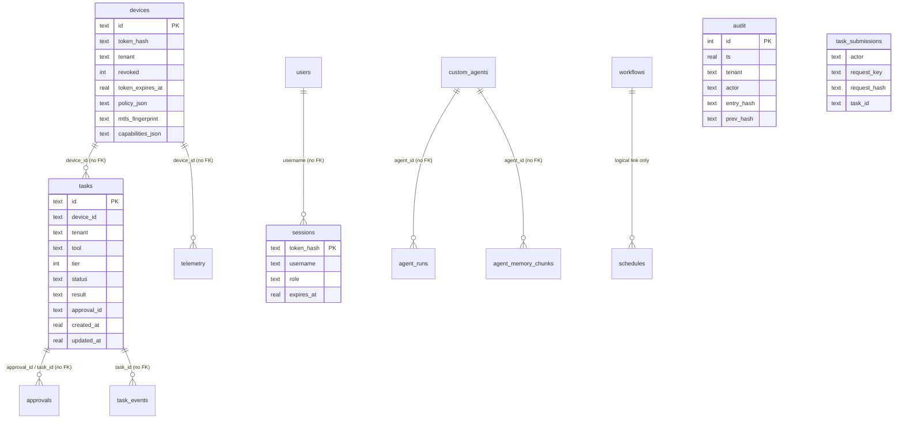

> **HISTORICAL analysis.** Current production assessment: [PRODUCTION_READINESS.md](./PRODUCTION_READINESS.md).

# 11 — Database and Storage Audit — AI Bridge

Scope: persistence layers only — SQLite, PostgreSQL, Redis, migrations,
transactions, indexes/constraints, retention, backup/recovery, and
in-memory vs persisted consistency. Read-only review; no migrations run, no
live database inspected. **VERIFIED** = read in cited code; **INFERRED** =
follows from code; **NOT FOUND** = searched, no evidence. No benchmarks were
run; performance claims are labelled hypotheses (see the companion
Performance report).

## 1. Executive summary

AI Bridge has a **dual-engine** design: SQLite (dev / single-node default)
and PostgreSQL 16+ (production, selected by `DATABASE_URL`), with a hand
written `?` → `%s` SQL translator and a file-based migration runner
(`migrations/001–012`, 278 lines total). The schema itself is reasonably
complete (~22 tables, 16 indexes in the inline `SCHEMA`), but it has
**no foreign keys anywhere**, no ORM, and two competing sources of truth
(the inline `SCHEMA` string in `db.py` and the `migrations/*.sql` files).
There is **one shared database connection per process, serialised by a
single `RLock`** — correct, but a throughput ceiling (see Performance
report). Retention is fragmentary: telemetry is capped (500/device), audit
deletion is manual/admin-only, and everything else (tasks, task_events,
agent memory, alert deliveries) grows without bound. Backup exists only for
offline SQLite; there is no Postgres backup/restore procedure in the repo.
Redis exists only for rate limiting, not as a data store.

## 2. Engines and selection

| Engine | When | How | File |
|--------|------|-----|------|
| SQLite | Default; `AI_BRIDGE_DATA_DIR` (`~/.ai-bridge/control.db`) | `sqlite3.connect(check_same_thread=False, timeout=15)`, `PRAGMA journal_mode=WAL`, `PRAGMA busy_timeout=5000` | `src/ai_bridge/control/db.py:415-435` |
| PostgreSQL 16+ | `DATABASE_URL` starts `postgres://` / `postgresql://` | Single `psycopg.connect(dsn, autocommit=False)`, reconnect-if-closed | `src/ai_bridge/control/db.py:330-410` |
| Redis 7 | Optional; `REDIS_URL` / `AI_BRIDGE_REDIS_URL` | Rate limiting only (sorted-set sliding window) | `src/ai_bridge/control/ratelimit.py`, `src/ai_bridge/control/durable_ratelimit.py` |
| Local agent spool | Always (agent-side) | Per-agent SQLite `agent_spool.db`, WAL | `agents/common/spool.py:30-55` |
| OAuth gateway DB | Prod compose | Separate SQLite file `AI_BRIDGE_OAUTH_DB` | `docker-compose.prod.yml` |

VERIFIED: `connect()` (`db.py:399-435`) auto-detects the engine and runs
migrations on **every** startup. Production readiness flags SQLite in
production as critical (`production_readiness.py`: `postgres_required_in_production`).
Dev compose (`docker-compose.yml`) ships Postgres only under the
`production` profile and binds the control API to `127.0.0.1:8000`; prod
compose (`docker-compose.prod.yml`) runs Postgres 16-alpine + Redis 7-alpine
+ 4 gunicorn workers, with named volumes `aibridge-pg`, `aibridge-data`,
`aibridge-redis`.

## 3. Schema inventory (VERIFIED, `src/ai_bridge/control/db.py:25-230`)

`SCHEMA` defines 22 `CREATE TABLE` statements and 16 `CREATE INDEX`
statements (counts from `grep -c`). Tables:

`devices, tasks, approvals, audit, settings, users, sessions, policies,
workflows, telemetry, triggers, schedules, task_submissions, custom_agents,
mcp_servers, mcp_oauth_states, agent_runs, workflow_templates,
alert_deliveries, device_metadata, task_events, agent_memory_chunks`
(+ `schema_migrations`, created by the runner, `migrations.py:20-40`).

Notable columns / design choices:

- **Devices** (`db.py:26-33`): `token_hash TEXT NOT NULL` (unsalted SHA-256,
  see Security report SEC-03 note), `revoked INTEGER DEFAULT 0`,
  `token_expires_at / token_issued_at REAL`, `policy_json TEXT`,
  `capabilities_json`, `mtls_fingerprint` (also lazily `ALTER TABLE`-added
  by `device_mtls.py:60-75`).
- **Tasks**: `status TEXT DEFAULT 'queued'` with **no CHECK constraint** —
  status values (`queued/running/completed/failed/cancelled/timed_out/
  needs_approval`) are enforced only in Python (`app.py:1644` validates on
  update; claim/result paths do not). `result TEXT` holds up to 512k chars
  generally and **16,000,000 chars for screenshots**
  (`app.py:4720-4730`) — multi-MB rows in the hot table.
- **Audit**: hash-chain columns `prev_hash, entry_hash` (added by migration
  012 and lazily by `_ensure_audit_hash_columns`, `db.py:440-465`).
  No `CHECK`, no trigger, no append-only enforcement at the DB layer.
- **Idempotency**: `task_submissions` has a real composite PK
  `(actor, request_key)` (`db.py:89-93`) — the strongest constraint in the
  schema, backing `POST /api/tasks` idempotency (`app.py:1529-1541`).
- **Secrets at rest**: `mcp_servers` stores `auth_token`,
  `oauth_client_secret`, `oauth_refresh_token` **plaintext**
  (`db.py:118-148`); `users.password_hash` is PBKDF2 (good);
  `sessions.token_hash` / `devices.token_hash` are hashes (good).
  `settings` is a generic key/value table used for rate-limit buckets,
  emergency-stop, human-takeover state, webhook URL, MCP tool policies —
  a god-table with no typing or namespacing enforcement.
- **JSON-in-TEXT everywhere**: `policy_json`, `args_json`, `result`,
  `steps_json`, `tools_json`, `headers_json`, `tags_json`,
  `device_ids_json`, `allowed_tools_json` — no JSON validation at the DB
  layer (SQLite has no JSON type enforcement here; Postgres uses TEXT too,
  not `jsonb` — the translator does not map types, so Postgres gets TEXT
  columns and no `jsonb` operators/indexes).

## 4. Indexes (VERIFIED, `db.py:150-230`)

`idx_devices_token_hash`, `idx_tasks_device_status (device_id, status)`,
`idx_approvals_task_id`, `idx_audit_tenant_ts (tenant, ts DESC)`,
`idx_workflows_status`, `idx_workflows_tenant_ts`,
`idx_telemetry_device_time (device_id, recorded_at DESC)`,
`idx_triggers_tenant`, `idx_schedules_next_run (enabled, next_run_at)`,
`idx_policies_version` (UNIQUE), `idx_mcp_servers_tenant`,
`idx_custom_agents_due (enabled, next_run_at)`,
`idx_agent_runs_agent`, `idx_alert_deliveries_ts`,
`idx_task_events_task`, `idx_agent_memory_agent`,
`idx_agent_memory_tags`.

**Missing / weak (INFERRED from the query patterns in `app.py`):**

- `tasks` has no `(tenant, created_at)` index, yet `list_tasks`
  (`app.py:1579-1585`) filters `WHERE tenant=? ORDER BY created_at DESC
  LIMIT 200` — full scan on large fleets (mitigated only by LIMIT).
- `tasks` has no `(status, updated_at)` index; the stale-sweep
  (`orchestration.py:35-45`) scans `WHERE status='running' AND updated_at < ?`.
- `audit` list/export filter by `tenant` only via `idx_audit_tenant_ts` — adequate.
- `settings.key` is a PK — adequate for the god-table, but rate-limit
  buckets (`durable_ratelimit.py:75-110`) share it with control-plane flags.
- `telemetry` pruning (`app.py:4459`) uses a `NOT IN (SELECT ... LIMIT 500)`
  subquery per heartbeat — correct but O(n) per device per heartbeat
  (hypothesis, see Performance report).

## 5. Constraints — what is NOT enforced (VERIFIED by grep)

- **Zero `FOREIGN KEY` clauses** in `src/` and `migrations/` (grep: 0 hits).
  No `ON DELETE CASCADE`, no referential integrity at all.
- **No CHECK constraints** on `status`, `role`, `tier`, `tool` anywhere.
- **No UNIQUE constraints** except `users.username`, `sessions.token_hash`
  (PK), `settings.key` (PK), `policies.version`, `task_submissions` (PK),
  `device_metadata.device_id` (PK).
- Consequences (INFERRED): deleting a device (`app.py:1157-1165`,
  `DELETE FROM devices`) orphans its tasks/telemetry/task_events/device_metadata;
  deleting a task (`app.py:1690-1700`) deletes its approvals but not its
  `task_events`; deleting a user does not revoke their sessions (mitigated:
  `auth_context` re-checks `users.disabled=0` per request, `app.py:723-731`).
  These are INFERRED from the absence of cascades plus the delete paths
  read — the delete-device body was not fully traced in this track, so
  orphaning is stated as INFERRED, not CONFIRMED.

## 6. Migrations (`migrations/001–012`, `src/ai_bridge/control/migrations.py`)

| File | Lines | Content (VERIFIED by reading) |
|------|-------|-------------------------------|
| 001_initial.sql | 24 | Base tables (mirrors `SCHEMA`) |
| 002_security_batch.sql | 16 | Security columns |
| 003_fleet_automation.sql | 64 | Triggers/schedules/workflows/telemetry |
| 004_workspace_operations.sql | 14 | Workspace ops |
| 005_custom_agents.sql | 35 | Custom agents + MCP servers |
| 006_custom_agents_failures.sql | 3 | Failure counters |
| 007_custom_agents_memory.sql | 2 | Memory columns |
| 008_agent_tools_and_mcp.sql | 22 | Agent tools / MCP |
| 009_mcp_oauth2.sql | 17 | OAuth columns/state |
| 010_templates_and_alerts.sql | 23 | Templates + alert deliveries |
| 011_orchestration_plane_state.sql | 1 | Plane-state marker |
| 012_full_schema_sync.sql | 57 | Full sync: capabilities/mtls/audit-hash columns, `device_metadata`, `task_events`, `agent_memory_chunks`, `workflow_templates`, `alert_deliveries` |

Runner behaviour (VERIFIED, `migrations.py:100-139`):

- Tracks applied versions in `schema_migrations(version, name, applied_at)`;
  applies `^\d+_*.sql` in sorted order; skips applied versions.
- Per-file: strips `--` comment lines, splits on `;`, adapts each statement
  (`SERIAL` ↔ `AUTOINCREMENT`, `REAL` ↔ `DOUBLE PRECISION`, `ADD COLUMN
  IF NOT EXISTS` handling for SQLite).
- **Risks (INFERRED/CONFIRMED by reading):**
  1. Splitting on `;` breaks any statement containing a semicolon in a
     string literal, default, or trigger body — no trigger bodies exist yet,
     so latent, not live.
  2. `PostgresConnection.executescript` (`db.py:375-395`) also splits on
     `;` and executes statement-by-statement with a single commit at the
     end — a mid-file failure rolls back that file only (good), but the
     `schema_migrations` row is written after the loop, so a crash between
     DDL and the tracking insert re-runs the file (mitigated by
     `IF NOT EXISTS` / column-exists guards — mostly idempotent).
  3. **Dual source of truth (CONFIRMED):** `connect()` first executes the
     inline `SCHEMA` (`db.py:427`), *then* runs migrations. `SCHEMA`
     already contains tables that migrations 001–012 also create
     (`IF NOT EXISTS` saves it), but any drift between the two must be
     fixed twice; migration 012 is literally titled "full_schema_sync",
     evidence the drift already happened.
  4. No down/rollback migrations exist (NOT FOUND: no `down` files, no
     `rollback` in the runner). Rollback = restore from backup.
  5. `PRAGMA table_info({table})` in `_sqlite_has_column`
     (`migrations.py:44-52`) interpolates the table name — table names come
     from migration files (trusted input), not user input; low risk, noted.
  6. Migration files are resolved relative to the repo
     (`MIGRATIONS_DIR = .../parent.parent.parent.parent / "migrations"`,
     `migrations.py:17`) — a packaged/installed deployment without the
     repo tree silently applies **zero** migrations (`mdir.exists()` false
     → return `[]`, `migrations.py:105-110`). The inline `SCHEMA` then
     masks the gap for SQLite, but Postgres (which relies on migrations
     for post-`SCHEMA` columns) can silently diverge. SUSPECTED deployment
     risk, needs an install-path test.

## 7. Transactions and connection management (VERIFIED)

- **One connection per process.** `LockedConnection` (SQLite) and
  `PostgresConnection` (Postgres) each wrap a single connection in an
  `RLock` (`db.py:240-410`). `transaction()` commits on success, rolls
  back on exception. Every `execute()` materialises rows under the lock
  (`_LockedResult`) so no cursor escapes the lock — good.
- **Consequence:** all DB work in a process is serialised. For SQLite this
  is nearly forced (WAL helps readers); for Postgres it throws away the
  database's concurrency — one slow query blocks heartbeats, claims, and
  audit writes in that worker. See Performance report.
- **Postgres reconnect:** `_ensure_conn` (`db.py:360-365`) reconnects if
  `closed`, but silently drops any in-flight transaction; callers are not
  told. `execute()` rolls back on error — good — but `lastrowid` is always
  `None` on Postgres (`getattr(cur, "lastrowid", None)`), which matters for
  `db.audit()` (see §9).
- **Parameter translation** (`to_pg_sql`, `db.py:190-235`): rewrites `?` →
  `%s`, escapes `%`, rewrites `INSERT OR REPLACE/IGNORE INTO settings` to
  `ON CONFLICT`. Only the `settings` upsert is translated; any other
  SQLite-ism (`AUTOINCREMENT`, `strftime('%s','now')` in
  `task_submissions.created_at` default, `db.py:92`) is **not** translated
  by `to_pg_sql` — the migration adapter handles `AUTOINCREMENT` only in
  migration files, and the inline `SCHEMA` is executed verbatim against
  Postgres via `executescript` (which splits on `;` and runs each statement
  through `cur.execute` **without** `to_pg_sql`). Whether `SCHEMA` executes
  cleanly on Postgres is therefore NOT VERIFIED from code reading alone:
  `AUTOINCREMENT` in the inline `SCHEMA` (`audit.id INTEGER PRIMARY KEY
  AUTOINCREMENT`, etc.) would fail on Postgres unless the migration path
  already created the tables — a real drift hazard. This needs a live
  Postgres boot test (flagged for the testing track).
- **No connection pool, no statement timeout, no `busy_timeout` on
  Postgres.** SQLite has `timeout=15.0` + `busy_timeout=5000`.
- **No ORM.** All SQL is hand-written, parameterised (grep: no f-string SQL
  with user input found in `control/` except the `PRAGMA table_info`
  case above and `LIKE 'plane.human_takeover.%'` with a constant prefix).

## 8. The audit hash chain (VERIFIED, `db.py:440-525`)

`db.audit()` redacts args/result, reads the tip hash
(`SELECT entry_hash ... ORDER BY id DESC LIMIT 1`), inserts with
`entry_hash=NULL`, reads back `lastrowid` (SQLite) or re-selects by
`(actor, tool, entry_hash IS NULL)` (Postgres fallback — racy if two
audits share actor+tool), computes
`SHA256(prev|id|ts|actor|device|tool|args_json|decision)`, then UPDATEs the
row. Problems:

1. Read-tip → insert → update is **not atomic** under the per-statement
   lock; two concurrent audits can share a `prev_hash` and fork the chain
   (INFERRED race; needs a concurrency test).
2. On Postgres the fallback `SELECT ... WHERE entry_hash IS NULL` can pick
   another concurrent row's id (SUSPECTED).
3. `list_audit` (`app.py:1980-2005`) recomputes hashes only for rows that
   lack them; there is **no verification endpoint or job** that walks the
   chain and reports a break (NOT FOUND).
4. The file-based audit (`src/ai_bridge/audit.py:12-23`) is a separate,
   unchained JSONL append — two audit systems with different guarantees.

## 9. Retention, growth, backup, recovery

| Area | State (VERIFIED) |
|------|------------------|
| Telemetry | Capped: heartbeat keeps the latest 500 rows/device via `DELETE ... NOT IN (SELECT ... LIMIT 500)` (`app.py:4455-4462`). Per-heartbeat write + delete. |
| Audit | No automatic retention. Manual admin endpoint `POST /api/audit/retention` deletes `ts < now - days*86400`, days clamped 30–3650 (`app.py:2016-2024`). See Security report SEC-05. |
| Tasks | Unbounded. Manual `DELETE /api/tasks/{id}` and bulk clear of terminal statuses (`app.py:1690-1710`). No TTL/sweep for completed tasks. |
| Task events | Unbounded; no prune found (NOT FOUND). |
| Agent memory / alert deliveries / schedules | Unbounded; no prune found. |
| Workflows | Unbounded; results JSON accumulates per workflow row. |
| Backups — SQLite | `src/ai_bridge/control/backup.py:18-48` `verified_backup()`: offline only, `O_EXCL` destination (never overwrite), mode `0600`, `sqlite3.backup()`, `PRAGMA integrity_check`, verifies `users`/`devices` countable. Explicitly "never replaces a live database". Good design. **No scheduler, no cron, no S3/off-host automation found** — backup is a manual CLI (`python -m ai_bridge.control.backup SRC DST`). |
| Backups — Postgres | **NOT FOUND.** No `pg_dump`/`pg_basebackup`/PITR procedure in repo, compose, or scripts (searched `deployment/`, `scripts/`, `backup.py`). Prod data safety rests on the `aibridge-pg` Docker volume. |
| Restore | No restore procedure documented/found for either engine (NOT FOUND). SQLite restore = copy file back (INFERRED); Postgres restore = undefined. |
| Agent spool | `agent_spool.db` per agent, WAL, `task_id` PK, upsert-on-conflict (`spool.py:55-80`). No size cap / prune: a long offline period with failing flush accumulates rows (INFERRED; `get_pending` caps reads at 50, not storage). |
| Redis persistence | Prod compose: `redis-server --appendonly yes` (`docker-compose.prod.yml`) — AOF on. But Redis holds only rate-limit buckets; losing it is harmless (falls back to memory/DB). |

## 10. In-memory vs persisted state (VERIFIED)

| State | Persisted? | Consequence |
|-------|-----------|-------------|
| Emergency stop | **Both**: `settings.plane.emergency_stop` + `app.state.emergency_stop`, re-synced with 0.75–1s TTL (`plane_state.py:20-60`) | Survives restart; converges across workers within ~1s (hypothesis on timing). |
| Human takeover | **Both**: `settings.plane.human_takeover.{device}` + in-memory registry in `v1_routes.py:44-99`, hydrated at startup | Survives restart; registry is per-process (see Distributed report). |
| Device live meta (`device_live_meta`) | **No** — `app.state` dict (`app.py:1053,4470`) | Lost on restart; per-worker divergent under gunicorn. |
| Latest desktop frames | **No** — `app.state.latest_frames` (`app.py:3305`) | Lost on restart; per-worker; 2.5s cache TTL. |
| WebRTC sessions | **Mixed** — sessions loaded from DB (`v1_routes.load_webrtc_session_db`) but `app.state.webrtc_sessions` cache exists (`app.py:3476`) | DB is source of truth; cache divergence possible. |
| OIDC pending logins / discovery | **No** — module dicts (`oidc.py:30-31`) | Lost on restart; broken across workers (Security SEC-10 note). |
| Rate-limit buckets | **No / DB / Redis** depending on backend (`ratelimit.py`, `durable_ratelimit.py`) | Memory backend lost on restart and per-worker; DB backend durable but racy (see Distributed report). |
| Agent WS subscribers | **No** — module dict (`agent_channel.py:20`) | Lost on restart; per-worker (see Distributed report). |
| Scheduler state | **DB-backed** (`schedules.next_run_at`) but **claim is not atomic** (see Distributed report) | Duplicate firing across workers. |
| Task claim / lease | **DB-backed** (`tasks.status`, `updated_at`) | The one correctly durable coordination mechanism (see Distributed report). |

## 11. SQLite vs Postgres behavioural deltas (VERIFIED deltas, impact INFERRED)

1. `SCHEMA` executed verbatim on Postgres may fail on `AUTOINCREMENT` /
   `strftime` defaults (§7) — needs a boot test.
2. `lastrowid` is `None` on Postgres → audit hash fallback path (§8).
3. `INSERT OR REPLACE/IGNORE` only translated for `settings`
   (`to_pg_sql`); other SQLite upserts would fail on Postgres (none found
   in the hot path except spool, which is SQLite-only by design).
4. `LIKE`/`ORDER BY` collation and `REAL` vs `DOUBLE PRECISION` are
   adapted in migrations only, not in `SCHEMA`.
5. Single-connection serialisation hurts Postgres most (it is built for
   concurrency); SQLite WAL at least matches the single-writer model.
6. `busy_timeout`/`WAL` are SQLite-only; Postgres has no equivalent
   timeout/statement guard configured.

## 12. Findings table

| ID | Severity | Title | File(s) |
|----|----------|-------|---------|
| DB-01 | High | No Postgres backup/restore procedure; prod safety = one Docker volume | `docker-compose.prod.yml`; `src/ai_bridge/control/backup.py` (SQLite-only) |
| DB-02 | High | Zero foreign keys / CHECKs; orphaned rows on delete; no referential integrity | `src/ai_bridge/control/db.py:25-230`; `migrations/*.sql` (grep: 0 FK) |
| DB-03 | High | Dual schema source of truth (`SCHEMA` vs migrations); Postgres boot against inline `SCHEMA` not verified (`AUTOINCREMENT`/`strftime`) | `src/ai_bridge/control/db.py:190-235,415-435`; `src/ai_bridge/control/migrations.py` |
| DB-04 | Medium | Single shared connection + one RLock serialises all DB work, both engines | `src/ai_bridge/control/db.py:240-410` |
| DB-05 | Medium | Audit hash chain is non-atomic, has a racy Postgres fallback, and no verifier | `src/ai_bridge/control/db.py:440-525` |
| DB-06 | Medium | MCP OAuth secrets plaintext at rest; `settings` god-table mixes secrets-adjacent flags with rate-limit buckets | `src/ai_bridge/control/db.py:118-148,110` |
| DB-07 | Medium | Unbounded growth: tasks, task_events, agent memory, alert deliveries, workflows — no retention except telemetry (500/device) and manual audit delete | `src/ai_bridge/control/app.py:1690-1710,2016-2024,4455-4462` |
| DB-08 | Medium | Migration runner splits on `;`, has no down-migrations, and silently no-ops if the repo `migrations/` dir is absent from an installed deployment | `src/ai_bridge/control/migrations.py:17,100-139` |
| DB-09 | Low | JSON-in-TEXT everywhere; Postgres gets TEXT, not `jsonb` — no JSON validation/indexing | `src/ai_bridge/control/db.py:25-230` |
| DB-10 | Low | Agent spool DB has no size cap/prune; offline results accumulate | `agents/common/spool.py:30-80` |
| DB-11 | Low | No statement/connection timeouts on Postgres; reconnect drops in-flight txns silently | `src/ai_bridge/control/db.py:330-410` |

## 13. Recommendations (priority order)

1. **P1** — Add a Postgres backup/restore runbook + scheduled `pg_dump`
   (or volume snapshots) and test a restore; automate the SQLite
   `verified_backup` CLI on a schedule with off-host encrypted copies.
2. **P1** — Add foreign keys (at least `tasks.device_id`,
   `approvals.task_id`, `task_events.task_id`, `telemetry.device_id`,
   `sessions.username`) with explicit `ON DELETE` behaviour, plus
   `CHECK (status IN (...))` on `tasks.status`; backfill/verify in a
   migration with a Postgres boot test (closes DB-03 too).
3. **P1** — Make the audit hash chain atomic (single transaction, or
   compute the chain in the DB with a trigger/sequence) and add a
   `GET /api/audit/verify` endpoint + scheduled verification.
4. **P1** — Encrypt `mcp_servers` credential columns (or move them to the
   secrets backend); split control flags out of the `settings` god-table
   or namespace keys.
5. **P2** — Introduce a real connection pool for Postgres (e.g.
   `psycopg_pool`, min 2/max 10) with statement timeouts; keep the
   serialised SQLite path.
6. **P2** — Add retention jobs: completed-task TTL, `task_events` prune,
   agent-memory cap; add the missing `(tenant, created_at)` and
   `(status, updated_at)` indexes on `tasks`.
7. **P2** — Single source of truth for schema: generate `SCHEMA` from the
   migration files (or drop the inline `SCHEMA` for Postgres); add a CI
   test that boots Postgres from scratch and applies migrations 001–012.
8. **P3** — Migrate JSON-TEXT columns to `jsonb` on Postgres (with a
   compatibility view for SQLite); cap the agent spool DB.
