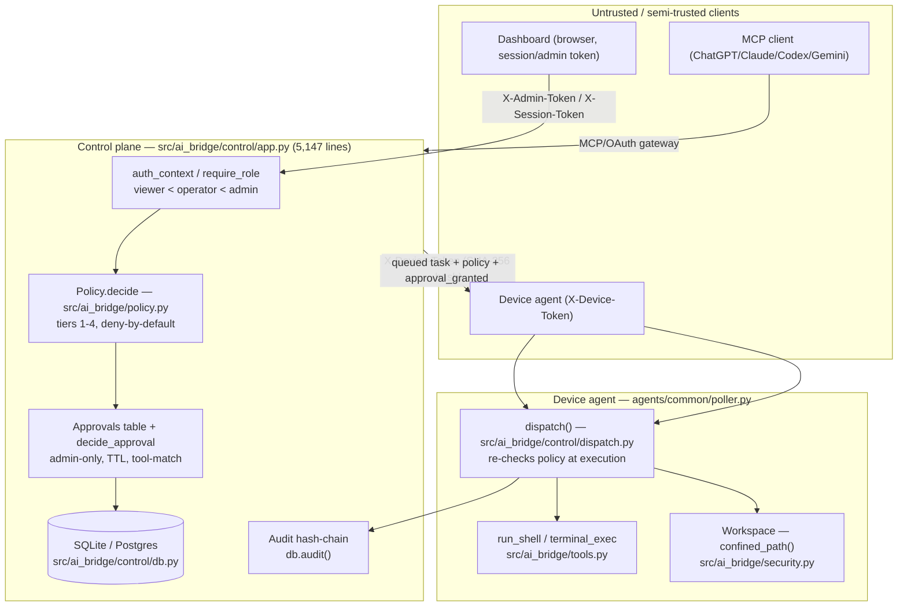

> **HISTORICAL analysis.** Current production assessment: [PRODUCTION_READINESS.md](./PRODUCTION_READINESS.md).

# 12 — Security and Threat Assessment — AI Bridge

Scope: security track of the autonomous investigation. Read-only review of the
repository at `/home/hatch/workspace/ai-bridge-main` (no source modified, no
live exploitation, no production access). All claims cite a real file path.
Status vocabulary: **VERIFIED** = read in the cited code; **INFERRED** = follows
from the code but not directly observed; **NOT FOUND** = searched, no evidence.
Severity for security items: **CONFIRMED** = the code path exists as described;
**SUSPECTED** = needs a live test / exploit PoC to confirm impact.

## 1. Executive summary

The core policy/redaction/token-hash machinery is genuinely present and in
several places well built (deny-by-default tool tiers, SHA-256 token hashes,
workspace confinement, secret redaction, atomic task claim). The system is
**not** uniformly secure: the same operation can be submitted through
`/api/tasks` (approval-gated) **and** through `/api/v1/tasks` and the
workflow/scheduler engine (not approval-gated), so the approval boundary is
only as strong as its weakest entry point. Tenant isolation is a
client-supplied query parameter, not a property of the authenticated user.
Audit "immutability" is a 405 on one route while an admin endpoint deletes
audit rows. mTLS is enforced on one agent route only. CSRF is off by default
and its secret is per-process, which breaks under the 4-worker production
deployment. Secrets (MCP OAuth tokens) are stored in plaintext in the
database, and `DATABASE_URL` (which carries the Postgres password) is passed
through to child processes spawned by `run_shell`.

Top findings (see §9 for the full table):

| # | Finding | Status |
|---|---------|--------|
| SEC-01 | `/api/v1/tasks` queues Tier-3/4 tools with no approval check | CONFIRMED |
| SEC-02 | Workflow / scheduler / trigger steps run with `approval_granted=True, is_admin=True` | CONFIRMED |
| SEC-03 | Tenant is a caller-supplied parameter; any viewer can read another tenant | CONFIRMED |
| SEC-04 | `terminal_exec` tasks are auto-approved in `next_task` | CONFIRMED |
| SEC-05 | Audit retention endpoint deletes audit rows (admin) | CONFIRMED |
| SEC-06 | MCP OAuth tokens / client secrets stored plaintext in `mcp_servers` | CONFIRMED (at rest) |
| SEC-07 | `DATABASE_URL` (+ Vault/TURN tokens) inherited by `run_shell` children | CONFIRMED |
| SEC-08 | Human takeover blocks desktop input only, not shell/file/workflow tasks | CONFIRMED |
| SEC-09 | Device mTLS enforced only on `tasks/next`, not heartbeat/rotate/result | CONFIRMED (as read) |
| SEC-10 | CSRF off by default; per-process secret breaks multi-worker | CONFIRMED |

## 2. Architecture under review (security boundaries)

Trust transitions: (a) MCP/OAuth identity → dashboard session/admin identity;
(b) admin identity → device policy stored in `devices.policy_json`;
(c) device token → device row (token hash only, no tenant check in
`device_row`); (d) queued task → agent-side `dispatch()` re-enforcement;
(e) agent process → OS shell / desktop / browser. Every transition after (d)
runs on a machine the operator may fully control, so agent-side checks are
defence-in-depth only — the plane must not depend on them. It mostly does
not, except where noted in §4.

## 3. What was verified strong (VERIFIED)

- **Deny-by-default tiers.** `src/ai_bridge/policy.py:24-176` maps every tool
  to a tier; unknown tools are denied (`policy.py:223-226`). `Policy` is a
  frozen dataclass built from admin config only (`policy.py:188-200`).
- **No shell injection primitives in the searched surface.** Grep over
  `src/ agents/ integrations/` found **zero** occurrences of `shell=True`,
  `os.system`, `eval(`, `exec(`, `pickle.load(s)`, `yaml.load(`,
  `verify=False`. All `subprocess` calls use argv form with `shell=False`
  (e.g. `src/ai_bridge/execution.py:164`, `src/ai_bridge/tools.py:1350`,
  `src/ai_bridge/git_ops.py:17`). `run_shell` splits with `shlex` so pipes,
  `&&`, redirection and globbing are *not* interpreted
  (`src/ai_bridge/tools.py:1307-1326,1414-1435`).
- **Bounded local execution.** `src/ai_bridge/execution.py` allowlists six
  task names only, validates test commands against an exact allowlist,
  clamps timeouts, applies `RLIMIT_CPU/AS/FSIZE`, a minimal env and a
  semaphore (`max_concurrent_tasks`, default 4,
  `src/ai_bridge/config.py`).
- **Workspace confinement.** `src/ai_bridge/security.py:60-78`
  `confined_path()` rejects NUL, absolute, drive/UNC paths and symlink
  escapes against a resolved root. Writes are atomic + backed up
  (`src/ai_bridge/workspace.py:70-100,179`). Secret-named files are refused
  for read/write/edit/move/delete.
- **Secret redaction.** `src/ai_bridge/security.py:82-137` (`redact`,
  `redact_obj`) covers bearer tokens, `api_key/password/token/secret`,
  device tokens and TURN secrets; applied in `audit.py`, `db.audit()`,
  `tools._run_argv`, and `logging_config.py:44`.
- **Token storage.** Device tokens and session tokens are stored only as
  SHA-256 hashes (`src/ai_bridge/control/db.py:429-431` `hash_token`;
  `src/ai_bridge/control/app.py:1032,4026`). Passwords are PBKDF2-HMAC-SHA256,
  200k iterations, per-user salt, constant-time compare
  (`src/ai_bridge/control/auth.py:21-30`). Sessions expire after 8h
  (`app.py:4025`, `expires = now + 8*3600`); device tokens expire after
  `AI_BRIDGE_DEVICE_TOKEN_TTL_DAYS` (default 7, `app.py:1013,4580`).
- **Device self-elevation guard (plane side).**
  `reject_policy_widening` (`src/ai_bridge/control/app.py:846-867`) refuses
  device-token attempts to enable `unrestricted/allow_tier3/desktop_enabled/
  allow_shell/...`, raise `max_tier_unattended`, widen allowlists or shrink
  `denied_tools`. Documented as the fix for exactly this attack.
- **Approval records.** Tier-4 in `/api/tasks` creates a pending approval
  with TTL (default 3600s, `app.py:1543-1549`); `next_task` grants approval
  only if the record is `approved`, unexpired **and tool-matching**
  (`app.py:4660-4672`); `decide_approval` only transitions `pending` rows
  (`app.py:1760-1780` approx., `UPDATE ... WHERE status='pending'`);
  expired approvals auto-cancel their task (`app.py:1720-1740`).
- **Webhook SSRF (partial).** `_validate_webhook_url`
  (`src/ai_bridge/control/app.py:59-75`) rejects non-http(s), loopback,
  private/link-local/multicast/reserved literal IPs and
  `metadata.google.internal`. See SEC-13 for the gap.
- **OIDC verification.** `src/ai_bridge/control/oidc.py:106-148` enforces
  RS256 only, JWKS signature, `iss`, `aud`, `exp`, `nonce`. State/nonce are
  `secrets.token_urlsafe(24)`, pending logins expire after 600s.
- **CORS.** Explicit origin list, not `*`, with `allow_credentials=True`
  (`src/ai_bridge/control/app.py:651-668`). No `verify=False` found.
- **Rate limiting exists** on auth routes (30/min/IP) and per-token
  (1200/min) / per-IP (300/min) in the middleware
  (`src/ai_bridge/control/app.py:4790-4810` approx.).

## 4. The 10 security invariants — verdicts

| # | Invariant | Verdict | Evidence |
|---|-----------|---------|----------|
| 1 | AI clients cannot self-elevate | **Mostly holds, with holes** | `reject_policy_widening` VERIFIED; but see SEC-01/02/04 (alternate entry points need only `operator`, not admin, and the workflow engine runs as admin); `dispatch()` conflates `approval_granted → is_admin` (`src/ai_bridge/control/dispatch.py:280`, `is_admin=is_admin or approval_granted`), so any approved task executes with admin-level Tier-3 ceiling at the agent. Poller `_effective_policy` (`agents/common/poller.py:280-340`) OR-merges remote policy with the agent-local base policy when an explicit local policy exists (`allow_writes/tier3/desktop = remote OR base`) — an agent operator who controls local env/policy can widen the *agent-side* check; impact is bounded because the agent host is already compromised in that scenario, but it defeats defence-in-depth. SUSPECTED widening, low severity alone. |
| 2 | Sensitive ops cannot bypass server policy | **FAILS** | SEC-01 (v1), SEC-02 (workflow/scheduler/trigger), SEC-04 (terminal). The canonical `/api/tasks` path enforces policy; the other three do not apply the same gate. |
| 3 | Device tokens cannot cross devices | **Holds for task flow** | `device_row` (`app.py:876-885`) looks up by token hash + `revoked=0` + expiry; `next_task` only returns tasks for `row["id"]` (`app.py:4640-4655`); `task_result` and `execution-state` require `device_id == row["id"]` (`app.py:4700-4730`). Caveats: token hash is **unsalted fast SHA-256** (`db.py:429`) — a leaked DB enables fast offline brute-force of low-entropy tokens (tokens are `secrets`-generated, so entropy is the mitigant; no pepper). No tenant filter in `device_row` — isolation rests on token-hash uniqueness, not tenant. |
| 4 | Screen viewing ≠ command execution | **Holds in the RBAC layer** | Frame viewing requires `viewer` (`app.py:3310-3330`, `get_desktop_frame`); task submission requires `operator`; desktop *input* tools are Tier-3 and need `desktop_enabled` + Tier-3/approval (`policy.py:246-265`). Note `_fetch_desktop_frame` internally dispatches with `approval_granted=True, max_tier_unattended=4` (`app.py:3321`) — server-side only, viewer-gated, so not a client bypass. WebRTC clipboard requires the session `clipboard_sync` permission (`src/ai_bridge/control/v1_routes.py:790-820`). |
| 5 | Human takeover blocks conflicting AI input | **PARTIAL — desktop only** | VERIFIED: v1 task creation rejects non-human tasks during takeover (`v1_routes.py:1058-1063`); `tools._require_no_human_takeover` (`tools.py:1820-1826`) gates desktop input functions (called at `tools.py:1911,1950,1968,1992,2017,2040,2064`). CONFIRMED GAPS: `/api/tasks` (`app.py:1488`) has **no** takeover check; `next_task` does **not** refuse to hand out already-queued tasks during takeover, so a task queued before takeover still executes; the workflow/scheduler/trigger path (`_execute_workflow_step_sync`) never checks takeover; the agent poller checks takeover only inside desktop tool functions, not for `run_shell`/`write_file`. State itself is sound: durable in `settings` (`plane_state.py:65-107`) + in-memory registry hydrated at startup (`v1_routes.py:92-99`). |
| 6 | Unauthorized users cannot inspect protected data | **FAILS for cross-tenant** | SEC-03. All list endpoints take `tenant` as a caller-supplied query param defaulting to `"default"` (`app.py:1091,1579,1972`); the `users` table has **no tenant column** (`db.py:113-117`), so nothing binds a session to a tenant. Any `viewer` can pass `tenant=<other>`. `v1_list_tasks` (`v1_routes.py:1017-1033`) has no tenant filter at all. Within one tenant, RBAC is enforced (`require_role`). |
| 7 | Destructive actions need approval | **PARTIAL** | Holds on `/api/tasks`: Tier-4 (incl. `delete_workspace_file`, `m365_send_mail`) needs approval unless `max_tier_unattended >= 4` or `unrestricted` (`app.py:1516-1526`, `policy.py:239-244`). Fails via SEC-01/02/04. Also note `policy.py:241`: an admin-set ceiling of 4 silently disables Tier-4 approval *by design* — a dangerous default to audit, not a bug. |
| 8 | Secrets not leaked via logs/results/env | **PARTIAL — env leak CONFIRMED** | Redaction VERIFIED (§3). SEC-07: `tools._run_argv` (`tools.py:1344-1375`) inherits `os.environ` minus only three keys (`_SCRUB_ENV_KEYS`, `tools.py:1300-1304`: admin token, device token, OIDC client secret). `DATABASE_URL` (Postgres password), `AI_BRIDGE_VAULT_TOKEN`, `AI_BRIDGE_TURN_SECRET`, webhook URLs and MCP OAuth material in env are all visible to any `run_shell` child. Contrast `execution.py:150-160`, which uses a minimal clean env — the two runners are inconsistent. SEC-06: MCP OAuth access/refresh tokens and client secrets stored **plaintext** in `mcp_servers.auth_token/oauth_client_secret/oauth_refresh_token` (`db.py:118-148`); refreshed tokens are written back plaintext (`mcp_oauth.py:270-290`). API exposure of those columns was NOT VERIFIED in this track (some list paths select only safe columns, `custom_agents.py:1621`; others use `SELECT *`, `custom_agents.py:157`, `ai_api.py:1666`) — treat exposure as SUSPECTED, plaintext-at-rest as CONFIRMED. Spool: agent results are spooled to local SQLite verbatim (`agents/common/spool.py:60-80`) with no redaction — a result containing a secret persists on disk. |
| 9 | Revocation enforced | **Mostly holds, in-flight gap** | VERIFIED: `device_row` rejects `revoked=0` false and expired tokens; `submit_task`, `refresh_device_telemetry`, remote-terminal all check `revoked=0`; `POST /api/devices/{id}/revoke` sets `revoked=1, status='revoked'` (`app.py:1116-1124`); user `disabled=0` is checked on every `auth_context` call (`app.py:723-731`). GAPS (INFERRED/CONFIRMED by absence): revoke does **not** cancel running tasks, does **not** push a WS cancel (`agent_channel.notify_cancel` is not called from revoke), and does not terminate WebRTC/terminal sessions; a revoked agent's in-flight task runs to completion locally, and its result post then fails 401 and stays spooled, retrying indefinitely (`poller.py:341-360`, spool `flush` breaks on first failure). Rotation is atomic single-hash replacement — old token invalid immediately (`app.py:4575-4585`) — good, but no grace period, so a rotation racing an in-flight heartbeat 401s and the poller falls back to the saved token file (`poller.py:257-268`). |
| 10 | Audit records append-only / unmodifiable via app ops | **FAILS as stated** | VERIFIED: `PUT/DELETE /api/audit/{id}` returns 405 (`app.py:2010-2014`). CONFIRMED: `POST /api/audit/retention` (admin, `app.py:2016-2024`) runs `DELETE FROM audit WHERE ts < cutoff` (days clamped 30–3650) — an admin can erase history, leaving only one new audit row recording the deletion. Hash chain (`db.py:440-525`) is real (prev_hash/entry_hash, SHA-256 over `prev|id|ts|actor|device|tool|args|decision`) but (a) the insert-then-UPDATE-hash is two steps, not atomic; (b) concurrent `audit()` calls can read the same tip and fork the chain — the per-statement lock in `LockedConnection`/`PostgresConnection` does not span read-tip → insert → update; (c) no chain-verification endpoint or scheduled verifier was found (list_audit recomputes hashes only for rows missing them, `app.py:1980-2005`); (d) WORM/SIEM export is opt-in (`worm_siem.py`, `AI_BRIDGE_WORM_SIEM_URL` unset by default) and failures are swallowed unless `AI_BRIDGE_WORM_SIEM_REQUIRED=1`. A DB-file holder can rewrite rows arbitrarily — expected, but no tamper-evidence without the external sink. |

## 5. Attack-surface inventory

| Surface | Entry | Auth | Notes / file |
|---|---|---|---|
| MCP stdio + Streamable HTTP | `src/ai_bridge/server.py` | Gateway verify URL / `AI_BRIDGE_HTTP_ALLOW_ANON=1` (dev only) | Anon mode is flagged critical in production by `production_readiness.py:87`. Verify behaviour of the gateway itself was out of this track's file list — NOT VERIFIED here. |
| Control-plane REST (5,147-line `app.py`) | ~120 routes | admin token / session / device token | Largest surface; includes installer-serving routes (`/install.sh`, `/install.ps1`), journald log reading (`service_logs`, `app.py:4384`), nginx log reading, terminal relay, WebRTC signalling. |
| v1 API | `src/ai_bridge/control/v1_routes.py` | operator/admin | SEC-01: no approval gate. Also `human_initiated` is a **client-supplied boolean** (`v1_routes.py:1058`) — any operator caller can set it to bypass the takeover gate. |
| Agent polling | `/api/agent/*` | device token | Outbound-only from agent; long-poll `wait` ≤ 25s; WS side-channel `agent_channel.py` (in-memory subscribers, per-worker). |
| Enrollment / rotation | `/api/devices/enroll`, `/api/agent/rotate` | admin / device token | Token shown once; rotation has no grace period. |
| Quick-approval links | `/api/approvals/quick/{id}?decision=&sig=` | HMAC-SHA256 (first 32 hex chars) of `approval_id:decision` (`app.py:100-112`) | No timestamp in the signed message — link validity rests entirely on the approval row's expiry/pending state; sig is reusable until the row is decided. Rate-limited 10/min/approval. |
| OIDC | `/api/auth/oidc/*` | provider | `_PENDING` + discovery cache are **in-memory per process** (`oidc.py:30-31,54-76`) — a callback landing on a different gunicorn worker fails (`pop_pending` returns None → 400). |
| Webhooks / alerts | Slack/Discord/Telegram/generic | admin-configured URL | SEC-13. Trigger webhooks in the scheduler loop (`app.py:2655`) call the same sender. |
| WORM/SIEM sink | `worm_siem.py` | optional HMAC | `httpx.post` with 5s timeout; URL from env, no allowlist validation (unlike webhooks). |
| MCP outbound OAuth | `mcp_oauth.py` | stored client creds | Discovery fetches `/.well-known/*` from **arbitrary operator-supplied MCP server URLs** (`discover_oauth_metadata`, `mcp_oauth.py:80-120`) — operator-controlled SSRF surface by design; no allowlist/DNS check. Token endpoints likewise. |
| Browser automation | `browser_tools.py` | Tier-3 | `browser_evaluate` executes arbitrary JS in the Playwright page (`browser_tools.py:547-560`); `browser_download_file` writes to disk (`:806-810`); Chromium sandbox can be disabled via env (`AI_BRIDGE_ALLOW_BROWSER_NO_SANDBOX`, flagged critical in prod by `production_readiness.py`). |
| Desktop / WebRTC | `v1_routes.py` sessions, `tools.py` desktop fns | session perms | Clipboard get/set gated on `clipboard_sync` perm; input gated on takeover (§4.5). Screen viewing is Tier-3 for capture tools but frame *viewing* is viewer-role — by design. |
| Terminal relay | `/api/devices/{id}/terminal/*` | **admin only** | SEC-04: creates `term-*` tasks auto-approved at claim time. |
| File/workspace | workspace tools | Tier 1–4 | Confinement VERIFIED; but `tools._confine_file_path` (`tools.py:1396-1412`) allows **any absolute path** when `is_admin` or `unrestricted` policy or `AI_BRIDGE_DISABLE_HOST_TOOLS=0` — host file access is one env flag away. |
| Updates | `tools.update_fleet_agent`, `agents/linux/agent_main.py:808-834` | Tier-3 | `git fetch/pull --ff-only` + `pip install -e` + `systemctl restart` with **no signature verification** found in the files read — update integrity rests on TLS + git transport. NOT VERIFIED as signed; treat as SUSPECTED unsigned-update risk. |
| Secrets backends | `secrets_backend.py` | env/Vault/AWS SM | Vault/AWS failures fall back to env **unless** `AI_BRIDGE_SECRETS_REQUIRED=1` — fail-open default (by design, documented). Vault token from env. |
| Docker / prod | `docker-compose.prod.yml` | env files | 4 gunicorn workers, Postgres, Redis, nginx, coturn; default domain `jxiptvplayer.app` and default TURN secret placeholder `change-me-in-production` in `docker-compose.yml` (dev) — verify prod values are overridden; NOT VERIFIED from files alone. |

## 6. Dangerous-pattern grep — verified results

Command: `grep -rn -E 'shell=True|os.system|eval\(|exec\(|pickle|verify=False' src agents integrations`
(plus `subprocess`, CORS, hard-coded secret greps).

| Pattern | Result |
|---|---|
| `shell=True` | **0 hits** in `src/ agents/` |
| `os.system` | **0 hits** |
| `eval(` / `exec(` (code exec) | **0 hits** (only the word "execute" in identifiers/docstrings; `browser_evaluate` is Playwright JS eval, see §5) |
| `pickle` | **0 hits** |
| `verify=False` / `check_hostname` disabled | **0 hits** |
| `subprocess.*` | All argv-form, `shell=False` (see §3). Two deliberate shells-by-argv: `terminal_exec` → `[shell, "-c", command]` (`tools.py:1455-1465`, admin terminal relay only) and `execution.py:130-135` `unshare --net ... sh -c` (opt-in netns isolation, fail-closed if `unshare` missing). |
| Hard-coded passwords/API keys/tokens | **0 hits** in `src/` for the patterns searched (placeholders only, e.g. `change-me-in-production` in compose files). |
| `CORS *` | Not `*` for origins; `allow_methods=["*"], allow_headers=["*"]` with credentials (`app.py:666-668`) — acceptable only because origins are enumerated; the list includes a hard-coded public IP `http://201.79.36.129` and placeholder `https://your-aws-domain.com`. |
| Secrets in logs | No `print/log(device_token)` found; `logging_config.py:44` redacts; Windows GUI masks tokens (`agents/windows/gui_app.py:1488`). One residual: `agents/linux/agent_main.py:790` logs the enrollment *response* on failure (`log_error(f"...: {res}")`) — if the response ever echoed a token it would leak; SUSPECTED, low. |

## 7. Detailed findings (CONFIRMED unless marked SUSPECTED)

- **SEC-01 (High, CONFIRMED).** `v1_create_task` (`src/ai_bridge/control/v1_routes.py:1034-1073`)
  queues any known tool — including Tier-4 `delete_workspace_file` and
  `m365_send_mail` — as `status='queued'` with no `needs_approval` branch,
  no approval record, and `tenant` hard-coded to `"default"`. The agent then
  claims it; `next_task` computes `approval_granted=False` (no approval id)
  and `dispatch()` … Tier-4 in `dispatch()` raises unless
  `max_tier_unattended >= 4` — so whether the bypass *executes* depends on
  the device policy ceiling: on `unrestricted`/ceiling-4 devices it executes
  outright; on ceiling-2 devices the agent fails the task with "denied".
  Either way the approval *queue* is bypassed as a control: no human ever
  sees the request. Fix: share one `submit_task` gate for both routes.
- **SEC-02 (High, CONFIRMED).** `_execute_workflow_step_sync`
  (`src/ai_bridge/control/app.py:2238-2330`) builds
  `Policy(allow_tier3=True, desktop_enabled=True, max_tier_unattended=4)` and
  calls `dispatch(..., approval_granted=True, is_admin=True)` for local steps,
  and queues remote steps without an approval id. Callers: workflow worker,
  scheduler loop (`app.py:2671-2720`), triggers, `run_schedule_now`. Per-step
  approval exists but is opt-in (`require_step_approval`, default `False`,
  `WorkflowIn`, `app.py:359-366`; only Tier ≥ 3 steps are gated even when on).
  A scheduled/triggered Tier-4 step therefore executes with no human in the
  loop. Fix: default `require_step_approval=True` for Tier ≥ 3, or route
  steps through the same approval creation as `/api/tasks`.
- **SEC-03 (High, CONFIRMED).** Tenant parameter injection — see §4.6.
  Fix: derive tenant from the authenticated session (add `tenant` to `users`
  / `sessions`) or reject non-default tenants for non-admins; add tenant
  filters to all v1 list/get routes.
- **SEC-04 (Medium, CONFIRMED).** `next_task`
  (`app.py:4660-4672`): `elif id.startswith("term-") and tool ==
  "terminal_exec": approval_granted = True`. The terminal relay
  (`_remote_terminal_exec`, `app.py:3758-3800`) is admin-only at creation, so
  this is admin-initiated shell without per-command approval — acceptable if
  intended, but it is an undocumented approval bypass and `term-*` ids are
  predictable in form. Fix: document it as the admin-shell exception, or
  require an approval record for non-interactive callers.
- **SEC-05 (Medium, CONFIRMED).** Audit retention deletion — §4.10.
  Fix: require the WORM sink (or an exported, signed backup) before any
  retention delete; log deletions to the external sink first; consider
  removing the endpoint or restricting it to a break-glass role.
- **SEC-06 (Medium, CONFIRMED at rest).** Plaintext MCP OAuth material —
  §4.8. Fix: encrypt `auth_token/oauth_refresh_token/oauth_client_secret`
  at rest (e.g. Fernet key from the secrets backend) or move to the secrets
  backend; never `SELECT *` on `mcp_servers` into API responses.
- **SEC-07 (Medium, CONFIRMED).** Child-process env leak — §4.8.
  Fix: reuse the minimal-env approach of `execution.py` in
  `tools._run_argv`, or extend `_SCRUB_ENV_KEYS` to `DATABASE_URL`,
  `*_SECRET*`, `*_TOKEN*`, webhook URLs.
- **SEC-08 (Medium, CONFIRMED).** Takeover scope gap — §4.5.
  Fix: check `is_human_takeover_active` in `/api/tasks`, in `next_task`
  (refuse to hand out queued tasks), and in `_execute_workflow_step_sync`.
- **SEC-09 (Medium, CONFIRMED as read).** mTLS is called only from
  `next_task` (`app.py:4607-4630`); `heartbeat`, `rotate`, `task_result`,
  `execution-state` and the WS handshake as read do not call
  `require_device_mtls`. Also the fingerprint arrives via proxy headers
  (`X-Client-Cert-Fingerprint`, `device_mtls.py:28-50`) — if the plane is
  ever exposed without a proxy that strips/sets those headers, any client
  can present any fingerprint value (SUSPECTED spoofing vector; depends on
  nginx config, NOT VERIFIED here). Fix: enforce mTLS on all agent routes;
  document/verify that nginx strips inbound fingerprint headers.
- **SEC-10 (Medium, CONFIRMED).** CSRF middleware is opt-in
  (`AI_BRIDGE_CSRF_ENABLED`, `app.py:648`) and the secret is
  `os.environ.get(...) or secrets.token_hex(32)` generated **per process**
  (`csrf.py:22`) — under 4 gunicorn workers a token minted by worker A is
  invalid on worker B. Also 24h TTL and a 16-hex-char (64-bit) truncated
  HMAC. Fix: enable by default, load the secret from the secrets backend /
  shared env, use full-length HMAC.
- **SEC-11 (Medium, SUSPECTED).** Webhook SSRF via DNS rebinding/redirect.
  `_validate_webhook_url` checks only the literal hostname/IP
  (`app.py:59-75`); it does not resolve DNS, pin the resolved address, or
  (as read) control redirects in `send_webhook_notification`. An
  attacker-controlled webhook URL whose DNS flips to a private address after
  validation, or a 302 to `http://169.254.169.254/`, may bypass the check.
  Needs a live test against the actual sender implementation.
- **SEC-12 (Low, CONFIRMED).** `desktop_anticipate_action` handler passes
  `approval_granted=True` unconditionally
  (`src/ai_bridge/control/dispatch.py:640-650` approx.). Low: the tool is
  Tier-1 (`READ_ONLY` in `policy.py`) and only *anticipates* an action.
- **SEC-13 (Low, INFERRED).** `Policy.decide` Tier-4 bypass when
  `max_tier_unattended >= 4` (`policy.py:239-244`) means any admin who sets a
  ceiling of 4 has silently turned off Tier-4 approval everywhere. Audit
  device policies for ceiling 4 / `unrestricted` (enrollment can set
  `unrestricted=True` from the request body, `app.py:1015-1030` — admin-only,
  but one click).
- **SEC-14 (Low, SUSPECTED).** Unsigned agent self-update
  (`agents/linux/agent_main.py:808-834`: `git pull --ff-only` + pip install +
  restart; no signature check found). If the git remote or TLS is
  compromised, agents execute arbitrary code. Verify against the update
  design docs before treating as a finding.

## 8. What was NOT verified (explicit gaps)

- MCP gateway verify flow (`AI_BRIDGE_GATEWAY_VERIFY_URL`,
  `server.py:91,1650`) and OAuth gateway (`deployment/oauth/`) — not in this
  track's file list; no claim made about MCP auth strength.
- Windows native agent IPC/DPAPI — separate track.
- Dashboard behaviour — separate track.
- Whether `mcp_servers` secrets reach API responses — SUSPECTED only (§4.8).
- Live behaviour of webhook redirects, CSRF under multi-worker, and the
  audit-chain fork race — all need runtime tests, not code reading.

## 9. Findings table

| ID | Severity | Status | Title | Primary file(s) |
|----|----------|--------|-------|-----------------|
| SEC-01 | High | CONFIRMED | v1 task API bypasses approval queue | `src/ai_bridge/control/v1_routes.py:1034-1073` |
| SEC-02 | High | CONFIRMED | Workflow/scheduler/trigger steps run as admin, approval opt-in | `src/ai_bridge/control/app.py:2238-2330,2329-2420,359-366` |
| SEC-03 | High | CONFIRMED | Tenant is caller-supplied; cross-tenant read by any viewer | `src/ai_bridge/control/app.py:1091,1579,1972`; `src/ai_bridge/control/db.py:113-117` |
| SEC-04 | Medium | CONFIRMED | `term-*` terminal tasks auto-approved at claim | `src/ai_bridge/control/app.py:4660-4672,3758-3800` |
| SEC-05 | Medium | CONFIRMED | Admin audit-retention endpoint deletes audit history | `src/ai_bridge/control/app.py:2016-2024` |
| SEC-06 | Medium | CONFIRMED | MCP OAuth tokens/secrets stored plaintext | `src/ai_bridge/control/db.py:118-148`; `src/ai_bridge/control/mcp_oauth.py:270-290` |
| SEC-07 | Medium | CONFIRMED | `run_shell` children inherit `DATABASE_URL` and other secrets | `src/ai_bridge/tools.py:1300-1304,1344-1375` |
| SEC-08 | Medium | CONFIRMED | Human takeover does not stop queued/shell/workflow tasks | `src/ai_bridge/control/app.py:1488`; `src/ai_bridge/control/v1_routes.py:1058`; `agents/common/poller.py` |
| SEC-09 | Medium | CONFIRMED/SUSPECTED | mTLS only on `tasks/next`; fingerprint via spoofable proxy header | `src/ai_bridge/control/device_mtls.py`; `src/ai_bridge/control/app.py:4607` |
| SEC-10 | Medium | CONFIRMED | CSRF off by default; per-process secret breaks 4-worker prod | `src/ai_bridge/control/csrf.py:22`; `src/ai_bridge/control/app.py:648` |
| SEC-11 | Medium | SUSPECTED | Webhook SSRF via DNS rebinding / redirect | `src/ai_bridge/control/app.py:59-75,114-260` |
| SEC-12 | Low | CONFIRMED | `desktop_anticipate_action` hard-codes `approval_granted=True` | `src/ai_bridge/control/dispatch.py` |
| SEC-13 | Low | INFERRED | Ceiling-4 / `unrestricted` silently disables Tier-4 approval | `src/ai_bridge/policy.py:239-244`; `src/ai_bridge/control/app.py:1015-1030` |
| SEC-14 | Low | SUSPECTED | Agent self-update without signature verification | `agents/linux/agent_main.py:808-834` |

## 10. Recommended fixes (priority order)

1. **P0** — One approval gate: make `v1_create_task`, `_execute_workflow_step_sync`,
   and the scheduler/trigger paths call the same `needs_approval` logic as
   `submit_task` (or reject Tier ≥ 3 without an approval id).
2. **P0** — Bind tenant to the authenticated session; add tenant checks to
   every v1 route.
3. **P1** — Encrypt `mcp_servers` credentials at rest; scrub `DATABASE_URL`
   and `*_SECRET*`/`*_TOKEN*` from child envs; require WORM export before
   audit retention deletes.
4. **P1** — Enforce takeover in `/api/tasks`, `next_task`, and the workflow
   engine; remove client-supplied `human_initiated` as a bypass (derive it
   from the authenticated actor instead).
5. **P1** — Enforce mTLS on all agent routes; verify nginx strips fingerprint
   headers; move CSRF secret to shared config and enable by default.
6. **P2** — Fix the audit hash-chain race (compute the chain under one lock /
   in one transaction); add a chain-verification endpoint; pin webhook DNS
   and disable redirects (or re-validate after redirect).
